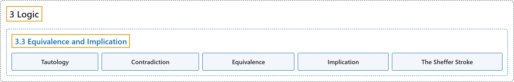

# 3.3 Equivalence and Implication

## Classification

## Glossary

| Term | Definition | 中文翻译 | Source |
|---|---|---|---|
| **3.3 Equivalence and Implication** 等价与蕴涵 | (No definition) | （无定义） | [Doerr & Levasseur, n.d., section 3.3](https://discretemath.org/ads/s-equivalence-implication.html) |
| **Tautology** 重言式 | "An expression involving logical variables that is **true in all cases** is a **tautology**. The number 1 is used to symbolize a tautology." | 涉及逻辑变量且**在所有情形下都为真**的表达式是**重言式**。数 1 用来表示重言式。 | [Doerr & Levasseur, n.d., Definition 3.3.2](https://discretemath.org/ads/s-equivalence-implication.html#def-tautology) |
| **Contradiction** 矛盾式 | "An expression involving logical variables that is **false for all cases** is called a **contradiction**. The number 0 is used to symbolize a contradiction." | 涉及逻辑变量且**在所有情形下都为假**的表达式称为**矛盾式**。数 0 用来表示矛盾式。 | [Doerr & Levasseur, n.d., Definition 3.3.4](https://discretemath.org/ads/s-equivalence-implication.html#def-contradiction) |
| **Equivalence** 等价 | "Let $S$ be a set of propositions and let $r$ and $s$ be propositions generated by $S\text{.}$ $r$ and $s$ are **equivalent if and only if $r\leftrightarrow s$ is a tautology**. The equivalence of $r$ and $s$ is denoted $r \iff s\text{.}$" | 设 $S$ 是命题集，$r$ 和 $s$ 是由 $S$ 生成的命题。**$r$ 和 $s$ 等价，当且仅当 $r\leftrightarrow s$ 是重言式**。$r$ 与 $s$ 的等价记作 $r \iff s$。 | [Doerr & Levasseur, n.d., Definition 3.3.6](https://discretemath.org/ads/s-equivalence-implication.html#def-equivalence) |
| **Implication** 蕴涵 | "Let $S$ be a set of propositions and let $r$ and $s$ be propositions generated by $S\text{.}$ We say that **$r$ implies $s$ if $r \to s$ is a tautology**. We write $r \Rightarrow s$ to indicate this implication." | 设 $S$ 是命题集，$r$ 和 $s$ 是由 $S$ 生成的命题。我们说 **$r$ 蕴含 $s$，若 $r \to s$ 是重言式**。我们记 $r \Rightarrow s$ 来表示这种蕴含。 | [Doerr & Levasseur, n.d., Definition 3.3.11](https://discretemath.org/ads/s-equivalence-implication.html#def-implication) |
| **The Sheffer Stroke** 谢弗竖线 | "The Sheffer Stroke is the **logical operator** defined by the following truth table:" | 谢弗竖线是由下面的真值表定义的**逻辑运算符**： | [Doerr & Levasseur, n.d., Definition 3.3.14](https://discretemath.org/ads/s-equivalence-implication.html#def-scheffer) |

## References

Doerr, A., & Levasseur, K. (n.d.). *Applied discrete structures*. Retrieved October 28, 2026, from <https://discretemath.org/ads/index-ads.html>
