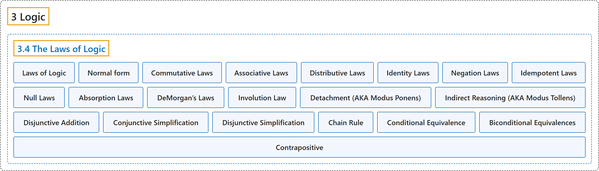

# 3.4 The Laws of Logic

## Classification

## Glossary

| Term | Definition | 中文翻译 | Source |
|---|---|---|---|
| **3.4 The Laws of Logic** 逻辑定律 | (No definition) | （无定义） | [Doerr & Levasseur, n.d., section 3.4](https://discretemath.org/ads/s-logic-laws.html) |
| **Laws of Logic** 逻辑定律 | (context) "In this section, we will list the most basic **equivalences and implications of logic**." | （语境）在本节中，我们将列出逻辑中最基本的**等价式与蕴含式**。 | [Doerr & Levasseur, n.d., section 3.4](https://discretemath.org/ads/s-logic-laws.html#s-logic-laws-2-2) |
| **Normal form** 范式 | "In general, it refers to a **way of representing objects** so that, although each may have many different names, **every possible name corresponds to exactly one object** ..." | 一般来说，它指一种**表示对象的方式**，使得尽管每个对象可能有许多不同的名称，**每个可能的名称都恰好对应一个对象**…… | [Weisstein, n.d.-c, "Normal form" entry, para. 1](https://mathworld.wolfram.com/NormalForm.html#:~:text=it%20refers%20to%20a%20way%20of%20representing%20objects) |
| **Commutative Laws** 交换律 | "$p \lor q\Leftrightarrow q\lor p$ $p \land q\Leftrightarrow q \land p$" | $p \lor q\Leftrightarrow q\lor p$ $p \land q\Leftrightarrow q \land p$ | [Doerr & Levasseur, n.d., Table 3.4.3](https://discretemath.org/ads/s-logic-laws.html#table-equivalences) |
| **Associative Laws** 结合律 | "$(p \lor q) \lor r \Leftrightarrow p \lor (q \lor r)$ ($p \land q) \land r\Leftrightarrow p \land (q \land r)$" | $(p \lor q) \lor r \Leftrightarrow p \lor (q \lor r)$ ($p \land q) \land r\Leftrightarrow p \land (q \land r)$ | [Doerr & Levasseur, n.d., Table 3.4.3](https://discretemath.org/ads/s-logic-laws.html#table-equivalences) |
| **Distributive Laws** 分配律 | "$p \land (q \lor r) \Leftrightarrow (p \land q ) \lor (p \land r)$ $p \lor (q \land r) \Leftrightarrow (p \lor q) \land (p \lor r)$" | $p \land (q \lor r) \Leftrightarrow (p \land q ) \lor (p \land r)$ $p \lor (q \land r) \Leftrightarrow (p \lor q) \land (p \lor r)$ | [Doerr & Levasseur, n.d., Table 3.4.3](https://discretemath.org/ads/s-logic-laws.html#table-equivalences) |
| **Identity Laws** 同一律 | "$p \lor 0\Leftrightarrow p$ $p \land 1 \Leftrightarrow p$" | $p \lor 0\Leftrightarrow p$ $p \land 1 \Leftrightarrow p$ | [Doerr & Levasseur, n.d., Table 3.4.3](https://discretemath.org/ads/s-logic-laws.html#table-equivalences) |
| **Negation Laws** 否定律 | "$p\land \neg p\Leftrightarrow 0$ $p\lor \neg p\Leftrightarrow 1$" | $p\land \neg p\Leftrightarrow 0$ $p\lor \neg p\Leftrightarrow 1$ | [Doerr & Levasseur, n.d., Table 3.4.3](https://discretemath.org/ads/s-logic-laws.html#table-equivalences) |
| **Idempotent Laws** 幂等律 | "$p \lor p \Leftrightarrow p$ $p\land p \Leftrightarrow p$" | $p \lor p \Leftrightarrow p$ $p\land p \Leftrightarrow p$ | [Doerr & Levasseur, n.d., Table 3.4.3](https://discretemath.org/ads/s-logic-laws.html#table-equivalences) |
| **Null Laws** 零律 | "$p \land 0 \Leftrightarrow 0$ $p \lor 1 \Leftrightarrow 1$" | $p \land 0 \Leftrightarrow 0$ $p \lor 1 \Leftrightarrow 1$ | [Doerr & Levasseur, n.d., Table 3.4.3](https://discretemath.org/ads/s-logic-laws.html#table-equivalences) |
| **Absorption Laws** 吸收律 | "$p \land (p\lor q)\Leftrightarrow p$ $p \lor (p \land q) \Leftrightarrow p$" | $p \land (p\lor q)\Leftrightarrow p$ $p \lor (p \land q) \Leftrightarrow p$ | [Doerr & Levasseur, n.d., Table 3.4.3](https://discretemath.org/ads/s-logic-laws.html#table-equivalences) |
| **DeMorgan’s Laws** 德摩根律 | "$\neg (p \lor q) \Leftrightarrow (\neg p) \land (\neg q)$ $\neg (p \land q) \Leftrightarrow (\neg p) \lor (\neg q)$" | $\neg (p \lor q) \Leftrightarrow (\neg p) \land (\neg q)$ $\neg (p \land q) \Leftrightarrow (\neg p) \lor (\neg q)$ | [Doerr & Levasseur, n.d., Table 3.4.3](https://discretemath.org/ads/s-logic-laws.html#table-equivalences) |
| **Involution Law** 对合律 | "$\neg (\neg p)\Leftrightarrow p$" | $\neg (\neg p)\Leftrightarrow p$ | [Doerr & Levasseur, n.d., Table 3.4.3](https://discretemath.org/ads/s-logic-laws.html#table-equivalences) |
| **Detachment (AKA Modus Ponens)** 分离规则（又称肯定前件式） | "$(p \rightarrow q) \land p\Rightarrow q$" | $(p \rightarrow q) \land p\Rightarrow q$ | [Doerr & Levasseur, n.d., Table 3.4.4](https://discretemath.org/ads/s-logic-laws.html#table-implications) |
| **Indirect Reasoning (AKA Modus Tollens)** 间接推理（又称否定后件式） | "$(p \to q) \land \neg q \Rightarrow \neg p$" | $(p \to q) \land \neg q \Rightarrow \neg p$ | [Doerr & Levasseur, n.d., Table 3.4.4](https://discretemath.org/ads/s-logic-laws.html#table-implications) |
| **Disjunctive Addition** 析取附加 | "$p\Rightarrow (p\lor q)$" | $p\Rightarrow (p\lor q)$ | [Doerr & Levasseur, n.d., Table 3.4.4](https://discretemath.org/ads/s-logic-laws.html#table-implications) |
| **Conjunctive Simplification** 合取化简 | "$(p \land q) \Rightarrow p$ and $(p \land q) \Rightarrow q$" | $(p \land q) \Rightarrow p$ 以及 $(p \land q) \Rightarrow q$ | [Doerr & Levasseur, n.d., Table 3.4.4](https://discretemath.org/ads/s-logic-laws.html#table-implications) |
| **Disjunctive Simplification** 析取化简 | "$(p \lor q) \land \neg p \Rightarrow q$ and $(p \lor q) \land \neg q\Rightarrow p$" | $(p \lor q) \land \neg p \Rightarrow q$ 以及 $(p \lor q) \land \neg q\Rightarrow p$ | [Doerr & Levasseur, n.d., Table 3.4.4](https://discretemath.org/ads/s-logic-laws.html#table-implications) |
| **Chain Rule** 链式法则 | "$(p \to q) \land ( q \rightarrow r) \Rightarrow (p\to r)$" | $(p \to q) \land ( q \rightarrow r) \Rightarrow (p\to r)$ | [Doerr & Levasseur, n.d., Table 3.4.4](https://discretemath.org/ads/s-logic-laws.html#table-implications) |
| **Conditional Equivalence** 条件等价 | "$p \rightarrow q \Leftrightarrow \neg p \lor q$" | $p \rightarrow q \Leftrightarrow \neg p \lor q$ | [Doerr & Levasseur, n.d., Table 3.4.4](https://discretemath.org/ads/s-logic-laws.html#table-implications) |
| **Biconditional Equivalences** 双条件等价 | "$(p \leftrightarrow q) \Leftrightarrow (p\rightarrow q) \land (q \rightarrow p)\Leftrightarrow (p \land q) \lor (\neg p \land \neg q)$" | $(p \leftrightarrow q) \Leftrightarrow (p\rightarrow q) \land (q \rightarrow p)\Leftrightarrow (p \land q) \lor (\neg p \land \neg q)$ | [Doerr & Levasseur, n.d., Table 3.4.4](https://discretemath.org/ads/s-logic-laws.html#table-implications) |
| **Contrapositive** 逆否 | "$(p\to q) \Leftrightarrow (\neg q \to \neg p)$" | $(p\to q) \Leftrightarrow (\neg q \to \neg p)$ | [Doerr & Levasseur, n.d., Table 3.4.4](https://discretemath.org/ads/s-logic-laws.html#table-implications) |

## References

Doerr, A., & Levasseur, K. (n.d.). *Applied discrete structures*. Retrieved October 28, 2026, from <https://discretemath.org/ads/index-ads.html>

Weisstein, E. W. (n.d.-c). *Normal form*. MathWorld: A Wolfram Resource. Retrieved October 27, 2026, from <https://mathworld.wolfram.com/NormalForm.html>
