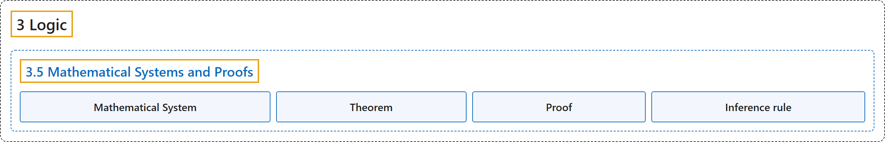

# 3.5 Mathematical Systems and Proofs

## Classification

## Glossary

| Term | Definition | 中文翻译 | Source |
|---|---|---|---|
| **3.5 Mathematical Systems and Proofs** 数学系统与证明 | (No definition) | （无定义） | [Doerr & Levasseur, n.d., section 3.5](https://discretemath.org/ads/s-math-systems.html) |
| **Mathematical System** 数学系统 | "A **mathematical system** consists of:" | **数学系统**由以下部分组成： | [Doerr & Levasseur, n.d., Definition 3.5.1](https://discretemath.org/ads/s-math-systems.html#def-mathematical-system) |
| **Theorem** 定理 | "A **true proposition derived from the axioms of a mathematical system** is called a **theorem**." | **由数学系统的公理推导出的真命题**称为**定理**。 | [Doerr & Levasseur, n.d., Definition 3.5.4](https://discretemath.org/ads/s-math-systems.html#def-theorem) |
| **Proof** 证明 | "A **proof** of a theorem is a **finite sequence of logically valid steps** that demonstrate that the **premises of a theorem imply its conclusion**." | 定理的**证明**是**有限的一系列逻辑上有效的步骤**，这些步骤表明**定理的前提蕴含其结论**。 | [Doerr & Levasseur, n.d., Definition 3.5.6](https://discretemath.org/ads/s-math-systems.html#def-proof) |
| **Inference rule** 推理规则 | "A syllogism, also known as a rule of inference, is a **formal logical scheme** used to **draw a conclusion from a set of premises**." | 三段论也称为推理规则，是一种**形式逻辑格式**，用于**从一组前提得出结论**。 | [Weisstein, n.d.-e, "Syllogism" entry, para. 1](https://mathworld.wolfram.com/Syllogism.html#:~:text=also%20known%20as%20a%20rule%20of%20inference) |

## References

Doerr, A., & Levasseur, K. (n.d.). *Applied discrete structures*. Retrieved October 28, 2026, from <https://discretemath.org/ads/index-ads.html>

Weisstein, E. W. (n.d.-e). *Syllogism*. MathWorld: A Wolfram Resource. Retrieved October 27, 2026, from <https://mathworld.wolfram.com/Syllogism.html>
