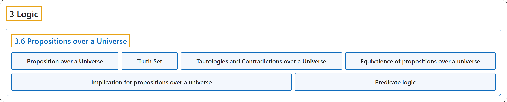

# 3.6 Propositions over a Universe

## Classification

## Glossary

| Term | Definition | 中文翻译 | Source |
|---|---|---|---|
| **3.6 Propositions over a Universe** 全集上的命题 | (No definition) | （无定义） | [Doerr & Levasseur, n.d., section 3.6](https://discretemath.org/ads/s-propositions-over-universe.html) |
| **Proposition over a Universe** 全集上的命题 | "Let $U$ be a nonempty set. A **proposition over $U$** is a **sentence that contains a variable that can take on any value in $U$** and that has a **definite truth value** as a result of any such substitution." | 设 $U$ 是非空集合。$U$ 上的**命题**是**含有可取 $U$ 中任意值的变量的句子**，并且对任何这样的代入都**具有确定的真值**。 | [Doerr & Levasseur, n.d., Definition 3.6.1](https://discretemath.org/ads/s-propositions-over-universe.html#def-proposition-over-U) |
| **Truth Set** 真值集 | "If $p$ is a proposition over $U\text{,}$ the **truth set of $p$** is **$T_p = \{a \in U \mid p(a) \textrm{ is true}\}\text{.}$**" | 若 $p$ 是 $U$， 上的命题，则 $p$ 的**真值集**是 **$T_p = \{a \in U \mid p(a) \textrm{ is true}\}$。** | [Doerr & Levasseur, n.d., Definition 3.6.3](https://discretemath.org/ads/s-propositions-over-universe.html#def-truth-set) |
| **Tautologies and Contradictions over a Universe** 全集上的重言式与矛盾式 | "A proposition over $U$ is a **tautology if its truth set is $U\text{.}$** It is a **contradiction if its truth set is empty**." | 若 $U$ 上的命题的真值集为 $U$，则它是**重言式**。若其真值集为空，则它是**矛盾式**。 | [Doerr & Levasseur, n.d., Definition 3.6.6](https://discretemath.org/ads/s-propositions-over-universe.html#def-tautology-contradiction-over-U) |
| **Equivalence of propositions over a universe** 全集上命题的等价 | "Two propositions, $p$ and $q\text{,}$ are **equivalent if $p \leftrightarrow q$ is a tautology**. In terms of truth sets, this means that $p$ and $q$ are **equivalent** if **$T_p=T_q$**." | 两个命题 $p$ 和 $q$ 若 **$p \leftrightarrow q$ 是重言式**，则它们是**等价**的。就真值集而言，这意味着若 **$T_p=T_q$**，则 $p$ 和 $q$ 等价。 | [Doerr & Levasseur, n.d., Definition 3.6.9](https://discretemath.org/ads/s-propositions-over-universe.html#def-equivanlence-over-U) |
| **Implication for propositions over a universe** 全集上命题的蕴涵 | "If $p$ and $q$ are propositions over $U\text{,}$ **$p$ implies $q$ if $p \rightarrow q$ is a tautology**." | 若 $p$ 和 $q$ 是 $U$， 上的命题，则若 **$p \rightarrow q$ 是重言式**，$p$ 蕴含 $q$。 | [Doerr & Levasseur, n.d., Definition 3.6.11](https://discretemath.org/ads/s-propositions-over-universe.html#def-implication-over-U) |
| **Predicate logic** 谓词逻辑 | "Predicate calculus, also called predicate logic or functional calculus, is the **branch of formal logic** that deals with **representing the logical connections between statements** as well as the statements themselves." | 谓词演算也称为谓词逻辑或函数演算，是**形式逻辑的一个分支**，研究**表示陈述之间的逻辑联系**以及陈述本身。 | [Weisstein, n.d.-d, "Predicate calculus" entry, para. 1](https://mathworld.wolfram.com/PredicateCalculus.html#:~:text=also%20called%20predicate%20logic) |

## References

Doerr, A., & Levasseur, K. (n.d.). *Applied discrete structures*. Retrieved October 28, 2026, from <https://discretemath.org/ads/index-ads.html>

Weisstein, E. W. (n.d.-d). *Predicate calculus*. MathWorld: A Wolfram Resource. Retrieved October 27, 2026, from <https://mathworld.wolfram.com/PredicateCalculus.html>
