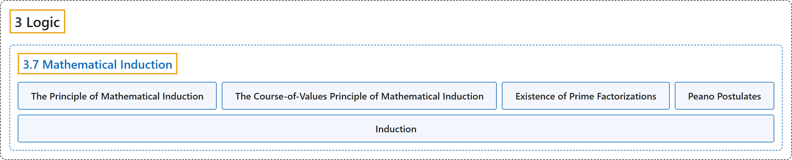

# 3.7 Mathematical Induction

## Classification

## Glossary

| Term | Definition | 中文翻译 | Source |
|---|---|---|---|
| **3.7 Mathematical Induction** 数学归纳法 | (No definition) | （无定义） | [Doerr & Levasseur, n.d., section 3.7](https://discretemath.org/ads/s-induction.html) |
| **The Principle of Mathematical Induction** 数学归纳法原理 | "Let $p(n)$ be a **proposition over the positive integers**. If" | 设 $p(n)$ 是**正整数上的命题**。若 | [Doerr & Levasseur, n.d., Theorem 3.7.3](https://discretemath.org/ads/s-induction.html#th-math-induction-basic) |
| **The Course-of-Values Principle of Mathematical Induction** 数学归纳法的强归纳原理（取值过程原理） | "If $p(n)$ is a **proposition over $\{k_0, k_0+ 1, k_0+ 2,\ldots \}\text{,}$** where $k_0$ is any integer, then $p(n)$ is a **tautology** if" | 若 $p(n)$ 是 **$\{k_0, k_0+ 1, k_0+ 2,\ldots \}$， 上的命题**，其中 $k_0$ 是任意整数，则在以下条件下 $p(n)$ 是**重言式**： | [Doerr & Levasseur, n.d., Theorem 3.7.9](https://discretemath.org/ads/s-induction.html#th-math-induction-course-of-values) |
| **Existence of Prime Factorizations** 素因数分解的存在性 | "Every positive integer greater than or equal to 2 **has a prime decomposition**." | 每个大于或等于 2 的正整数都**有素因数分解**。 | [Doerr & Levasseur, n.d., Theorem 3.7.10](https://discretemath.org/ads/s-induction.html#th-prime-factorizations-exist) |
| **Peano Postulates** 皮亚诺公设 | "The **system of positive integers** consists of a nonempty set, $\mathbb{P}\text{;}$ a least element of $\mathbb{P}\text{,}$ denoted 1; and a “**successor function**,” s, with the properties" | **正整数系统**由一个非空集合 $\mathbb{P}$、$\mathbb{P}$； 的一个记作 1 的最小元素，以及一个具有以下性质的“**后继函数**”s 组成 | [Doerr & Levasseur, n.d., Axiom 3.7.11](https://discretemath.org/ads/s-induction.html#sss-peano-postulates) |
| **Induction** 归纳法 | "Mathematical induction is a **method for proving** that a proposition P(n) **holds for every integer** n>=n0." | 数学归纳法是一种**证明方法**，用来证明命题 P(n) **对每个整数都成立**（n>=n0）。 | [Weisstein, n.d.-a, "Mathematical induction" entry, para. 1](https://mathworld.wolfram.com/MathematicalInduction.html#:~:text=Mathematical%20induction%20is%20a%20method%20for%20proving) |

## References

Doerr, A., & Levasseur, K. (n.d.). *Applied discrete structures*. Retrieved October 28, 2026, from <https://discretemath.org/ads/index-ads.html>

Weisstein, E. W. (n.d.-a). *Mathematical induction*. MathWorld: A Wolfram Resource. Retrieved October 27, 2026, from <https://mathworld.wolfram.com/MathematicalInduction.html>
