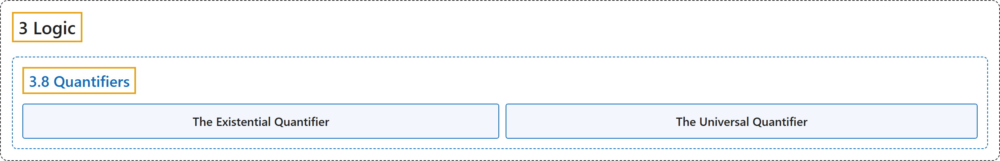

# 3.8 Quantifiers

## Classification

## Glossary

| Term | Definition | 中文翻译 | Source |
|---|---|---|---|
| **3.8 Quantifiers** 量词 | (No definition) | （无定义） | [Doerr & Levasseur, n.d., section 3.8](https://discretemath.org/ads/s-quantifiers.html) |
| **The Existential Quantifier** 存在量词 | "If $p(n)$ is a proposition over $U$ with $T_p\neq \emptyset\text{,}$ we commonly say “**There exists an $n$ in $U$ such that $p(n)$ (is true)**.” We abbreviate this with the symbols $(\exists n)_U(p(n))\text{.}$ The symbol $\exists$ is called the **existential quantifier**. If the context is clear, the mention of $U$ is dropped: $(\exists n)(p(n))\text{.}$" | 若 $p(n)$ 是 $U$ 上的命题且 $T_p\neq \emptyset$，我们通常说“**存在 $U$ 中的 $n$ 使得 $p(n)$**（为真）”。我们用符号 $(\exists n)_U(p(n))$。 来缩写它。符号 $\exists$ 称为**存在量词**。若上下文清楚，则省略 $U$：$(\exists n)(p(n))$。 | [Doerr & Levasseur, n.d., Definition 3.8.1](https://discretemath.org/ads/s-quantifiers.html#def-exist-quantifier) |
| **The Universal Quantifier** 全称量词 | "If $p(n)$ is a proposition over $U$ with $T_p=U\text{,}$ we commonly say “**For all $n$ in $U\text{,}$ $p(n)$ (is true)**.” We abbreviate this with the symbols $(\forall n)_U(p(n))\text{.}$ The symbol $\forall$ is called the **universal quantifier**. If the context is clear, the mention of $U$ is dropped: $(\forall n)(p(n))\text{.}$" | 若 $p(n)$ 是 $U$ 上的命题且 $T_p=U$，我们通常说“**对 $U$ 中所有的 $n$，$p(n)$**（为真）”。我们用符号 $(\forall n)_U(p(n))$。 来缩写它。符号 $\forall$ 称为**全称量词**。若上下文清楚，则省略 $U$：$(\forall n)(p(n))$。 | [Doerr & Levasseur, n.d., Definition 3.8.3](https://discretemath.org/ads/s-quantifiers.html#def-universal-quantifier) |

## References

Doerr, A., & Levasseur, K. (n.d.). *Applied discrete structures*. Retrieved October 28, 2026, from <https://discretemath.org/ads/index-ads.html>
