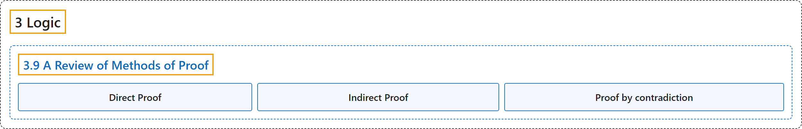

# 3.9 A Review of Methods of Proof

## Classification

## Glossary

| Term | Definition | 中文翻译 | Source |
|---|---|---|---|
| **3.9 A Review of Methods of Proof** 证明方法回顾 | (No definition) | （无定义） | [Doerr & Levasseur, n.d., section 3.9](https://discretemath.org/ads/s-proof-review.html) |
| **Direct Proof** 直接证明 | "**Directly**: Assume $P$ is true and prove $C$ is true." | **直接证明**：假设 $P$ 为真，并证明 $C$ 为真。 | [Doerr & Levasseur, n.d., section 3.9](https://discretemath.org/ads/s-proof-review.html#ss-proof-concepts-5-1-1-1) |
| **Indirect Proof** 间接证明 | "**Indirectly** (or **by contradiction**): Assume $P$ is true and $C$ is false and prove that this leads to a contradiction of some premise, theorem, or basic truth." | **间接证明**（或**反证法**）：假设 $P$ 为真且 $C$ 为假，并证明这会导致与某个前提、定理或基本事实相矛盾。 | [Doerr & Levasseur, n.d., section 3.9](https://discretemath.org/ads/s-proof-review.html#ss-proof-concepts-5-1-2-1) |
| **Proof by contradiction** 反证法 | "A proof by contradiction establishes the truth of a given proposition by the **supposition that it is false** and the subsequent drawing of a conclusion that is **contradictory to something that is proven to be true**." | 反证法这样确立一个命题为真：先**假设它为假**，再推出一个**与某个已证明为真的事实相矛盾**的结论。 | [Weisstein, n.d.-b, "Proof by contradiction" entry, para. 1](https://mathworld.wolfram.com/ProofbyContradiction.html#:~:text=A%20proof%20by%20contradiction%20establishes%20the%20truth) |

## References

Doerr, A., & Levasseur, K. (n.d.). *Applied discrete structures*. Retrieved October 28, 2026, from <https://discretemath.org/ads/index-ads.html>

Weisstein, E. W. (n.d.-b). *Proof by contradiction*. MathWorld: A Wolfram Resource. Retrieved October 27, 2026, from <https://mathworld.wolfram.com/ProofbyContradiction.html>
