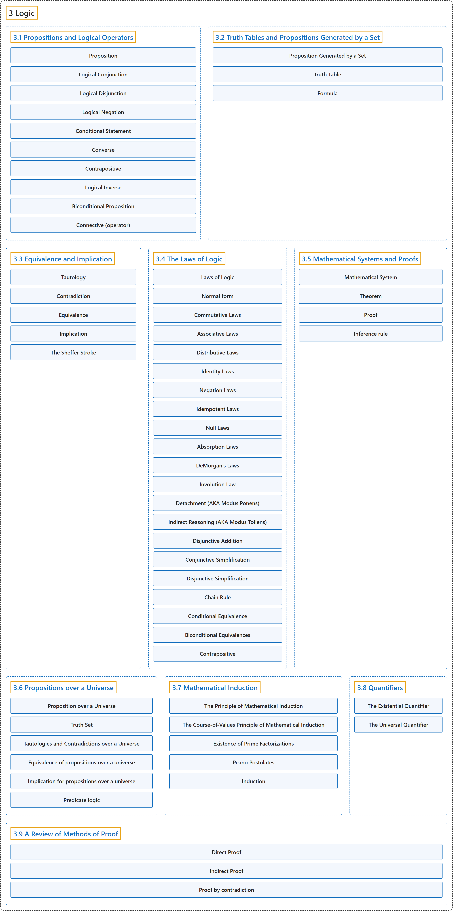

# 3 Logic

## Classification

## Glossary

| Term | Definition | 中文翻译 | Source |
|---|---|---|---|
| **3 Logic** 逻辑 | (No definition) | （无定义） | [Doerr & Levasseur, n.d., chapter 3](https://discretemath.org/ads/chapter3.html) |
| **[3.1 Propositions and Logical Operators](3-1-propositions-and-logical-operators.md)** 命题与逻辑运算符 | (No definition) | （无定义） | [Doerr & Levasseur, n.d., section 3.1](https://discretemath.org/ads/s-propositions-logic-operators.html) |
| **[3.2 Truth Tables and Propositions Generated by a Set](3-2-truth-tables-and-propositions-generated-by-a-set.md)** 真值表与由集合生成的命题 | (No definition) | （无定义） | [Doerr & Levasseur, n.d., section 3.2](https://discretemath.org/ads/s-truth-tables.html) |
| **[3.3 Equivalence and Implication](3-3-equivalence-and-implication.md)** 等价与蕴涵 | (No definition) | （无定义） | [Doerr & Levasseur, n.d., section 3.3](https://discretemath.org/ads/s-equivalence-implication.html) |
| **[3.4 The Laws of Logic](3-4-the-laws-of-logic.md)** 逻辑定律 | (No definition) | （无定义） | [Doerr & Levasseur, n.d., section 3.4](https://discretemath.org/ads/s-logic-laws.html) |
| **[3.5 Mathematical Systems and Proofs](3-5-mathematical-systems-and-proofs.md)** 数学系统与证明 | (No definition) | （无定义） | [Doerr & Levasseur, n.d., section 3.5](https://discretemath.org/ads/s-math-systems.html) |
| **[3.6 Propositions over a Universe](3-6-propositions-over-a-universe.md)** 全集上的命题 | (No definition) | （无定义） | [Doerr & Levasseur, n.d., section 3.6](https://discretemath.org/ads/s-propositions-over-universe.html) |
| **[3.7 Mathematical Induction](3-7-mathematical-induction.md)** 数学归纳法 | (No definition) | （无定义） | [Doerr & Levasseur, n.d., section 3.7](https://discretemath.org/ads/s-induction.html) |
| **[3.8 Quantifiers](3-8-quantifiers.md)** 量词 | (No definition) | （无定义） | [Doerr & Levasseur, n.d., section 3.8](https://discretemath.org/ads/s-quantifiers.html) |
| **[3.9 A Review of Methods of Proof](3-9-a-review-of-methods-of-proof.md)** 证明方法回顾 | (No definition) | （无定义） | [Doerr & Levasseur, n.d., section 3.9](https://discretemath.org/ads/s-proof-review.html) |

## References

Doerr, A., & Levasseur, K. (n.d.). *Applied discrete structures*. Retrieved October 28, 2026, from <https://discretemath.org/ads/index-ads.html>
