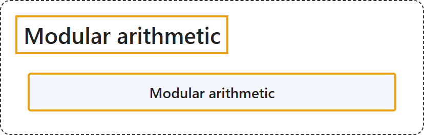

# 1.5 Modular arithmetic

## Classification

## Glossary

| Term | Definition | 中文翻译 | Source |
|---|---|---|---|
| **Modular arithmetic** 模运算 | "Modular arithmetic is the **arithmetic of congruences**, sometimes known informally as '**clock arithmetic**.'" | 模运算是**同余的算术**，非正式地也称为“**时钟算术**”。 | [Weisstein, n.d., "Modular arithmetic" entry, para. 1](https://mathworld.wolfram.com/ModularArithmetic.html#:~:text=Modular%20arithmetic%20is%20the%20arithmetic%20of%20congruences) |

## References

- Joint Task Force on Computing Curricula. (2024). *Computer science curricula 2023*. Association for Computing Machinery. <https://doi.org/10.1145/3664191>
- Weisstein, E. W. (n.d.). *Modular arithmetic*. MathWorld: A Wolfram Resource. Retrieved October 27, 2026, from <https://mathworld.wolfram.com/ModularArithmetic.html>
