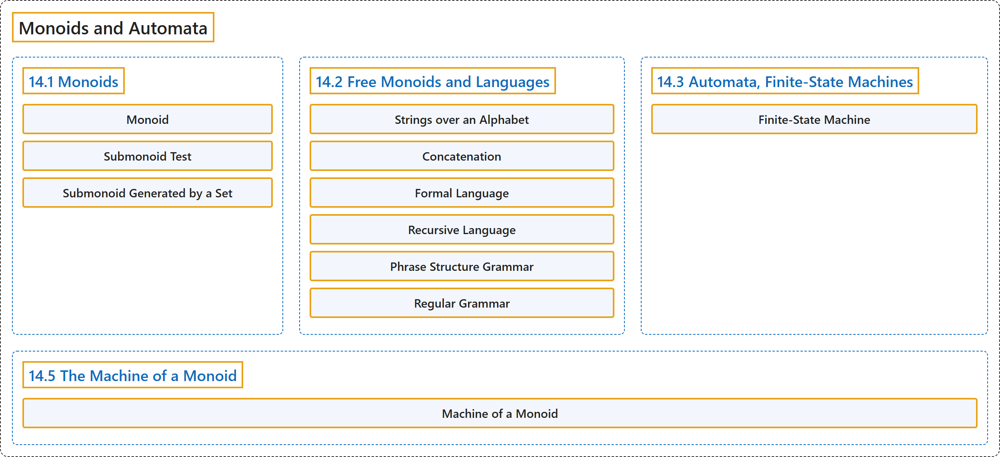

# 14 Monoids and Automata

## Classification

## Glossary

| Term | Definition | 中文翻译 | Source |
|---|---|---|---|
| **14 Monoids and Automata** 幺半群与自动机 | (No definition) | （无定义） | [Doerr & Levasseur, n.d., chapter 14](https://discretemath.org/ads/chapter_14.html) |
| **14.1 Monoids** 幺半群 | (No definition) | （无定义） | [Doerr & Levasseur, n.d., section 14.1](https://discretemath.org/ads/s-Monoids.html) |
| **Monoid** 幺半群 | "**A monoid** is a set $M$ together with **a binary operation $*$** with the properties" | **幺半群**是带有**二元运算** $*$ 的集合 $M$，且该运算具有下列性质 | [Doerr & Levasseur, n.d., Definition 14.1.1](https://discretemath.org/ads/s-Monoids.html#def-monoid) |
| **Submonoid Test** 子幺半群判定 | "Assume $[M; *]$ is a monoid and $K$ is a nonempty subset of $M\text{.}$ Then **$K$ is a submonoid of $M$** if and only if the following two conditions are met." | 设 $[M; *]$ 为幺半群，$K$ 为 $M$ 的非空子集。则 **$K$ 是 $M$ 的子幺半群**当且仅当满足下列两个条件。 | [Doerr & Levasseur, n.d., Theorem 14.1.5](https://discretemath.org/ads/s-Monoids.html#th-submonoid) |
| **Submonoid Generated by a Set** 由集合生成的子幺半群 | "If $S$ is a subset of monoid $[M;*]\text{,}$ **the submonoid generated by $S\text{,}$** $\langle S\rangle\text{,}$ is defined by:." | 若 $S$ 是幺半群 $[M;*]$， 的子集，则**由 $S$ 生成的子幺半群** $\langle S\rangle$， 定义为： | [Doerr & Levasseur, n.d., Definition 14.1.6](https://discretemath.org/ads/s-Monoids.html#def-submonoid-generated-by-a-set) |
| **14.2 Free Monoids and Languages** 自由幺半群与语言 | (No definition) | （无定义） | [Doerr & Levasseur, n.d., section 14.2](https://discretemath.org/ads/s-free-monoids-and-languages.html) |
| **Strings over an Alphabet** 字母表上的字符串 | "**A string of length $n\text{,}$** $n \geqslant 1$ over alphabet $A$ is a sequence of $n$ letters from $A\text{:}$ $a_1a_2\ldots a_n\text{.}$ **The null string**, $\lambda\text{,}$ is defined as the string of length zero containing no letters. The set of strings of length $n$ over $A$ is denoted by $A^n\text{.}$ **The set of all strings over $A$** is denoted $A^*\text{.}$" | 字母表 $A$ 上长度为 $n$（$n \geqslant 1$）的**字符串**是 $A$ 中 $n$ 个字母的序列：$a_1a_2\ldots a_n$。 **空串** $\lambda$， 定义为长度为零、不含任何字母的字符串。$A$ 上长度为 $n$ 的字符串的集合记作 $A^n$。 $A$ 上**所有字符串的集合**记作 $A^*$。 | [Doerr & Levasseur, n.d., Definition 14.2.1](https://discretemath.org/ads/s-free-monoids-and-languages.html#def-strings-over-alphabet) |
| **Concatenation** 连接 | "Let $a=a_1a_2\cdots a_m$ and $b=b_1b_2\cdots b_n$ be strings of length $m$ and $n\text{,}$ respectively. **The concatenation of $a$ with $b\text{,}$** $a+b\text{,}$ is the string $a_1a_2\cdots a_mb_1b_2\cdots b_n$ of length $m+n\text{.}$" | 设 $a=a_1a_2\cdots a_m$ 与 $b=b_1b_2\cdots b_n$ 分别为长度 $m$ 和 $n$， 的字符串。**$a$ 与 $b$， 的连接** $a+b$， 是长度为 $m+n$。 的字符串 $a_1a_2\cdots a_mb_1b_2\cdots b_n$。 | [Doerr & Levasseur, n.d., Definition 14.2.4](https://discretemath.org/ads/s-free-monoids-and-languages.html#def-concatenation) |
| **Formal Language** 形式语言 | "If $A$ is an alphabet, **a formal language over $A$** is **a subset** of $A^*\text{.}$" | 若 $A$ 是字母表，则 $A$ 上的**形式语言**是 $A^*$。 的**子集**。 | [Doerr & Levasseur, n.d., Definition 14.2.6](https://discretemath.org/ads/s-free-monoids-and-languages.html#def-formal-language) |
| **Recursive Language** 递归语言 | "A language is **recursive** if there exists **a recognition algorithm** for it." | 若语言存在**识别算法**，则该语言是**递归的**。 | [Doerr & Levasseur, n.d., Definition 14.2.9](https://discretemath.org/ads/s-free-monoids-and-languages.html#def-recursive-language) |
| **Phrase Structure Grammar** 短语结构文法 | "**A phrase structure grammar** consists of **four components**:" | **短语结构文法**由四个**组成部分**构成： | [Doerr & Levasseur, n.d., Definition 14.2.15](https://discretemath.org/ads/s-free-monoids-and-languages.html#def-phrase-structure-language) |
| **Regular Grammar** 正则文法 | "**A regular (right-hand form) grammar** is a grammar whose production rules are all of the form $A\to t$ and $A\to tB\text{,}$ where $A$ and $B$ are nonterminal and $t$ is terminal. **A left-hand form grammar** allows only $A \to t$ and $A\to Bt\text{.}$ A language that has a regular phrase structure language is called a **regular language**." | **正则（右线性形式）文法**是产生式规则全部形如 $A\to t$ 和 $A\to tB$， 的文法，其中 $A$ 和 $B$ 是非终结符，$t$ 是终结符。**左线性形式文法**只允许 $A \to t$ 和 $A\to Bt$。 具有正则短语结构语言的语言称为**正则语言**。 | [Doerr & Levasseur, n.d., Definition 14.2.21](https://discretemath.org/ads/s-free-monoids-and-languages.html#def-regular-grammar) |
| **14.3 Automata, Finite-State Machines** 自动机、有限状态机 | (No definition) | （无定义） | [Doerr & Levasseur, n.d., section 14.3](https://discretemath.org/ads/s-automata-finite-state-machines.html) |
| **Finite-State Machine** 有限状态机 | "**A finite-state machine** is defined by **a quintet $(S, X, Z, w, t)$** where" | **有限状态机**由一个**五元组** $(S, X, Z, w, t)$ 定义，其中 | [Doerr & Levasseur, n.d., Definition 14.3.1](https://discretemath.org/ads/s-automata-finite-state-machines.html#def-finite-state-machine) |
| **14.5 The Machine of a Monoid** 幺半群的机器 | (No definition) | （无定义） | [Doerr & Levasseur, n.d., section 14.5](https://discretemath.org/ads/s-machine-of-monoid.html) |
| **Machine of a Monoid** 幺半群的机器 | "If $[M;*]$ is a finite monoid, then **the machine of $M\text{,}$** denoted $m(M)\text{,}$ is **the state machine** with state set $M\text{,}$ input set $M\text{,}$ and next-state function $t: M\times M \to M$ defined by $t(s, x) = s * x\text{.}$" | 若 $[M;*]$ 是有限幺半群，则 $M$， 的**机器**（记作 $m(M)$）是状态集为 $M$， 输入集为 $M$， 且次态函数 $t: M\times M \to M$ 由 $t(s, x) = s * x$。 定义的**状态机**。 | [Doerr & Levasseur, n.d., Definition 14.5.1](https://discretemath.org/ads/s-machine-of-monoid.html#def-machine-of-monoid) |

## References

Doerr, A., & Levasseur, K. (n.d.). *Applied discrete structures*. Retrieved October 28, 2026, from <https://discretemath.org/ads/index-ads.html>
