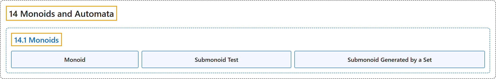

# 14.1 Monoids

## Classification

## Glossary

| Term | Definition | 中文翻译 | Source |
|---|---|---|---|
| **14.1 Monoids** 幺半群 | (No definition) | （无定义） | [Doerr & Levasseur, n.d., section 14.1](https://discretemath.org/ads/s-Monoids.html) |
| **Monoid** 幺半群 | "**A monoid** is a set $M$ together with **a binary operation $*$** with the properties" | **幺半群**是带有**二元运算** $*$ 的集合 $M$，且该运算具有下列性质 | [Doerr & Levasseur, n.d., Definition 14.1.1](https://discretemath.org/ads/s-Monoids.html#def-monoid) |
| **Submonoid Test** 子幺半群判定 | "Assume $[M; *]$ is a monoid and $K$ is a nonempty subset of $M\text{.}$ Then **$K$ is a submonoid of $M$** if and only if the following two conditions are met." | 设 $[M; *]$ 为幺半群，$K$ 为 $M$ 的非空子集。则 **$K$ 是 $M$ 的子幺半群**当且仅当满足下列两个条件。 | [Doerr & Levasseur, n.d., Theorem 14.1.5](https://discretemath.org/ads/s-Monoids.html#th-submonoid) |
| **Submonoid Generated by a Set** 由集合生成的子幺半群 | "If $S$ is a subset of monoid $[M;*]\text{,}$ **the submonoid generated by $S\text{,}$** $\langle S\rangle\text{,}$ is defined by:." | 若 $S$ 是幺半群 $[M;*]$， 的子集，则**由 $S$ 生成的子幺半群** $\langle S\rangle$， 定义为： | [Doerr & Levasseur, n.d., Definition 14.1.6](https://discretemath.org/ads/s-Monoids.html#def-submonoid-generated-by-a-set) |

## References

Doerr, A., & Levasseur, K. (n.d.). *Applied discrete structures*. Retrieved October 28, 2026, from <https://discretemath.org/ads/index-ads.html>
