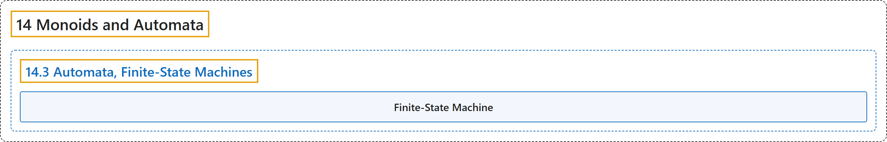

# 14.3 Automata, Finite-State Machines

## Classification

## Glossary

| Term | Definition | 中文翻译 | Source |
|---|---|---|---|
| **14.3 Automata, Finite-State Machines** 自动机、有限状态机 | (No definition) | （无定义） | [Doerr & Levasseur, n.d., section 14.3](https://discretemath.org/ads/s-automata-finite-state-machines.html) |
| **Finite-State Machine** 有限状态机 | "**A finite-state machine** is defined by **a quintet $(S, X, Z, w, t)$** where" | **有限状态机**由一个**五元组** $(S, X, Z, w, t)$ 定义，其中 | [Doerr & Levasseur, n.d., Definition 14.3.1](https://discretemath.org/ads/s-automata-finite-state-machines.html#def-finite-state-machine) |

## References

Doerr, A., & Levasseur, K. (n.d.). *Applied discrete structures*. Retrieved October 28, 2026, from <https://discretemath.org/ads/index-ads.html>
