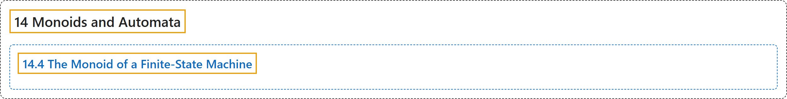

# 14.4 The Monoid of a Finite-State Machine

## Classification

## Glossary

| Term | Definition | 中文翻译 | Source |
|---|---|---|---|
| **14.4 The Monoid of a Finite-State Machine** 有限状态机的幺半群 | (No definition) | （无定义） | [Doerr & Levasseur, n.d., section 14.4](https://discretemath.org/ads/s-monoid-of-fsm.html) |

## References

Doerr, A., & Levasseur, K. (n.d.). *Applied discrete structures*. Retrieved October 28, 2026, from <https://discretemath.org/ads/index-ads.html>
