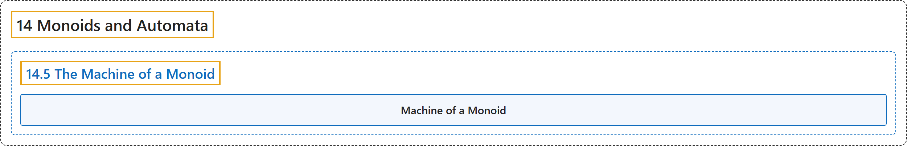

# 14.5 The Machine of a Monoid

## Classification

## Glossary

| Term | Definition | 中文翻译 | Source |
|---|---|---|---|
| **14.5 The Machine of a Monoid** 幺半群的机器 | (No definition) | （无定义） | [Doerr & Levasseur, n.d., section 14.5](https://discretemath.org/ads/s-machine-of-monoid.html) |
| **Machine of a Monoid** 幺半群的机器 | "If $[M;*]$ is a finite monoid, then **the machine of $M\text{,}$** denoted $m(M)\text{,}$ is **the state machine** with state set $M\text{,}$ input set $M\text{,}$ and next-state function $t: M\times M \to M$ defined by $t(s, x) = s * x\text{.}$" | 若 $[M;*]$ 是有限幺半群，则 $M$， 的**机器**（记作 $m(M)$）是状态集为 $M$， 输入集为 $M$， 且次态函数 $t: M\times M \to M$ 由 $t(s, x) = s * x$。 定义的**状态机**。 | [Doerr & Levasseur, n.d., Definition 14.5.1](https://discretemath.org/ads/s-machine-of-monoid.html#def-machine-of-monoid) |

## References

Doerr, A., & Levasseur, K. (n.d.). *Applied discrete structures*. Retrieved October 28, 2026, from <https://discretemath.org/ads/index-ads.html>
