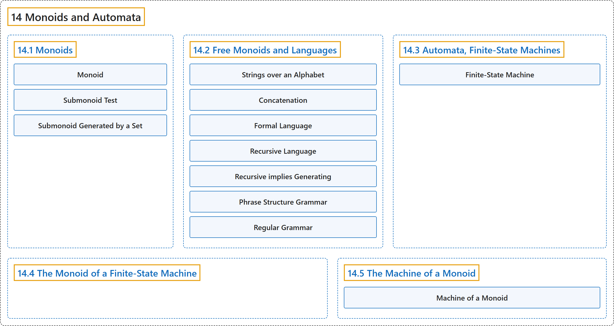

# 14 Monoids and Automata

## Classification

## Glossary

| Term | Definition | 中文翻译 | Source |
|---|---|---|---|
| **14 Monoids and Automata** 幺半群与自动机 | (No definition) | （无定义） | [Doerr & Levasseur, n.d., chapter 14](https://discretemath.org/ads/chapter_14.html) |
| **[14.1 Monoids](14-1-monoids.md)** 幺半群 | (No definition) | （无定义） | [Doerr & Levasseur, n.d., section 14.1](https://discretemath.org/ads/s-Monoids.html) |
| **[14.2 Free Monoids and Languages](14-2-free-monoids-and-languages.md)** 自由幺半群与语言 | (No definition) | （无定义） | [Doerr & Levasseur, n.d., section 14.2](https://discretemath.org/ads/s-free-monoids-and-languages.html) |
| **[14.3 Automata, Finite-State Machines](14-3-automata-finite-state-machines.md)** 自动机、有限状态机 | (No definition) | （无定义） | [Doerr & Levasseur, n.d., section 14.3](https://discretemath.org/ads/s-automata-finite-state-machines.html) |
| **[14.4 The Monoid of a Finite-State Machine](14-4-the-monoid-of-a-finite-state-machine.md)** 有限状态机的幺半群 | (No definition) | （无定义） | [Doerr & Levasseur, n.d., section 14.4](https://discretemath.org/ads/s-monoid-of-fsm.html) |
| **[14.5 The Machine of a Monoid](14-5-the-machine-of-a-monoid.md)** 幺半群的机器 | (No definition) | （无定义） | [Doerr & Levasseur, n.d., section 14.5](https://discretemath.org/ads/s-machine-of-monoid.html) |

## References

Doerr, A., & Levasseur, K. (n.d.). *Applied discrete structures*. Retrieved October 28, 2026, from <https://discretemath.org/ads/index-ads.html>
