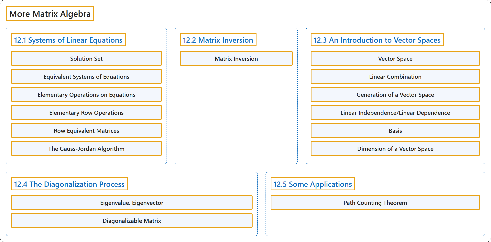

# 12 More Matrix Algebra

## Classification

## Glossary

| Term | Definition | 中文翻译 | Source |
|---|---|---|---|
| **12 More Matrix Algebra** 矩阵代数再论 | (No definition) | （无定义） | [Doerr & Levasseur, n.d., chapter 12](https://discretemath.org/ads/chapter_12.html) |
| **12.1 Systems of Linear Equations** 线性方程组 | (No definition) | （无定义） | [Doerr & Levasseur, n.d., section 12.1](https://discretemath.org/ads/s-systems-linear-equations.html) |
| **Solution Set** 解集 | "Given a system of equations involving real variables $x_1\text{,}$ $x_2, \ldots \text{,}$ $x_n\text{,}$ the **solution set** of the system is the set of **$n$-tuples** in $\mathbb{R}^n\text{,}$ $\left(a_1, a_2, \ldots,a_n\right)$ such that the substitutions $x_1= a_1\text{,}$ $x_2= a_2, \ldots\text{,}$ $x_n= a_n$ make all the equations true." | 给定含实变量 $x_1$， $x_2, \ldots$， $x_n$， 的方程组，该方程组的**解集**是 $\mathbb{R}^n$， 中的 **$n$ 元组** $\left(a_1, a_2, \ldots,a_n\right)$ 的集合，使得代入 $x_1= a_1$， $x_2= a_2, \ldots$， $x_n= a_n$ 后所有方程都成立。 | [Doerr & Levasseur, n.d., Definition 12.1.1](https://discretemath.org/ads/s-systems-linear-equations.html#def-solution-set) |
| **Equivalent Systems of Equations** 等价方程组 | "Two systems of linear equations **are called equivalent** if they have **the same set of solutions**." | 两个线性方程组若有**相同的解集**，则称为**等价**的。 | [Doerr & Levasseur, n.d., Definition 12.1.2](https://discretemath.org/ads/s-systems-linear-equations.html#def-equivalent-systems) |
| **Elementary Operations on Equations** 方程的初等运算 | "If **any sequence of the following operations** is performed on a system of equations, the resulting system is **equivalent to the original system**:" | 若对方程组施行下列**操作的任意序列**，则所得方程组与原方程组**等价**： | [Doerr & Levasseur, n.d., Theorem 12.1.4](https://discretemath.org/ads/s-systems-linear-equations.html#theorem-elem-equation-operations) |
| **Elementary Row Operations** 初等行变换 | "If any sequence of the following operations is performed on **the augmented matrix** of a system of equations, the resulting matrix is a system that is equivalent to the original system. The following operations on a matrix are called **elementary row operations**:" | 若对方程组的**增广矩阵**施行下列操作的任意序列，则所得矩阵是与原方程组等价的方程组。矩阵上的下列操作称为**初等行变换**： | [Doerr & Levasseur, n.d., Theorem 12.1.5](https://discretemath.org/ads/s-systems-linear-equations.html#theorem-elementary-row-operations) |
| **Row Equivalent Matrices** 行等价矩阵 | "Two matrices, $A$ and $B\text{,}$ are said to be **row-equivalent** if one can be obtained from the other by **any sequence of zero or more elementary row operations**." | 若矩阵 $A$ 和 $B$， 中的一个可由另一个经过**零个或多个初等行变换的任意序列**得到，则称 $A$ 与 $B$， **行等价**。 | [Doerr & Levasseur, n.d., Definition 12.1.6](https://discretemath.org/ads/s-systems-linear-equations.html#def-row-equivalent) |
| **The Gauss-Jordan Algorithm** 高斯-若尔当算法 | "Given a matrix equation $A x = b\text{,}$ where A is $n \times m\text{,}$ let $C$ be **the augmented matrix** $[A \vert b]\text{.}$ The process of **row-reducing to echelon form** involves performing the following algorithm where $C[i]$ is the $i^{\textrm{th}}$ row of $C\text{.}$" | 给定矩阵方程 $A x = b$， 其中 A 为 $n \times m$， 令 $C$ 为**增广矩阵** $[A \vert b]$。 **行化简为行阶梯形**的过程包括执行下列算法，其中 $C[i]$ 是 $C$ 的第 $i^{\textrm{th}}$ 行。 | [Doerr & Levasseur, n.d., Algorithm 12.1.9](https://discretemath.org/ads/s-systems-linear-equations.html#algorithm-gauss-jordan) |
| **12.2 Matrix Inversion** 矩阵求逆 | (No definition) | （无定义） | [Doerr & Levasseur, n.d., section 12.2](https://discretemath.org/ads/s-matrix-inversion.html) |
| **Matrix Inversion** 矩阵求逆 | (context) "This enables us to define the inverse of an $n \times n$ matrix $A$ as **the unique matrix $B$ such that $A B = B A =I\text{,}$** where $I$ is the $n \times n$ identity matrix." | （语境）这使我们能够把 $n \times n$ 矩阵 $A$ 的逆定义为**满足 $A B = B A =I$， 的唯一矩阵 $B$**，其中 $I$ 是 $n \times n$ 单位矩阵。 | [Doerr & Levasseur, n.d., section 12.2](https://discretemath.org/ads/s-matrix-inversion.html#s-matrix-inversion-3-2) |
| **12.3 An Introduction to Vector Spaces** 向量空间简介 | (No definition) | （无定义） | [Doerr & Levasseur, n.d., section 12.3](https://discretemath.org/ads/s-intro-to-vector-spaces.html) |
| **Vector Space** 向量空间 | "Let $V$ be any nonempty set of objects. Define on $V$ an operation, called **addition**, for any two elements $\vec{x}, \vec{y} \in V\text{,}$ and denote this operation by $\vec{x}+ \vec{y}\text{.}$ Let **scalar multiplication** be defined for a real number $a \in \mathbb{R}$ and any element $\vec{x}\in V$ and denote this operation by $a \vec{x}\text{.}$ The set $V$ together with operations of addition and scalar multiplication is called **a vector space** over $\mathbb{R}$ if the following hold for all $\vec{x}, \vec{y}, \vec{z}\in V$, and $a,b \in \mathbb{R}\text{:}$" | 设 $V$ 为任意非空对象集。在 $V$ 上定义一种称为**加法**的运算，对任意两个元素 $\vec{x}, \vec{y} \in V$， 将该运算记作 $\vec{x}+ \vec{y}$。 对实数 $a \in \mathbb{R}$ 与任意元素 $\vec{x}\in V$ 定义**数乘**，记该运算为 $a \vec{x}$。 若对所有 $\vec{x}, \vec{y}, \vec{z}\in V$ 与 $a,b \in \mathbb{R}$： 下列条件成立，则带有加法与数乘运算的集合 $V$ 称为 $\mathbb{R}$ 上的**向量空间**： | [Doerr & Levasseur, n.d., Definition 12.3.1](https://discretemath.org/ads/s-intro-to-vector-spaces.html#def-vector-space) |
| **Linear Combination** 线性组合 | "A vector $\pmb{ y}$ in vector space $V$ (over $\mathbb{R}$) is **a linear combination** of the vectors $\vec{x}_1\text{,}$ $\vec{x}_2, \ldots\text{,}$ $\vec{x}_n$ if there exist **scalars** $a_1,a_2,\ldots,a_n$ in $\mathbb{R}$ such that $\vec{y} = a_1\vec{x}_1+ a_2\vec{x}_2+\ldots +a_n\vec{x}_n$" | 若存在 $\mathbb{R}$ 中的**标量** $a_1,a_2,\ldots,a_n$ 使得 $\vec{y} = a_1\vec{x}_1+ a_2\vec{x}_2+\ldots +a_n\vec{x}_n$，则向量空间 $V$（在 $\mathbb{R}$ 上）中的向量 $\pmb{ y}$ 是向量 $\vec{x}_1$， $\vec{x}_2, \ldots$， $\vec{x}_n$ 的**线性组合** | [Doerr & Levasseur, n.d., Definition 12.3.6](https://discretemath.org/ads/s-intro-to-vector-spaces.html#def-linear-combination) |
| **Generation of a Vector Space** 向量空间的生成 | "Let $\left\{\vec{x}_1,\vec{x}_2, \ldots,\vec{x}_n\right\}$ be a set of vectors in a vector space $V$ over $\mathbb{R}\text{.}$ This set is said to **generate**, or **span**, $V$ if, for any given vector $\vec{y} \in V\text{,}$ we can always find scalars $a_1\text{,}$ $a_2, \ldots\text{,}$ $a_n$ such that $\vec{y} = a_1 \vec{x}_1+a_2 \vec{x}_2+\ldots +a_n \vec{x}_n\text{.}$ A set that generates a vector space is called a **generating set**." | 设 $\left\{\vec{x}_1,\vec{x}_2, \ldots,\vec{x}_n\right\}$ 为 $\mathbb{R}$。 上向量空间 $V$ 中的一组向量。若对任意给定向量 $\vec{y} \in V$， 总能找到标量 $a_1$， $a_2, \ldots$， $a_n$ 使得 $\vec{y} = a_1 \vec{x}_1+a_2 \vec{x}_2+\ldots +a_n \vec{x}_n$。 则称该集合**生成**（或**张成**）$V$。生成向量空间的集合称为**生成集**。 | [Doerr & Levasseur, n.d., Definition 12.3.9](https://discretemath.org/ads/s-intro-to-vector-spaces.html#def-generate) |
| **Linear Independence/Linear Dependence** 线性无关／线性相关 | "A set of vectors $\left\{\vec{x}_1,\vec{x}_2, \ldots,\vec{x}_n\right\}$ from a real vector space $V$ is **linearly independent** if the only solution to the equation $a_1 \vec{x}_1+a_2 \vec{x}_2+\ldots +a_n \vec{x}_n= \vec{0}$ is $a_1 = a_2 = \ldots = a_n = 0\text{.}$ Otherwise the set is called a **linearly dependent set**." | 若方程 $a_1 \vec{x}_1+a_2 \vec{x}_2+\ldots +a_n \vec{x}_n= \vec{0}$ 的唯一解为 $a_1 = a_2 = \ldots = a_n = 0$。 则实向量空间 $V$ 中的向量组 $\left\{\vec{x}_1,\vec{x}_2, \ldots,\vec{x}_n\right\}$ **线性无关**。否则称该向量组为**线性相关**组。 | [Doerr & Levasseur, n.d., Definition 12.3.13](https://discretemath.org/ads/s-intro-to-vector-spaces.html#def-linear-independence) |
| **Basis** 基 | "A set of vectors $B=\left\{\vec{x}_1,\vec{x}_2, \ldots,\vec{x}_n\right\}$ is **a basis for a vector space $V$** if:" | 向量组 $B=\left\{\vec{x}_1,\vec{x}_2, \ldots,\vec{x}_n\right\}$ 是向量空间 $V$ 的**基**，若： | [Doerr & Levasseur, n.d., Definition 12.3.14](https://discretemath.org/ads/s-intro-to-vector-spaces.html#def-basis) |
| **Dimension of a Vector Space** 向量空间的维数 | "Let $V$ be a vector space over $\mathbb{R}$ with **basis** $\left\{\vec{x}_1,\vec{x}_2, \ldots,\vec{x}_n\right\}\text{.}$ Then **the dimension of $V$** is $n\text{.}$ We use the notation $\dim V = n$ to indicate that $V$ is $n$-dimensional." | 设 $V$ 为 $\mathbb{R}$ 上的向量空间，其**基**为 $\left\{\vec{x}_1,\vec{x}_2, \ldots,\vec{x}_n\right\}$。 则 $V$ 的**维数**为 $n$。 我们用记号 $\dim V = n$ 表示 $V$ 是 $n$ 维的。 | [Doerr & Levasseur, n.d., Definition 12.3.18](https://discretemath.org/ads/s-intro-to-vector-spaces.html#def-def-dimension) |
| **12.4 The Diagonalization Process** 对角化过程 | (No definition) | （无定义） | [Doerr & Levasseur, n.d., section 12.4](https://discretemath.org/ads/s-the-diagonalization-process.html) |
| **Eigenvalue, Eigenvector** 特征值、特征向量 | "Let $A$ be an $n\times n$ matrix over $\mathbb{R}\text{.}$ $\lambda$ is **an eigenvalue** of $A$ if for some nonzero column vector $\vec{x}\in \mathbb{R}^n$ we have $A \vec{x} = \lambda \vec{x}\text{.}$ $\vec{x}$ is called **an eigenvector** corresponding to the eigenvalue $\lambda\text{.}$" | 设 $A$ 为 $\mathbb{R}$。 上的 $n\times n$ 矩阵。若对某个非零列向量 $\vec{x}\in \mathbb{R}^n$ 有 $A \vec{x} = \lambda \vec{x}$。 则 $\lambda$ 是 $A$ 的**特征值**。$\vec{x}$ 称为对应于特征值 $\lambda$。 的**特征向量**。 | [Doerr & Levasseur, n.d., Definition 12.4.1](https://discretemath.org/ads/s-the-diagonalization-process.html#def-eigenvalue-eigenvector) |
| **Diagonalizable Matrix** 可对角化矩阵 | "An $n\times n$ matrix $A$ is called **diagonalizable** if there exists an invertible $n\times n$ matrix $P$ such that $P^{-1} A P$ is a **diagonal matrix** $D\text{.}$ The matrix $P$ is said to diagonalize the matrix $A\text{.}$" | 若存在可逆的 $n\times n$ 矩阵 $P$，使得 $P^{-1} A P$ 为**对角矩阵** $D$。 则称 $n\times n$ 矩阵 $A$ **可对角化**。称矩阵 $P$ 将矩阵 $A$ 对角化。 | [Doerr & Levasseur, n.d., Definition 12.4.5](https://discretemath.org/ads/s-the-diagonalization-process.html#def-diagonalizable-matrix) |
| **12.5 Some Applications** 一些应用 | (No definition) | （无定义） | [Doerr & Levasseur, n.d., section 12.5](https://discretemath.org/ads/s-some-applications.html) |
| **Path Counting Theorem** 路径计数定理 | "If $A$ is the **adjacency matrix** of a graph with vertices $\{v_1, v_2, \dots,v_n\}\text{,}$ then the entry $\left(A^k\right)_{ij}$ is **the number of paths of length $k$** from node $v_i$ to node $v_j\text{.}$" | 若 $A$ 是顶点为 $\{v_1, v_2, \dots,v_n\}$， 的图的**邻接矩阵**，则元素 $\left(A^k\right)_{ij}$ 是从结点 $v_i$ 到结点 $v_j$。 的长度为 $k$ 的**路径条数**。 | [Doerr & Levasseur, n.d., Theorem 12.5.2](https://discretemath.org/ads/s-some-applications.html#theorem-12-5-1) |

## References

Doerr, A., & Levasseur, K. (n.d.). *Applied discrete structures*. Retrieved October 28, 2026, from <https://discretemath.org/ads/index-ads.html>
