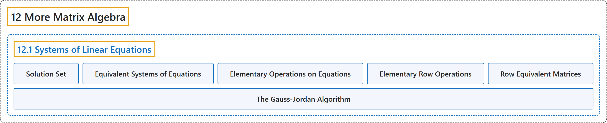

# 12.1 Systems of Linear Equations

## Classification

## Glossary

| Term | Definition | 中文翻译 | Source |
|---|---|---|---|
| **12.1 Systems of Linear Equations** 线性方程组 | (No definition) | （无定义） | [Doerr & Levasseur, n.d., section 12.1](https://discretemath.org/ads/s-systems-linear-equations.html) |
| **Solution Set** 解集 | "Given a system of equations involving real variables $x_1\text{,}$ $x_2, \ldots \text{,}$ $x_n\text{,}$ the **solution set** of the system is the set of **$n$-tuples** in $\mathbb{R}^n\text{,}$ $\left(a_1, a_2, \ldots,a_n\right)$ such that the substitutions $x_1= a_1\text{,}$ $x_2= a_2, \ldots\text{,}$ $x_n= a_n$ make all the equations true." | 给定含实变量 $x_1$， $x_2, \ldots$， $x_n$， 的方程组，该方程组的**解集**是 $\mathbb{R}^n$， 中的 **$n$ 元组** $\left(a_1, a_2, \ldots,a_n\right)$ 的集合，使得代入 $x_1= a_1$， $x_2= a_2, \ldots$， $x_n= a_n$ 后所有方程都成立。 | [Doerr & Levasseur, n.d., Definition 12.1.1](https://discretemath.org/ads/s-systems-linear-equations.html#def-solution-set) |
| **Equivalent Systems of Equations** 等价方程组 | "Two systems of linear equations **are called equivalent** if they have **the same set of solutions**." | 两个线性方程组若有**相同的解集**，则称为**等价**的。 | [Doerr & Levasseur, n.d., Definition 12.1.2](https://discretemath.org/ads/s-systems-linear-equations.html#def-equivalent-systems) |
| **Elementary Operations on Equations** 方程的初等运算 | "If **any sequence of the following operations** is performed on a system of equations, the resulting system is **equivalent to the original system**:" | 若对方程组施行下列**操作的任意序列**，则所得方程组与原方程组**等价**： | [Doerr & Levasseur, n.d., Theorem 12.1.4](https://discretemath.org/ads/s-systems-linear-equations.html#theorem-elem-equation-operations) |
| **Elementary Row Operations** 初等行变换 | "If any sequence of the following operations is performed on **the augmented matrix** of a system of equations, the resulting matrix is a system that is equivalent to the original system. The following operations on a matrix are called **elementary row operations**:" | 若对方程组的**增广矩阵**施行下列操作的任意序列，则所得矩阵是与原方程组等价的方程组。矩阵上的下列操作称为**初等行变换**： | [Doerr & Levasseur, n.d., Theorem 12.1.5](https://discretemath.org/ads/s-systems-linear-equations.html#theorem-elementary-row-operations) |
| **Row Equivalent Matrices** 行等价矩阵 | "Two matrices, $A$ and $B\text{,}$ are said to be **row-equivalent** if one can be obtained from the other by **any sequence of zero or more elementary row operations**." | 若矩阵 $A$ 和 $B$， 中的一个可由另一个经过**零个或多个初等行变换的任意序列**得到，则称 $A$ 与 $B$， **行等价**。 | [Doerr & Levasseur, n.d., Definition 12.1.6](https://discretemath.org/ads/s-systems-linear-equations.html#def-row-equivalent) |
| **The Gauss-Jordan Algorithm** 高斯-若尔当算法 | "Given a matrix equation $A x = b\text{,}$ where A is $n \times m\text{,}$ let $C$ be **the augmented matrix** $[A \vert b]\text{.}$ The process of **row-reducing to echelon form** involves performing the following algorithm where $C[i]$ is the $i^{\textrm{th}}$ row of $C\text{.}$" | 给定矩阵方程 $A x = b$， 其中 A 为 $n \times m$， 令 $C$ 为**增广矩阵** $[A \vert b]$。 **行化简为行阶梯形**的过程包括执行下列算法，其中 $C[i]$ 是 $C$ 的第 $i^{\textrm{th}}$ 行。 | [Doerr & Levasseur, n.d., Algorithm 12.1.9](https://discretemath.org/ads/s-systems-linear-equations.html#algorithm-gauss-jordan) |

## References

Doerr, A., & Levasseur, K. (n.d.). *Applied discrete structures*. Retrieved October 28, 2026, from <https://discretemath.org/ads/index-ads.html>
