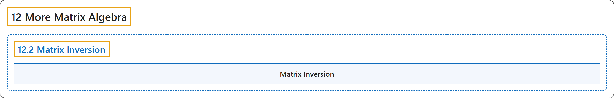

# 12.2 Matrix Inversion

## Classification

## Glossary

| Term | Definition | 中文翻译 | Source |
|---|---|---|---|
| **12.2 Matrix Inversion** 矩阵求逆 | (No definition) | （无定义） | [Doerr & Levasseur, n.d., section 12.2](https://discretemath.org/ads/s-matrix-inversion.html) |
| **Matrix Inversion** 矩阵求逆 | (context) "This enables us to define the inverse of an $n \times n$ matrix $A$ as **the unique matrix $B$ such that $A B = B A =I\text{,}$** where $I$ is the $n \times n$ identity matrix." | （语境）这使我们能够把 $n \times n$ 矩阵 $A$ 的逆定义为**满足 $A B = B A =I$， 的唯一矩阵 $B$**，其中 $I$ 是 $n \times n$ 单位矩阵。 | [Doerr & Levasseur, n.d., section 12.2](https://discretemath.org/ads/s-matrix-inversion.html#s-matrix-inversion-3-2) |

## References

Doerr, A., & Levasseur, K. (n.d.). *Applied discrete structures*. Retrieved October 28, 2026, from <https://discretemath.org/ads/index-ads.html>
