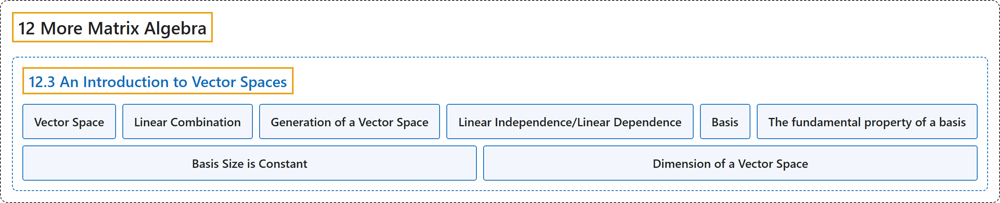

# 12.3 An Introduction to Vector Spaces

## Classification

## Glossary

| Term | Definition | 中文翻译 | Source |
|---|---|---|---|
| **12.3 An Introduction to Vector Spaces** 向量空间介绍 | (No definition) | （无定义） | [Doerr & Levasseur, n.d., section 12.3](https://discretemath.org/ads/s-intro-to-vector-spaces.html) |
| **Vector Space** 向量空间 | "Let $V$ be any nonempty set of objects. Define on $V$ an operation, called **addition**, for any two elements $\vec{x}, \vec{y} \in V\text{,}$ and denote this operation by $\vec{x}+ \vec{y}\text{.}$ Let **scalar multiplication** be defined for a real number $a \in \mathbb{R}$ and any element $\vec{x}\in V$ and denote this operation by $a \vec{x}\text{.}$ The set $V$ together with operations of addition and scalar multiplication is called **a vector space** over $\mathbb{R}$ if the following hold for all $\vec{x}, \vec{y}, \vec{z}\in V$, and $a,b \in \mathbb{R}\text{:}$" | 设 $V$ 为任意非空对象集。在 $V$ 上定义一种称为**加法**的运算，对任意两个元素 $\vec{x}, \vec{y} \in V$， 将该运算记作 $\vec{x}+ \vec{y}$。 对实数 $a \in \mathbb{R}$ 与任意元素 $\vec{x}\in V$ 定义**数乘**，记该运算为 $a \vec{x}$。 若对所有 $\vec{x}, \vec{y}, \vec{z}\in V$ 与 $a,b \in \mathbb{R}$： 下列条件成立，则带有加法与数乘运算的集合 $V$ 称为 $\mathbb{R}$ 上的**向量空间**： | [Doerr & Levasseur, n.d., Definition 12.3.1](https://discretemath.org/ads/s-intro-to-vector-spaces.html#def-vector-space) |
| **Linear Combination** 线性组合 | "A vector $\pmb{ y}$ in vector space $V$ (over $\mathbb{R}$) is **a linear combination** of the vectors $\vec{x}_1\text{,}$ $\vec{x}_2, \ldots\text{,}$ $\vec{x}_n$ if there exist **scalars** $a_1,a_2,\ldots,a_n$ in $\mathbb{R}$ such that $\vec{y} = a_1\vec{x}_1+ a_2\vec{x}_2+\ldots +a_n\vec{x}_n$" | 若存在 $\mathbb{R}$ 中的**标量** $a_1,a_2,\ldots,a_n$ 使得 $\vec{y} = a_1\vec{x}_1+ a_2\vec{x}_2+\ldots +a_n\vec{x}_n$，则向量空间 $V$（在 $\mathbb{R}$ 上）中的向量 $\pmb{ y}$ 是向量 $\vec{x}_1$， $\vec{x}_2, \ldots$， $\vec{x}_n$ 的**线性组合** | [Doerr & Levasseur, n.d., Definition 12.3.6](https://discretemath.org/ads/s-intro-to-vector-spaces.html#def-linear-combination) |
| **Generation of a Vector Space** 向量空间的生成 | "Let $\left\{\vec{x}_1,\vec{x}_2, \ldots,\vec{x}_n\right\}$ be a set of vectors in a vector space $V$ over $\mathbb{R}\text{.}$ This set is said to **generate**, or **span**, $V$ if, for any given vector $\vec{y} \in V\text{,}$ we can always find scalars $a_1\text{,}$ $a_2, \ldots\text{,}$ $a_n$ such that $\vec{y} = a_1 \vec{x}_1+a_2 \vec{x}_2+\ldots +a_n \vec{x}_n\text{.}$ A set that generates a vector space is called a **generating set**." | 设 $\left\{\vec{x}_1,\vec{x}_2, \ldots,\vec{x}_n\right\}$ 为 $\mathbb{R}$。 上向量空间 $V$ 中的一组向量。若对任意给定向量 $\vec{y} \in V$， 总能找到标量 $a_1$， $a_2, \ldots$， $a_n$ 使得 $\vec{y} = a_1 \vec{x}_1+a_2 \vec{x}_2+\ldots +a_n \vec{x}_n$。 则称该集合**生成**（或**张成**）$V$。生成向量空间的集合称为**生成集**。 | [Doerr & Levasseur, n.d., Definition 12.3.9](https://discretemath.org/ads/s-intro-to-vector-spaces.html#def-generate) |
| **Linear Independence/Linear Dependence** 线性无关／线性相关 | "A set of vectors $\left\{\vec{x}_1,\vec{x}_2, \ldots,\vec{x}_n\right\}$ from a real vector space $V$ is **linearly independent** if the only solution to the equation $a_1 \vec{x}_1+a_2 \vec{x}_2+\ldots +a_n \vec{x}_n= \vec{0}$ is $a_1 = a_2 = \ldots = a_n = 0\text{.}$ Otherwise the set is called a **linearly dependent set**." | 若方程 $a_1 \vec{x}_1+a_2 \vec{x}_2+\ldots +a_n \vec{x}_n= \vec{0}$ 的唯一解为 $a_1 = a_2 = \ldots = a_n = 0$。 则实向量空间 $V$ 中的向量组 $\left\{\vec{x}_1,\vec{x}_2, \ldots,\vec{x}_n\right\}$ **线性无关**。否则称该向量组为**线性相关**组。 | [Doerr & Levasseur, n.d., Definition 12.3.13](https://discretemath.org/ads/s-intro-to-vector-spaces.html#def-linear-independence) |
| **Basis** 基 | "A set of vectors $B=\left\{\vec{x}_1,\vec{x}_2, \ldots,\vec{x}_n\right\}$ is **a basis for a vector space $V$** if:" | 向量组 $B=\left\{\vec{x}_1,\vec{x}_2, \ldots,\vec{x}_n\right\}$ 是向量空间 $V$ 的**基**，若： | [Doerr & Levasseur, n.d., Definition 12.3.14](https://discretemath.org/ads/s-intro-to-vector-spaces.html#def-basis) |
| **The fundamental property of a basis** 基的基本性质 | "If $\left\{\vec{x}_1,\vec{x}_2, \ldots ,\vec{x}_n\right\}$ is a basis for a vector space V over $\mathbb{R}$, then any vector $y \in V$ **can be uniquely expressed** as a linear combination of the $\vec{x}_i\textrm{'s}$." | 若 $\left\{\vec{x}_1,\vec{x}_2, \ldots ,\vec{x}_n\right\}$ 是 $\mathbb{R}$ 上向量空间 V 的一组基，则任一向量 $y \in V$ **都可以唯一地表示为** $\vec{x}_i\textrm{'s}$ 的线性组合。 | [Doerr & Levasseur, n.d., Theorem 12.3.15](https://discretemath.org/ads/s-intro-to-vector-spaces.html#theorem-basis-property) |
| **Basis Size is Constant** 基的大小不变 | "If $V$ is a vector space with a basis containing $n$ elements, then **all bases of $V$ contain $n$ elements**." | 若 $V$ 是一个向量空间，且有一组含 $n$ 个元素的基，则 **$V$ 的所有基都含 $n$ 个元素**。 | [Doerr & Levasseur, n.d., Theorem 12.3.17](https://discretemath.org/ads/s-intro-to-vector-spaces.html#theorem-basis-size) |
| **Dimension of a Vector Space** 向量空间的维数 | "Let $V$ be a vector space over $\mathbb{R}$ with **basis** $\left\{\vec{x}_1,\vec{x}_2, \ldots,\vec{x}_n\right\}\text{.}$ Then **the dimension of $V$** is $n\text{.}$ We use the notation $\dim V = n$ to indicate that $V$ is $n$-dimensional." | 设 $V$ 为 $\mathbb{R}$ 上的向量空间，其**基**为 $\left\{\vec{x}_1,\vec{x}_2, \ldots,\vec{x}_n\right\}$。 则 $V$ 的**维数**为 $n$。 我们用记号 $\dim V = n$ 表示 $V$ 是 $n$ 维的。 | [Doerr & Levasseur, n.d., Definition 12.3.18](https://discretemath.org/ads/s-intro-to-vector-spaces.html#def-def-dimension) |

## References

Doerr, A., & Levasseur, K. (n.d.). *Applied discrete structures*. Retrieved October 28, 2026, from <https://discretemath.org/ads/index-ads.html>
