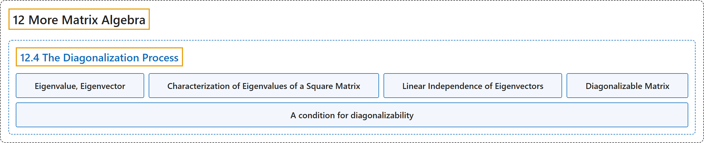

# 12.4 The Diagonalization Process

## Classification

## Glossary

| Term | Definition | 中文翻译 | Source |
|---|---|---|---|
| **12.4 The Diagonalization Process** 对角化过程 | (No definition) | （无定义） | [Doerr & Levasseur, n.d., section 12.4](https://discretemath.org/ads/s-the-diagonalization-process.html) |
| **Eigenvalue, Eigenvector** 特征值、特征向量 | "Let $A$ be an $n\times n$ matrix over $\mathbb{R}\text{.}$ $\lambda$ is **an eigenvalue** of $A$ if for some nonzero column vector $\vec{x}\in \mathbb{R}^n$ we have $A \vec{x} = \lambda \vec{x}\text{.}$ $\vec{x}$ is called **an eigenvector** corresponding to the eigenvalue $\lambda\text{.}$" | 设 $A$ 为 $\mathbb{R}$。 上的 $n\times n$ 矩阵。若对某个非零列向量 $\vec{x}\in \mathbb{R}^n$ 有 $A \vec{x} = \lambda \vec{x}$。 则 $\lambda$ 是 $A$ 的**特征值**。$\vec{x}$ 称为对应于特征值 $\lambda$。 的**特征向量**。 | [Doerr & Levasseur, n.d., Definition 12.4.1](https://discretemath.org/ads/s-the-diagonalization-process.html#def-eigenvalue-eigenvector) |
| **Characterization of Eigenvalues of a Square Matrix** 方阵特征值的刻画 | "Let $A$ be any $n\times n$ matrix over $\mathbb{R}$. Then $\lambda \in \mathbb{R}$ is an eigenvalue of $A$ **if and only if $\det (A - \lambda I) = 0$**." | 设 $A$ 是 $\mathbb{R}$ 上任意 $n\times n$ 矩阵。则 $\lambda \in \mathbb{R}$ 是 $A$ 的特征值**当且仅当 $\det (A - \lambda I) = 0$**。 | [Doerr & Levasseur, n.d., Theorem 12.4.3](https://discretemath.org/ads/s-the-diagonalization-process.html#theorem-evalue-det-theorem) |
| **Linear Independence of Eigenvectors** 特征向量的线性无关性 | "Nonzero eigenvectors corresponding to distinct eigenvalues **are linearly independent**." | 对应于不同特征值的非零特征向量**线性无关**。 | [Doerr & Levasseur, n.d., Theorem 12.4.4](https://discretemath.org/ads/s-the-diagonalization-process.html#theorem-evector-independence) |
| **Diagonalizable Matrix** 可对角化矩阵 | "An $n\times n$ matrix $A$ is called **diagonalizable** if there exists an invertible $n\times n$ matrix $P$ such that $P^{-1} A P$ is a **diagonal matrix** $D\text{.}$ The matrix $P$ is said to diagonalize the matrix $A\text{.}$" | 若存在可逆的 $n\times n$ 矩阵 $P$，使得 $P^{-1} A P$ 为**对角矩阵** $D$。 则称 $n\times n$ 矩阵 $A$ **可对角化**。称矩阵 $P$ 将矩阵 $A$ 对角化。 | [Doerr & Levasseur, n.d., Definition 12.4.5](https://discretemath.org/ads/s-the-diagonalization-process.html#def-diagonalizable-matrix) |
| **A condition for diagonalizability** 可对角化的一个条件 | "Let $A$ be an $n \times n$ matrix. Then $A$ is diagonalizable if and only if $A$ **has $n$ linearly independent eigenvectors**." | 设 $A$ 是 $n \times n$ 矩阵。则 $A$ 可对角化，当且仅当 $A$ **有 $n$ 个线性无关的特征向量**。 | [Doerr & Levasseur, n.d., Theorem 12.4.9](https://discretemath.org/ads/s-the-diagonalization-process.html#theorem-diagon-condition) |

## References

Doerr, A., & Levasseur, K. (n.d.). *Applied discrete structures*. Retrieved October 28, 2026, from <https://discretemath.org/ads/index-ads.html>
