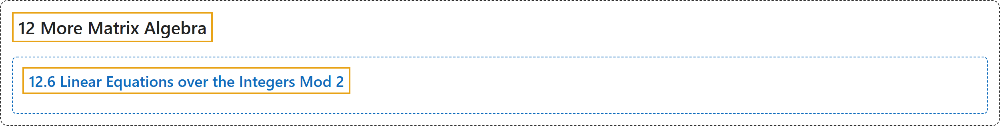

# 12.6 Linear Equations over the Integers Mod 2

## Classification

## Glossary

| Term | Definition | 中文翻译 | Source |
|---|---|---|---|
| **12.6 Linear Equations over the Integers Mod 2** 模 2 整数上的线性方程组 | (No definition) | （无定义） | [Doerr & Levasseur, n.d., section 12.6](https://discretemath.org/ads/s-systems-linear-equations-mod-2.html) |

## References

Doerr, A., & Levasseur, K. (n.d.). *Applied discrete structures*. Retrieved October 28, 2026, from <https://discretemath.org/ads/index-ads.html>
