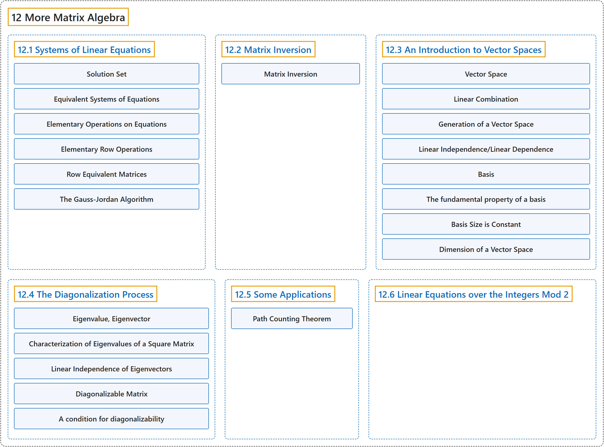

# 12 More Matrix Algebra

## Classification

## Glossary

| Term | Definition | 中文翻译 | Source |
|---|---|---|---|
| **12 More Matrix Algebra** 矩阵代数再论 | (No definition) | （无定义） | [Doerr & Levasseur, n.d., chapter 12](https://discretemath.org/ads/chapter_12.html) |
| **[12.1 Systems of Linear Equations](12-1-systems-of-linear-equations.md)** 线性方程组 | (No definition) | （无定义） | [Doerr & Levasseur, n.d., section 12.1](https://discretemath.org/ads/s-systems-linear-equations.html) |
| **[12.2 Matrix Inversion](12-2-matrix-inversion.md)** 矩阵求逆 | (No definition) | （无定义） | [Doerr & Levasseur, n.d., section 12.2](https://discretemath.org/ads/s-matrix-inversion.html) |
| **[12.3 An Introduction to Vector Spaces](12-3-an-introduction-to-vector-spaces.md)** 向量空间介绍 | (No definition) | （无定义） | [Doerr & Levasseur, n.d., section 12.3](https://discretemath.org/ads/s-intro-to-vector-spaces.html) |
| **[12.4 The Diagonalization Process](12-4-the-diagonalization-process.md)** 对角化过程 | (No definition) | （无定义） | [Doerr & Levasseur, n.d., section 12.4](https://discretemath.org/ads/s-the-diagonalization-process.html) |
| **[12.5 Some Applications](12-5-some-applications.md)** 一些应用 | (No definition) | （无定义） | [Doerr & Levasseur, n.d., section 12.5](https://discretemath.org/ads/s-some-applications.html) |
| **[12.6 Linear Equations over the Integers Mod 2](12-6-linear-equations-over-the-integers-mod-2.md)** 模 2 整数上的线性方程组 | (No definition) | （无定义） | [Doerr & Levasseur, n.d., section 12.6](https://discretemath.org/ads/s-systems-linear-equations-mod-2.html) |

## References

Doerr, A., & Levasseur, K. (n.d.). *Applied discrete structures*. Retrieved October 28, 2026, from <https://discretemath.org/ads/index-ads.html>
