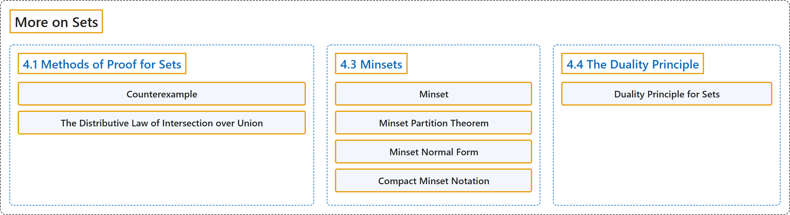

# 4 More on Sets

## Classification

## Glossary

| Term | Definition | 中文翻译 | Source |
|---|---|---|---|
| **4 More on Sets** 集合再论 | (No definition) | （无定义） | [Doerr & Levasseur, n.d., chapter 4](https://discretemath.org/ads/chapter_4.html) |
| **4.1 Methods of Proof for Sets** 集合的证明方法 | (No definition) | （无定义） | [Doerr & Levasseur, n.d., section 4.1](https://discretemath.org/ads/s-proof-methods-sets.html) |
| **Counterexample** 反例 | "An **example that disproves a statement** is called a **counterexample**." | **驳倒某个命题的例子**称为**反例**。 | [Doerr & Levasseur, n.d., Definition 4.1.1](https://discretemath.org/ads/s-proof-methods-sets.html#def-counterexample) |
| **The Distributive Law of Intersection over Union** 交对并的分配律 | "If $A\text{,}$ $B\text{,}$ and $C$ are sets, then **$A\cap (B \cup C) = (A\cap B) \cup (A \cap C)\text{.}$**" | 若 $A$、$B$， 和 $C$ 是集合，则 **$A\cap (B \cup C) = (A\cap B) \cup (A \cap C)$。** | [Doerr & Levasseur, n.d., Theorem 4.1.7](https://discretemath.org/ads/s-proof-methods-sets.html#th-distr-law-i-over-u) |
| **4.3 Minsets** 最小项集 | (No definition) | （无定义） | [Doerr & Levasseur, n.d., section 4.3](https://discretemath.org/ads/s-minsets.html) |
| **Minset** 最小项集 | "Let $\{B_1, B_2,\ldots,B_n\}$ be a set of subsets of set $A\text{.}$ Sets of the form **$D_1\cap D_2\cap \cdots \cap D_n\text{,}$** where each $D_i$ may be either $B_i$ or $B_i^c\text{,}$ is called a **minset** generated by $B_1\text{,}$ $B_2\text{,...}$ and $B_n\text{.}$" | 设 $\{B_1, B_2,\ldots,B_n\}$ 是集合 $A$。 的一组子集。形如 **$D_1\cap D_2\cap \cdots \cap D_n$，** 的集合（其中每个 $D_i$ 可以是 $B_i$ 或 $B_i^c$）称为由 $B_1$， $B_2\text{,...}$ 和 $B_n$。 生成的**最小项集**。 | [Doerr & Levasseur, n.d., Definition 4.3.4](https://discretemath.org/ads/s-minsets.html#def-Minset) |
| **Minset Partition Theorem** 最小项集划分定理 | "Let $A$ be a set and let $B_1\text{,}$ $B_2$ $\ldots$, $B_n$ be subsets of $A\text{.}$ The **set of nonempty minsets generated by $B_1\text{,}$ $B_2$ $\ldots$, $B_n$ is a partition of $A\text{.}$**" | 设 $A$ 是集合，$B_1$， $B_2$ $\ldots$, $B_n$ 是 $A$ 的子集。由 $B_1$， $B_2$ $\ldots$, $B_n$ 生成的**非空最小项集构成的集合是 $A$ 的一个划分**。 | [Doerr & Levasseur, n.d., Theorem 4.3.8](https://discretemath.org/ads/s-minsets.html#th-minset-partition) |
| **Minset Normal Form** 最小项集范式 | "A set is said to be in **minset normal form** when it is expressed as the **union of zero or more distinct nonempty minsets**." | 当一个集合被表示为**零个或多个互不相同的非空最小项集的并集**时，称该集合处于**最小项范式**。 | [Doerr & Levasseur, n.d., Definition 4.3.9](https://discretemath.org/ads/s-minsets.html#def-minset-normal-form) |
| **Compact Minset Notation** 紧凑最小项集记号 | "Let $\{B_1, B_2,\ldots,B_n\}$ be a set of subsets of set $A\text{.}$ If $b$ is equal to 0 or 1 and $C$ is any set, then $C^{(b)}$ is defined to be $C$ if $b=1$ and $C^c$ if $b=0\text{.}$ Then we can **denote a minset compactly** as an expression $M_{b_1 b_2 \dots b_n}$ where" | 设 $\{B_1, B_2,\ldots,B_n\}$ 是集合 $A$。 的一组子集。若 $b$ 等于 0 或 1，$C$ 是任意集合，则当 $b=1$ 时 $C^{(b)}$ 定义为 $C$，当 $b=0$。 时定义为 $C^c$。于是我们可以把最小项集**紧凑地表示**为表达式 $M_{b_1 b_2 \dots b_n}$，其中 | [Doerr & Levasseur, n.d., Definition 4.3.10](https://discretemath.org/ads/s-minsets.html#def-compact-Minset) |
| **4.4 The Duality Principle** 对偶原理 | (No definition) | （无定义） | [Doerr & Levasseur, n.d., section 4.4](https://discretemath.org/ads/s-duality-principle.html) |
| **Duality Principle for Sets** 集合的对偶原理 | "Let $S$ be any identity involving sets and the operations complement, intersection and union. If **$S^*$** is obtained from $S$ by making the substitutions $\cup \to \cap\text{,}$ $\cap \to \cup\text{,}$ $\emptyset \to U$, and $U\to \emptyset\text{,}$ then the statement $S^*$ is also true and it is called the **dual of the statement $S\text{.}$**" | 设 $S$ 是任何涉及集合以及补、交、并运算的恒等式。若通过代换 $\cup \to \cap$、$\cap \to \cup$、$\emptyset \to U$ 和 $U\to \emptyset$， 由 $S$ 得到 **$S^*$**，则命题 $S^*$ 也成立，并称之为命题 $S$ 的**对偶**。 | [Doerr & Levasseur, n.d., Definition 4.4.1](https://discretemath.org/ads/s-duality-principle.html#def-duality-sets) |

## References

Doerr, A., & Levasseur, K. (n.d.). *Applied discrete structures*. Retrieved October 28, 2026, from <https://discretemath.org/ads/index-ads.html>
