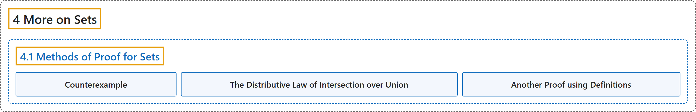

# 4.1 Methods of Proof for Sets

## Classification

## Glossary

| Term | Definition | 中文翻译 | Source |
|---|---|---|---|
| **4.1 Methods of Proof for Sets** 集合的证明方法 | (No definition) | （无定义） | [Doerr & Levasseur, n.d., section 4.1](https://discretemath.org/ads/s-proof-methods-sets.html) |
| **Counterexample** 反例 | "An **example that disproves a statement** is called a **counterexample**." | **驳倒某个命题的例子**称为**反例**。 | [Doerr & Levasseur, n.d., Definition 4.1.1](https://discretemath.org/ads/s-proof-methods-sets.html#def-counterexample) |
| **The Distributive Law of Intersection over Union** 交对并的分配律 | "If $A\text{,}$ $B\text{,}$ and $C$ are sets, then **$A\cap (B \cup C) = (A\cap B) \cup (A \cap C)\text{.}$**" | 若 $A$、$B$， 和 $C$ 是集合，则 **$A\cap (B \cup C) = (A\cap B) \cup (A \cap C)$。** | [Doerr & Levasseur, n.d., Theorem 4.1.7](https://discretemath.org/ads/s-proof-methods-sets.html#th-distr-law-i-over-u) |
| **Another Proof using Definitions** 用定义的另一个证明 | "If $A$, $B$, and $C$ are any sets, then **$A \times (B \cap C) = (A \times B) \cap (A \times C)$**." | 若 $A$、$B$ 和 $C$ 是任意集合，则 **$A \times (B \cap C) = (A \times B) \cap (A \times C)$**。 | [Doerr & Levasseur, n.d., Theorem 4.1.8](https://discretemath.org/ads/s-proof-methods-sets.html#th-set-proof-example2) |

## References

Doerr, A., & Levasseur, K. (n.d.). *Applied discrete structures*. Retrieved October 28, 2026, from <https://discretemath.org/ads/index-ads.html>
