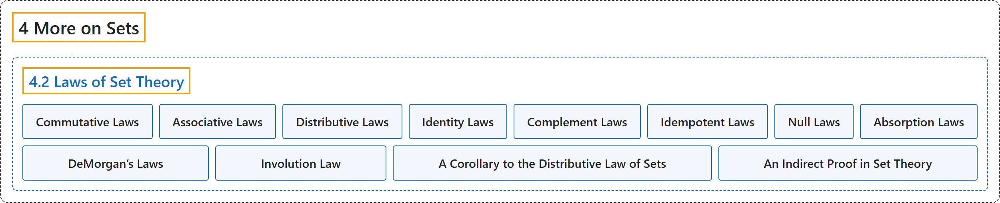

# 4.2 Laws of Set Theory

## Classification

## Glossary

| Term | Definition | 中文翻译 | Source |
|---|---|---|---|
| **4.2 Laws of Set Theory** 集合论的定律 | (No definition) | （无定义） | [Doerr & Levasseur, n.d., section 4.2](https://discretemath.org/ads/s-laws-of-set-theory.html) |
| **Commutative Laws** 交换律 | "(1) $A \cup B = B \cup A$ ($1^{\prime}$) $A \cap B = B\cap A$" | (1) $A \cup B = B \cup A$ ($1^{\prime}$) $A \cap B = B\cap A$ | [Doerr & Levasseur, n.d., Table 4.2.1](https://discretemath.org/ads/s-laws-of-set-theory.html#table-set-laws) |
| **Associative Laws** 结合律 | "(2) $A \cup (B \cup C)= (A\cup B)\cup C$ ($2^{\prime}$) $A \cap (B \cap C) = (A \cap B) \cap C$" | (2) $A \cup (B \cup C)= (A\cup B)\cup C$ ($2^{\prime}$) $A \cap (B \cap C) = (A \cap B) \cap C$ | [Doerr & Levasseur, n.d., Table 4.2.1](https://discretemath.org/ads/s-laws-of-set-theory.html#table-set-laws) |
| **Distributive Laws** 分配律 | "(3) $A\cap (B \cup C)=(A\cap B )\cup (A\cap C)$ ($3^{\prime}$) $A \cup (B \cap C) = (A \cup B ) \cap (A\cup C)$" | (3) $A\cap (B \cup C)=(A\cap B )\cup (A\cap C)$ ($3^{\prime}$) $A \cup (B \cap C) = (A \cup B ) \cap (A\cup C)$ | [Doerr & Levasseur, n.d., Table 4.2.1](https://discretemath.org/ads/s-laws-of-set-theory.html#table-set-laws) |
| **Identity Laws** 同一律 | "(4) $A \cup \emptyset = \emptyset \cup A = A$ ($4^{\prime}$) $A \cap U = U \cap A = A$" | (4) $A \cup \emptyset = \emptyset \cup A = A$ ($4^{\prime}$) $A \cap U = U \cap A = A$ | [Doerr & Levasseur, n.d., Table 4.2.1](https://discretemath.org/ads/s-laws-of-set-theory.html#table-set-laws) |
| **Complement Laws** 补律 | "(5) $A\cup A^c= U$ ($5^{\prime}$) $A\cap A^c= \emptyset$" | (5) $A\cup A^c= U$ ($5^{\prime}$) $A\cap A^c= \emptyset$ | [Doerr & Levasseur, n.d., Table 4.2.1](https://discretemath.org/ads/s-laws-of-set-theory.html#table-set-laws) |
| **Idempotent Laws** 幂等律 | "(6) $A \cup A = A$ ($6^{\prime}$) $A\cap A = A$" | (6) $A \cup A = A$ ($6^{\prime}$) $A\cap A = A$ | [Doerr & Levasseur, n.d., Table 4.2.1](https://discretemath.org/ads/s-laws-of-set-theory.html#table-set-laws) |
| **Null Laws** 零律 | "(7) $A \cup U = U$ ($7^{\prime}$) $A \cap \emptyset =\emptyset$" | (7) $A \cup U = U$ ($7^{\prime}$) $A \cap \emptyset =\emptyset$ | [Doerr & Levasseur, n.d., Table 4.2.1](https://discretemath.org/ads/s-laws-of-set-theory.html#table-set-laws) |
| **Absorption Laws** 吸收律 | "(8) $A \cup (A\cap B) = A$ ($8^{\prime}$) $A\cap (A \cup B) = A$" | (8) $A \cup (A\cap B) = A$ ($8^{\prime}$) $A\cap (A \cup B) = A$ | [Doerr & Levasseur, n.d., Table 4.2.1](https://discretemath.org/ads/s-laws-of-set-theory.html#table-set-laws) |
| **DeMorgan’s Laws** 德摩根律 | "(9) $(A \cup B)^c= A^c\cap B^c$ ($9^{\prime}$) $(A\cap B)^c = A^c \cup B^c$" | (9) $(A \cup B)^c= A^c\cap B^c$ ($9^{\prime}$) $(A\cap B)^c = A^c \cup B^c$ | [Doerr & Levasseur, n.d., Table 4.2.1](https://discretemath.org/ads/s-laws-of-set-theory.html#table-set-laws) |
| **Involution Law** 对合律 | "(10) $(A^c)^c= A$" | (10) $(A^c)^c= A$ | [Doerr & Levasseur, n.d., Table 4.2.1](https://discretemath.org/ads/s-laws-of-set-theory.html#table-set-laws) |
| **A Corollary to the Distributive Law of Sets** 集合分配律的一个推论 | "Let A and B be sets. Then **$(A\cap B) \cup (A\cap B^c) = A$**." | 设 A 和 B 为集合。则 **$(A\cap B) \cup (A\cap B^c) = A$**。 | [Doerr & Levasseur, n.d., Corollary 4.2.2](https://discretemath.org/ads/s-laws-of-set-theory.html#th-corollary-to-distr) |
| **An Indirect Proof in Set Theory** 集合论中的一个间接证明 | "Let $A, B, C$ be sets. If $A\subseteq B$ and $B\cap C = \emptyset$, then **$A\cap C = \emptyset$**." | 设 $A, B, C$ 为集合。若 $A\subseteq B$ 且 $B\cap C = \emptyset$，则 **$A\cap C = \emptyset$**。 | [Doerr & Levasseur, n.d., Theorem 4.2.3](https://discretemath.org/ads/s-laws-of-set-theory.html#theorem-example-sets-contradiction) |

## References

Doerr, A., & Levasseur, K. (n.d.). *Applied discrete structures*. Retrieved October 28, 2026, from <https://discretemath.org/ads/index-ads.html>
