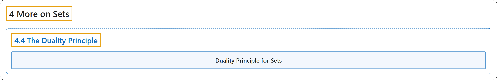

# 4.4 The Duality Principle

## Classification

## Glossary

| Term | Definition | 中文翻译 | Source |
|---|---|---|---|
| **4.4 The Duality Principle** 对偶原理 | (No definition) | （无定义） | [Doerr & Levasseur, n.d., section 4.4](https://discretemath.org/ads/s-duality-principle.html) |
| **Duality Principle for Sets** 集合的对偶原理 | "Let $S$ be any identity involving sets and the operations complement, intersection and union. If **$S^*$** is obtained from $S$ by making the substitutions $\cup \to \cap\text{,}$ $\cap \to \cup\text{,}$ $\emptyset \to U$, and $U\to \emptyset\text{,}$ then the statement $S^*$ is also true and it is called the **dual of the statement $S\text{.}$**" | 设 $S$ 是任何涉及集合以及补、交、并运算的恒等式。若通过代换 $\cup \to \cap$、$\cap \to \cup$、$\emptyset \to U$ 和 $U\to \emptyset$， 由 $S$ 得到 **$S^*$**，则命题 $S^*$ 也成立，并称之为命题 $S$ 的**对偶**。 | [Doerr & Levasseur, n.d., Definition 4.4.1](https://discretemath.org/ads/s-duality-principle.html#def-duality-sets) |

## References

Doerr, A., & Levasseur, K. (n.d.). *Applied discrete structures*. Retrieved October 28, 2026, from <https://discretemath.org/ads/index-ads.html>
