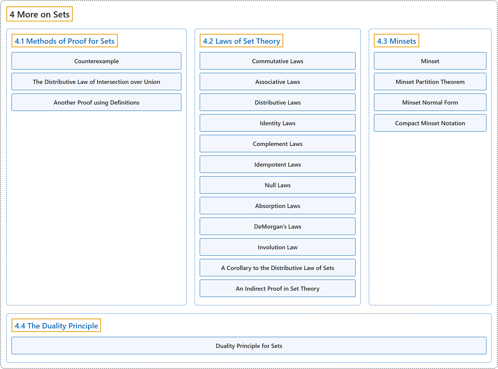

# 4 More on Sets

## Classification

## Glossary

| Term | Definition | 中文翻译 | Source |
|---|---|---|---|
| **4 More on Sets** 集合再论 | (No definition) | （无定义） | [Doerr & Levasseur, n.d., chapter 4](https://discretemath.org/ads/chapter_4.html) |
| **[4.1 Methods of Proof for Sets](4-1-methods-of-proof-for-sets.md)** 集合的证明方法 | (No definition) | （无定义） | [Doerr & Levasseur, n.d., section 4.1](https://discretemath.org/ads/s-proof-methods-sets.html) |
| **[4.2 Laws of Set Theory](4-2-laws-of-set-theory.md)** 集合论的定律 | (No definition) | （无定义） | [Doerr & Levasseur, n.d., section 4.2](https://discretemath.org/ads/s-laws-of-set-theory.html) |
| **[4.3 Minsets](4-3-minsets.md)** 最小项集 | (No definition) | （无定义） | [Doerr & Levasseur, n.d., section 4.3](https://discretemath.org/ads/s-minsets.html) |
| **[4.4 The Duality Principle](4-4-the-duality-principle.md)** 对偶原理 | (No definition) | （无定义） | [Doerr & Levasseur, n.d., section 4.4](https://discretemath.org/ads/s-duality-principle.html) |

## References

Doerr, A., & Levasseur, K. (n.d.). *Applied discrete structures*. Retrieved October 28, 2026, from <https://discretemath.org/ads/index-ads.html>
