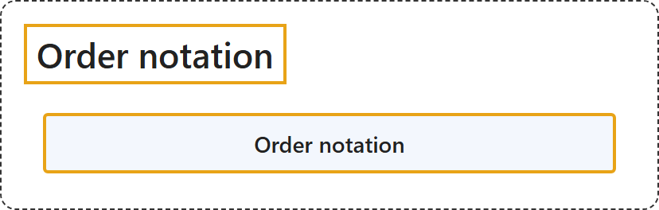

# 1.8 Order notation

## Classification

## Glossary

| Term | Definition | 中文翻译 | Source |
|---|---|---|---|
| **Order notation** 阶的记号 | (context) "... the symbols **O(x)** (sometimes called 'big-O') and o(x) (sometimes called 'little-o') are known as the **Landau symbols** ..." | （语境）……符号 **O(x)**（有时称为“大 O”）和 o(x)（有时称为“小 o”）称为**朗道符号**…… | [Weisstein, n.d., "Landau symbols" entry, para. 1](https://mathworld.wolfram.com/LandauSymbols.html#:~:text=are%20known%20as%20the%20Landau%20symbols) |

## References

- Joint Task Force on Computing Curricula. (2024). *Computer science curricula 2023*. Association for Computing Machinery. <https://doi.org/10.1145/3664191>
- Weisstein, E. W. (n.d.). *Landau symbols*. MathWorld: A Wolfram Resource. Retrieved October 27, 2026, from <https://mathworld.wolfram.com/LandauSymbols.html>
