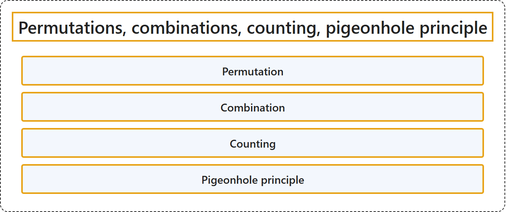

# 1.4 Permutations, combinations, counting, pigeonhole principle

Tier: CS Core.

## Classification

## Glossary

| Term | Definition | 中文翻译 | Source |
|---|---|---|---|
| **Permutation** 排列 | "A permutation of a set S is a **one-to-one correspondence of S with itself**." | 集合 S 的排列是 **S 与它自身之间的一一对应**。 | [Weisstein, n.d.-d, "Permutation" entry, para. 1](https://mathworld.wolfram.com/Permutation.html#:~:text=is%20a%20one%2Dto%2Done%20correspondence%20of) |
| **Combination** 组合 | "The number of ways of **picking k unordered outcomes** from **n possibilities**." | **选出 k 个无序结果**的方式数，这些结果取自 **n 种可能**。 | [Weisstein, n.d.-a, "Combination" entry, para. 1](https://mathworld.wolfram.com/Combination.html#:~:text=The%20number%20of%20ways%20of%20picking) |
| **Counting** 计数 | (context) "Enumerative combinatorics is the part concerned specifically with **counting finite sets of objects** satisfying **prescribed conditions**." | （语境）枚举组合学是专门研究**对有限的对象集合计数**的部分，这些对象满足**规定的条件**。 | [Weisstein, n.d.-b, "Combinatorics" entry, para. 2](https://mathworld.wolfram.com/Combinatorics.html#:~:text=Enumerative%20combinatorics%20is%20the%20part%20concerned%20specifically%20with%20counting) |
| **Pigeonhole principle** 鸽巢原理 | "A.k.a. the pigeonhole principle. Given n boxes and m>n objects, **at least one box must contain more than one object**." | 又称鸽巢原理。给定 n 个盒子和 m>n 个物体，**至少有一个盒子必须装有多于一个物体**。 | [Weisstein, n.d.-c, "Dirichlet's box principle" entry, para. 1](https://mathworld.wolfram.com/DirichletsBoxPrinciple.html#:~:text=at%20least%20one%20box%20must%20contain%20more%20than%20one%20object) |

## References

- Joint Task Force on Computing Curricula. (2024). *Computer science curricula 2023*. Association for Computing Machinery. <https://doi.org/10.1145/3664191>
- Weisstein, E. W. (n.d.-a). *Combination*. MathWorld: A Wolfram Resource. Retrieved October 27, 2026, from <https://mathworld.wolfram.com/Combination.html>
- Weisstein, E. W. (n.d.-b). *Combinatorics*. MathWorld: A Wolfram Resource. Retrieved October 27, 2026, from <https://mathworld.wolfram.com/Combinatorics.html>
- Weisstein, E. W. (n.d.-c). *Dirichlet's box principle*. MathWorld: A Wolfram Resource. Retrieved October 27, 2026, from <https://mathworld.wolfram.com/DirichletsBoxPrinciple.html>
- Weisstein, E. W. (n.d.-d). *Permutation*. MathWorld: A Wolfram Resource. Retrieved October 27, 2026, from <https://mathworld.wolfram.com/Permutation.html>
