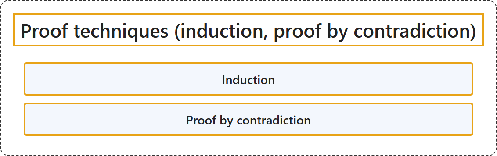

# 1.3 Proof Techniques (induction, proof by contradiction)

## Classification

## Glossary

| Term | Definition | 中文翻译 | Source |
|---|---|---|---|
| **Induction** 归纳法 | "Mathematical induction is a **method for proving** that a proposition P(n) **holds for every integer** n>=n0." | 数学归纳法是一种**证明方法**，用来证明命题 P(n) **对每个整数都成立**（n>=n0）。 | [Weisstein, n.d.-a, "Mathematical induction" entry, para. 1](https://mathworld.wolfram.com/MathematicalInduction.html#:~:text=Mathematical%20induction%20is%20a%20method%20for%20proving) |
| **Proof by contradiction** 反证法 | "A proof by contradiction establishes the truth of a given proposition by the **supposition that it is false** and the subsequent drawing of a conclusion that is **contradictory to something that is proven to be true**." | 反证法这样确立一个命题为真：先**假设它为假**，再推出一个**与某个已证明为真的事实相矛盾**的结论。 | [Weisstein, n.d.-b, "Proof by contradiction" entry, para. 1](https://mathworld.wolfram.com/ProofbyContradiction.html#:~:text=A%20proof%20by%20contradiction%20establishes%20the%20truth) |

## References

- Joint Task Force on Computing Curricula. (2024). *Computer science curricula 2023*. Association for Computing Machinery. <https://doi.org/10.1145/3664191>
- Weisstein, E. W. (n.d.-a). *Mathematical induction*. MathWorld: A Wolfram Resource. Retrieved October 27, 2026, from <https://mathworld.wolfram.com/MathematicalInduction.html>
- Weisstein, E. W. (n.d.-b). *Proof by contradiction*. MathWorld: A Wolfram Resource. Retrieved October 27, 2026, from <https://mathworld.wolfram.com/ProofbyContradiction.html>
