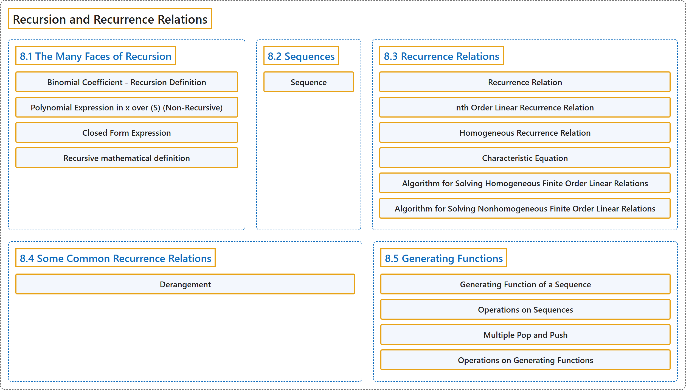

# 8 Recursion and Recurrence Relations

## Classification

## Glossary

| Term | Definition | 中文翻译 | Source |
|---|---|---|---|
| **8 Recursion and Recurrence Relations** 递归与递推关系 | (No definition) | （无定义） | [Doerr & Levasseur, n.d., chapter 8](https://discretemath.org/ads/chapter_8.html) |
| **8.1 The Many Faces of Recursion** 递归的多种面貌 | (No definition) | （无定义） | [Doerr & Levasseur, n.d., section 8.1](https://discretemath.org/ads/s-faces-of-recursion.html) |
| **Binomial Coefficient - Recursion Definition** 二项式系数的递归定义 | "Assume $n\geq 0$ and $n \geq k \geq 0\text{.}$ We **define $\binom{n}{k}$** by" | 设 $n\geq 0$ 且 $n \geq k \geq 0$。我们如下**定义 $\binom{n}{k}$** | [Doerr & Levasseur, n.d., Definition 8.1.1](https://discretemath.org/ads/s-faces-of-recursion.html#def-binomial-coefficient-recursive) |
| **Polynomial Expression in x over (S) (Non-Recursive)** (S) 上关于 x 的多项式表达式（非递归形式） | "Let $n$ be an integer, $n\geq 0\text{.}$ An **$n^{\text{th}}$ degree polynomial in $x$** is an expression of the form $a_nx^n+ a_{n-1}x^{n-1}+ \cdots + a_1x+a_0\text{,}$ where $a_n, a_{n-1},\ldots,a_1,a_0$ are elements of some designated set of numbers, $S\text{,}$ called the **set of coefficients** and $a_n\neq 0\text{.}$" | 设 $n$ 为整数，$n\geq 0$。$x$ 的 **$n$ 次多项式**是形如 $a_nx^n+ a_{n-1}x^{n-1}+ \cdots + a_1x+a_0$， 的表达式，其中 $a_n, a_{n-1},\ldots,a_1,a_0$ 是某个指定数集 $S$， 的元素，$S$， 称为**系数集**，且 $a_n\neq 0$。 | [Doerr & Levasseur, n.d., Definition 8.1.3](https://discretemath.org/ads/s-faces-of-recursion.html#def-polynomial-expression-nonrecursive) |
| **Closed Form Expression** 闭式表达式 | "Let $E = E\left(x_1, x_2, \ldots,x_n\right)$ be an algebraic expression involving variables $x_1, x_2, \ldots,x_n$ which are allowed to take on values from some predetermined set. $E$ is a **closed form expression if there exists a number $T$** such that the evaluation of $E$ with any allowed values of the variables will take no more than $T$ operations (alternatively, $T$ time units)." | 设 $E = E\left(x_1, x_2, \ldots,x_n\right)$ 是含变量 $x_1, x_2, \ldots,x_n$ 的代数表达式，这些变量可取某个预先给定集合中的值。若存在数 $T$，使得对变量的任何允许取值计算 $E$ 所需的运算都不超过 $T$ 次（或 $T$ 个时间单位），则 $E$ 是**封闭形式表达式**。 | [Doerr & Levasseur, n.d., Definition 8.1.11](https://discretemath.org/ads/s-faces-of-recursion.html#def-closed-form-expression) |
| **Recursive mathematical definition** 递归数学定义 | (context) "A recursive process is one in which objects are **defined in terms of other objects of the same type**." | （语境）递归过程是这样一种过程：对象**用同类型的其他对象来定义**。 | [Weisstein, n.d., "Recursion" entry, para. 1](https://mathworld.wolfram.com/Recursion.html#:~:text=A%20recursive%20process%20is%20one%20in%20which%20objects%20are%20defined) |
| **8.2 Sequences** 序列 | (No definition) | （无定义） | [Doerr & Levasseur, n.d., section 8.2](https://discretemath.org/ads/s-Sequences.html) |
| **Sequence** 序列 | "A **sequence** is **a function from the natural numbers into some predetermined set**. The image of any natural number $k$ can be written as $S(k)$ or $S_k$ and is called the **$k^{th}$ term of $S\text{.}$** The variable $k$ is called the **index or argument** of the sequence." | **序列**是**从自然数到某个预先给定集合的函数**。任一自然数 $k$ 的像可写作 $S(k)$ 或 $S_k$，称为 $S$。 的**第 $k$ 项**。变量 $k$ 称为序列的**下标或自变量**。 | [Doerr & Levasseur, n.d., Definition 8.2.1](https://discretemath.org/ads/s-Sequences.html#def-sequence) |
| **8.3 Recurrence Relations** 递推关系 | (No definition) | （无定义） | [Doerr & Levasseur, n.d., section 8.3](https://discretemath.org/ads/s-recurrence-relations.html) |
| **Recurrence Relation** 递推关系 | "Let $S$ be a sequence of numbers. A **recurrence relation** on $S$ is **a formula that relates all but a finite number of terms of $S$ to previous terms of $S\text{.}$** That is, there is a $k_0$ in the domain of $S$ such that if $k \geq k_0\text{,}$ then $S(k)$ is expressed in terms of some (and possibly all) of the terms that precede $S(k)\text{.}$ If the domain of $S$ is $\{0,1,2,\dots \}\text{,}$ the terms $S(0), S(1),..., S\left(k_0-1\right)$ are not defined by the recurrence formula. Their values are the **initial conditions** (or boundary conditions, or basis) that complete the definition of $S\text{.}$" | 设 $S$ 为数列。$S$ 上的**递推关系**是**把 $S$ 中除有限项之外的所有项与 $S$ 的前面各项联系起来的公式**。即，在 $S$ 的定义域中存在 $k_0$，使得当 $k \geq k_0$， 时，$S(k)$ 由在 $S(k)$ 之前的某些（可能是全部）项表示。若 $S$ 的定义域为 $\{0,1,2,\dots \}$，则项 $S(0), S(1),..., S\left(k_0-1\right)$ 不由递推公式定义。它们的值就是完成 $S$ 的定义的**初始条件**（或边界条件，或基础）。 | [Doerr & Levasseur, n.d., Definition 8.3.1](https://discretemath.org/ads/s-recurrence-relations.html#def-recurrence-relation) |
| **nth Order Linear Recurrence Relation** n 阶线性递推关系 | "Let $S$ be a sequence of numbers with domain $k\geq 0\text{.}$ An **$n^{\textrm{th}}$ order linear recurrence relation on $S$ with constant coefficients** is a recurrence relation that can be written in the form" | 设 $S$ 为定义域 $k\geq 0$。 的数列。$S$ 上的**常系数 n 阶线性递推关系**是可以写成如下形式的递推关系 | [Doerr & Levasseur, n.d., Definition 8.3.3](https://discretemath.org/ads/s-recurrence-relations.html#def-n-th-order-rr) |
| **Homogeneous Recurrence Relation** 齐次递推关系 | "An $n^{th}$ order linear relation is **homogeneous if $f(k) = 0$ for all $k\text{.}$** For each recurrence relation $S(k) + C_1S(k - 1) +\ldots + C_n S(k - n) = f(k)\text{,}$ the **associated homogeneous relation** is $S(k) + C_1S(k - 1) +\ldots + C_n S(k - n) =0$" | 若对所有 $k$。 都有 $f(k) = 0$，则 n 阶线性关系是**齐次**的。对每个递推关系 $S(k) + C_1S(k - 1) +\ldots + C_n S(k - n) = f(k)$，其**相伴齐次关系**为 $S(k) + C_1S(k - 1) +\ldots + C_n S(k - n) =0$ | [Doerr & Levasseur, n.d., Definition 8.3.7](https://discretemath.org/ads/s-recurrence-relations.html#def-homogeneous-recurrence-relation) |
| **Characteristic Equation** 特征方程 | "The **characteristic equation** of the homogeneous $n^{\textrm{th}}$ order linear relation $S(k) + C_1 S(k- 1) +\ldots + C_n S(k - n) =0$ is the $n\text{th}$ degree polynomial equation" | 齐次 $n$ 阶线性关系 $S(k) + C_1 S(k- 1) +\ldots + C_n S(k - n) =0$ 的**特征方程**是 $n$ 次多项式方程 | [Doerr & Levasseur, n.d., Definition 8.3.10](https://discretemath.org/ads/s-recurrence-relations.html#def-characteristic-equation) |
| **Algorithm for Solving Homogeneous Finite Order Linear Relations** 求解齐次有限阶线性递推关系的算法 | "**Write out** the **characteristic equation** of the relation $S(k) + C_1S(k - 1) +\ldots + C_n S(k - n) =0\text{,}$ which is $a^n+ C_1a^{n-1}+\cdots +C_{n-1}a+C_n=0\text{.}$" | **写出**关系 $S(k) + C_1S(k - 1) +\ldots + C_n S(k - n) =0$， 的**特征方程**，即 $a^n+ C_1a^{n-1}+\cdots +C_{n-1}a+C_n=0$。 | [Doerr & Levasseur, n.d., Algorithm 8.3.12](https://discretemath.org/ads/s-recurrence-relations.html#algorithm-linear-homogeneous-recurrence-relations) |
| **Algorithm for Solving Nonhomogeneous Finite Order Linear Relations** 求解非齐次有限阶线性递推关系的算法 | "To **solve the recurrence relation** $S(k) + C_1S(k - 1) +\ldots + C_n S(k - n) = f(k)$" | **求解递推关系** $S(k) + C_1S(k - 1) +\ldots + C_n S(k - n) = f(k)$ | [Doerr & Levasseur, n.d., Algorithm 8.3.16](https://discretemath.org/ads/s-recurrence-relations.html#algorithm-linear-nonhomogeneous-recurrence-relations) |
| **8.4 Some Common Recurrence Relations** 一些常见的递推关系 | (No definition) | （无定义） | [Doerr & Levasseur, n.d., section 8.4](https://discretemath.org/ads/s-some-common-rrs.html) |
| **Derangement** 错排 | "A **derangement** of a nonempty set $A$ is **a permutation of $A$** (i.e., a bijection from $A$ into $A$) such that **$f(a)\neq a$ for all $a \in A\text{.}$**" | 非空集合 $A$ 的**错排**是 $A$ 的一个**置换**（即从 $A$ 到 $A$ 的双射），使得**对所有 $a \in A$。 都有 $f(a)\neq a$**。 | [Doerr & Levasseur, n.d., Definition 8.4.8](https://discretemath.org/ads/s-some-common-rrs.html#def-derangement) |
| **8.5 Generating Functions** 生成函数 | (No definition) | （无定义） | [Doerr & Levasseur, n.d., section 8.5](https://discretemath.org/ads/s-generating-functions.html) |
| **Generating Function of a Sequence** 序列的生成函数 | "The **generating function of a sequence $S$** with terms $S_0,S_1,S_2, \dots \text{,}$ is the **infinite sum**" | 项为 $S_0,S_1,S_2, \dots$， 的序列 $S$ 的**生成函数**是**无穷和** | [Doerr & Levasseur, n.d., Definition 8.5.1](https://discretemath.org/ads/s-generating-functions.html#def-generating-function) |
| **Operations on Sequences** 序列的运算 | "Let $S$ and $T$ be sequences of numbers and let $c$ be a real number. Define the sum $S + T\text{,}$ the scalar product $c S\text{,}$ the product $S T\text{,}$ the **convolution $S*T\text{,}$** the **pop operation** $S\uparrow$ (read “$S$ pop”), and the **push operation** $S\downarrow$ (read “$S$ push”) term-wise for $k \geq 0$ by" | 设 $S$ 和 $T$ 为数列，$c$ 为实数。对 $k \geq 0$ 逐项定义和 $S + T$、数乘 $c S$、积 $S T$、**卷积 $S*T$，**、**弹出运算** $S\uparrow$（读作“$S$ pop”）与**压入运算** $S\downarrow$（读作“$S$ push”）如下 | [Doerr & Levasseur, n.d., Definition 8.5.3](https://discretemath.org/ads/s-generating-functions.html#ops-on-sequences-2) |
| **Multiple Pop and Push** 多重弹出与压入 | "If S is a sequence of numbers and $p$ a positive integer greater than 1, **define**" | 若 S 为数列，$p$ 为大于 1 的正整数，**定义** | [Doerr & Levasseur, n.d., Definition 8.5.6](https://discretemath.org/ads/s-generating-functions.html#def-multiple-pop-and-push) |
| **Operations on Generating Functions** 生成函数的运算 | "If $G(z)=\sum_{k=0}^{\infty} a_k z^k$ and $H(z) =\sum_{k=0}^{\infty} b_k z^k$ are **generating functions** and $c$ is a real number, then the sum $G + H\text{,}$ scalar product $c G\text{,}$ product $G H\text{,}$ and **monomial product $z^p G\text{,}$** $p \geq 1$ are generating functions, where" | 若 $G(z)=\sum_{k=0}^{\infty} a_k z^k$ 与 $H(z) =\sum_{k=0}^{\infty} b_k z^k$ 是**生成函数**，$c$ 为实数，则和 $G + H$、数乘 $c G$、积 $G H$， 以及**单项式积 $z^p G$，**（$p \geq 1$）都是生成函数，其中 | [Doerr & Levasseur, n.d., Definition 8.5.7](https://discretemath.org/ads/s-generating-functions.html#sss-operations-on-generating-functions-3) |

## References

Doerr, A., & Levasseur, K. (n.d.). *Applied discrete structures*. Retrieved October 28, 2026, from <https://discretemath.org/ads/index-ads.html>

Weisstein, E. W. (n.d.). *Recursion*. MathWorld: A Wolfram Resource. Retrieved October 27, 2026, from <https://mathworld.wolfram.com/Recursion.html>
