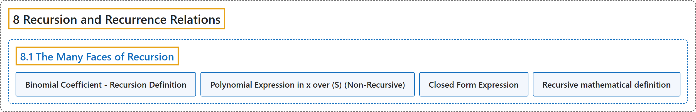

# 8.1 The Many Faces of Recursion

## Classification

## Glossary

| Term | Definition | 中文翻译 | Source |
|---|---|---|---|
| **8.1 The Many Faces of Recursion** 递归的多种面貌 | (No definition) | （无定义） | [Doerr & Levasseur, n.d., section 8.1](https://discretemath.org/ads/s-faces-of-recursion.html) |
| **Binomial Coefficient - Recursion Definition** 二项式系数的递归定义 | "Assume $n\geq 0$ and $n \geq k \geq 0\text{.}$ We **define $\binom{n}{k}$** by" | 设 $n\geq 0$ 且 $n \geq k \geq 0$。我们如下**定义 $\binom{n}{k}$** | [Doerr & Levasseur, n.d., Definition 8.1.1](https://discretemath.org/ads/s-faces-of-recursion.html#def-binomial-coefficient-recursive) |
| **Polynomial Expression in x over (S) (Non-Recursive)** (S) 上关于 x 的多项式表达式（非递归形式） | "Let $n$ be an integer, $n\geq 0\text{.}$ An **$n^{\text{th}}$ degree polynomial in $x$** is an expression of the form $a_nx^n+ a_{n-1}x^{n-1}+ \cdots + a_1x+a_0\text{,}$ where $a_n, a_{n-1},\ldots,a_1,a_0$ are elements of some designated set of numbers, $S\text{,}$ called the **set of coefficients** and $a_n\neq 0\text{.}$" | 设 $n$ 为整数，$n\geq 0$。$x$ 的 **$n$ 次多项式**是形如 $a_nx^n+ a_{n-1}x^{n-1}+ \cdots + a_1x+a_0$， 的表达式，其中 $a_n, a_{n-1},\ldots,a_1,a_0$ 是某个指定数集 $S$， 的元素，$S$， 称为**系数集**，且 $a_n\neq 0$。 | [Doerr & Levasseur, n.d., Definition 8.1.3](https://discretemath.org/ads/s-faces-of-recursion.html#def-polynomial-expression-nonrecursive) |
| **Closed Form Expression** 闭式表达式 | "Let $E = E\left(x_1, x_2, \ldots,x_n\right)$ be an algebraic expression involving variables $x_1, x_2, \ldots,x_n$ which are allowed to take on values from some predetermined set. $E$ is a **closed form expression if there exists a number $T$** such that the evaluation of $E$ with any allowed values of the variables will take no more than $T$ operations (alternatively, $T$ time units)." | 设 $E = E\left(x_1, x_2, \ldots,x_n\right)$ 是含变量 $x_1, x_2, \ldots,x_n$ 的代数表达式，这些变量可取某个预先给定集合中的值。若存在数 $T$，使得对变量的任何允许取值计算 $E$ 所需的运算都不超过 $T$ 次（或 $T$ 个时间单位），则 $E$ 是**封闭形式表达式**。 | [Doerr & Levasseur, n.d., Definition 8.1.11](https://discretemath.org/ads/s-faces-of-recursion.html#def-closed-form-expression) |
| **Recursive mathematical definition** 递归数学定义 | (context) "A recursive process is one in which objects are **defined in terms of other objects of the same type**." | （语境）递归过程是这样一种过程：对象**用同类型的其他对象来定义**。 | [Weisstein, n.d., "Recursion" entry, para. 1](https://mathworld.wolfram.com/Recursion.html#:~:text=A%20recursive%20process%20is%20one%20in%20which%20objects%20are%20defined) |

## References

Doerr, A., & Levasseur, K. (n.d.). *Applied discrete structures*. Retrieved October 28, 2026, from <https://discretemath.org/ads/index-ads.html>

Weisstein, E. W. (n.d.). *Recursion*. MathWorld: A Wolfram Resource. Retrieved October 27, 2026, from <https://mathworld.wolfram.com/Recursion.html>
