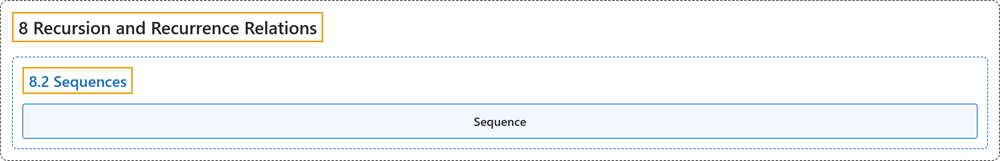

# 8.2 Sequences

## Classification

## Glossary

| Term | Definition | 中文翻译 | Source |
|---|---|---|---|
| **8.2 Sequences** 序列 | (No definition) | （无定义） | [Doerr & Levasseur, n.d., section 8.2](https://discretemath.org/ads/s-Sequences.html) |
| **Sequence** 序列 | "A **sequence** is **a function from the natural numbers into some predetermined set**. The image of any natural number $k$ can be written as $S(k)$ or $S_k$ and is called the **$k^{th}$ term of $S\text{.}$** The variable $k$ is called the **index or argument** of the sequence." | **序列**是**从自然数到某个预先给定集合的函数**。任一自然数 $k$ 的像可写作 $S(k)$ 或 $S_k$，称为 $S$。 的**第 $k$ 项**。变量 $k$ 称为序列的**下标或自变量**。 | [Doerr & Levasseur, n.d., Definition 8.2.1](https://discretemath.org/ads/s-Sequences.html#def-sequence) |

## References

Doerr, A., & Levasseur, K. (n.d.). *Applied discrete structures*. Retrieved October 28, 2026, from <https://discretemath.org/ads/index-ads.html>
