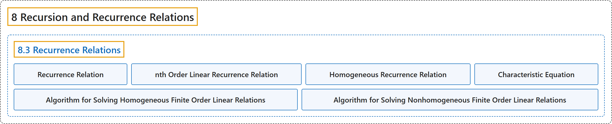

# 8.3 Recurrence Relations

## Classification

## Glossary

| Term | Definition | 中文翻译 | Source |
|---|---|---|---|
| **8.3 Recurrence Relations** 递推关系 | (No definition) | （无定义） | [Doerr & Levasseur, n.d., section 8.3](https://discretemath.org/ads/s-recurrence-relations.html) |
| **Recurrence Relation** 递推关系 | "Let $S$ be a sequence of numbers. A **recurrence relation** on $S$ is **a formula that relates all but a finite number of terms of $S$ to previous terms of $S\text{.}$** That is, there is a $k_0$ in the domain of $S$ such that if $k \geq k_0\text{,}$ then $S(k)$ is expressed in terms of some (and possibly all) of the terms that precede $S(k)\text{.}$ If the domain of $S$ is $\{0,1,2,\dots \}\text{,}$ the terms $S(0), S(1),..., S\left(k_0-1\right)$ are not defined by the recurrence formula. Their values are the **initial conditions** (or boundary conditions, or basis) that complete the definition of $S\text{.}$" | 设 $S$ 为数列。$S$ 上的**递推关系**是**把 $S$ 中除有限项之外的所有项与 $S$ 的前面各项联系起来的公式**。即，在 $S$ 的定义域中存在 $k_0$，使得当 $k \geq k_0$， 时，$S(k)$ 由在 $S(k)$ 之前的某些（可能是全部）项表示。若 $S$ 的定义域为 $\{0,1,2,\dots \}$，则项 $S(0), S(1),..., S\left(k_0-1\right)$ 不由递推公式定义。它们的值就是完成 $S$ 的定义的**初始条件**（或边界条件，或基础）。 | [Doerr & Levasseur, n.d., Definition 8.3.1](https://discretemath.org/ads/s-recurrence-relations.html#def-recurrence-relation) |
| **nth Order Linear Recurrence Relation** n 阶线性递推关系 | "Let $S$ be a sequence of numbers with domain $k\geq 0\text{.}$ An **$n^{\textrm{th}}$ order linear recurrence relation on $S$ with constant coefficients** is a recurrence relation that can be written in the form" | 设 $S$ 为定义域 $k\geq 0$。 的数列。$S$ 上的**常系数 n 阶线性递推关系**是可以写成如下形式的递推关系 | [Doerr & Levasseur, n.d., Definition 8.3.3](https://discretemath.org/ads/s-recurrence-relations.html#def-n-th-order-rr) |
| **Homogeneous Recurrence Relation** 齐次递推关系 | "An $n^{th}$ order linear relation is **homogeneous if $f(k) = 0$ for all $k\text{.}$** For each recurrence relation $S(k) + C_1S(k - 1) +\ldots + C_n S(k - n) = f(k)\text{,}$ the **associated homogeneous relation** is $S(k) + C_1S(k - 1) +\ldots + C_n S(k - n) =0$" | 若对所有 $k$。 都有 $f(k) = 0$，则 n 阶线性关系是**齐次**的。对每个递推关系 $S(k) + C_1S(k - 1) +\ldots + C_n S(k - n) = f(k)$，其**相伴齐次关系**为 $S(k) + C_1S(k - 1) +\ldots + C_n S(k - n) =0$ | [Doerr & Levasseur, n.d., Definition 8.3.7](https://discretemath.org/ads/s-recurrence-relations.html#def-homogeneous-recurrence-relation) |
| **Characteristic Equation** 特征方程 | "The **characteristic equation** of the homogeneous $n^{\textrm{th}}$ order linear relation $S(k) + C_1 S(k- 1) +\ldots + C_n S(k - n) =0$ is the $n\text{th}$ degree polynomial equation" | 齐次 $n$ 阶线性关系 $S(k) + C_1 S(k- 1) +\ldots + C_n S(k - n) =0$ 的**特征方程**是 $n$ 次多项式方程 | [Doerr & Levasseur, n.d., Definition 8.3.10](https://discretemath.org/ads/s-recurrence-relations.html#def-characteristic-equation) |
| **Algorithm for Solving Homogeneous Finite Order Linear Relations** 求解齐次有限阶线性递推关系的算法 | "**Write out** the **characteristic equation** of the relation $S(k) + C_1S(k - 1) +\ldots + C_n S(k - n) =0\text{,}$ which is $a^n+ C_1a^{n-1}+\cdots +C_{n-1}a+C_n=0\text{.}$" | **写出**关系 $S(k) + C_1S(k - 1) +\ldots + C_n S(k - n) =0$， 的**特征方程**，即 $a^n+ C_1a^{n-1}+\cdots +C_{n-1}a+C_n=0$。 | [Doerr & Levasseur, n.d., Algorithm 8.3.12](https://discretemath.org/ads/s-recurrence-relations.html#algorithm-linear-homogeneous-recurrence-relations) |
| **Algorithm for Solving Nonhomogeneous Finite Order Linear Relations** 求解非齐次有限阶线性递推关系的算法 | "To **solve the recurrence relation** $S(k) + C_1S(k - 1) +\ldots + C_n S(k - n) = f(k)$" | **求解递推关系** $S(k) + C_1S(k - 1) +\ldots + C_n S(k - n) = f(k)$ | [Doerr & Levasseur, n.d., Algorithm 8.3.16](https://discretemath.org/ads/s-recurrence-relations.html#algorithm-linear-nonhomogeneous-recurrence-relations) |

## References

Doerr, A., & Levasseur, K. (n.d.). *Applied discrete structures*. Retrieved October 28, 2026, from <https://discretemath.org/ads/index-ads.html>
