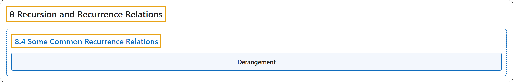

# 8.4 Some Common Recurrence Relations

## Classification

## Glossary

| Term | Definition | 中文翻译 | Source |
|---|---|---|---|
| **8.4 Some Common Recurrence Relations** 一些常见的递推关系 | (No definition) | （无定义） | [Doerr & Levasseur, n.d., section 8.4](https://discretemath.org/ads/s-some-common-rrs.html) |
| **Derangement** 错排 | "A **derangement** of a nonempty set $A$ is **a permutation of $A$** (i.e., a bijection from $A$ into $A$) such that **$f(a)\neq a$ for all $a \in A\text{.}$**" | 非空集合 $A$ 的**错排**是 $A$ 的一个**置换**（即从 $A$ 到 $A$ 的双射），使得**对所有 $a \in A$。 都有 $f(a)\neq a$**。 | [Doerr & Levasseur, n.d., Definition 8.4.8](https://discretemath.org/ads/s-some-common-rrs.html#def-derangement) |

## References

Doerr, A., & Levasseur, K. (n.d.). *Applied discrete structures*. Retrieved October 28, 2026, from <https://discretemath.org/ads/index-ads.html>
