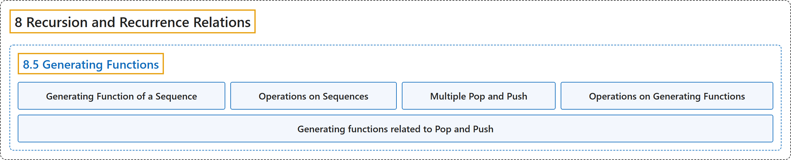

# 8.5 Generating Functions

## Classification

## Glossary

| Term | Definition | 中文翻译 | Source |
|---|---|---|---|
| **8.5 Generating Functions** 生成函数 | (No definition) | （无定义） | [Doerr & Levasseur, n.d., section 8.5](https://discretemath.org/ads/s-generating-functions.html) |
| **Generating Function of a Sequence** 序列的生成函数 | "The **generating function of a sequence $S$** with terms $S_0,S_1,S_2, \dots \text{,}$ is the **infinite sum**" | 项为 $S_0,S_1,S_2, \dots$， 的序列 $S$ 的**生成函数**是**无穷和** | [Doerr & Levasseur, n.d., Definition 8.5.1](https://discretemath.org/ads/s-generating-functions.html#def-generating-function) |
| **Operations on Sequences** 序列的运算 | "Let $S$ and $T$ be sequences of numbers and let $c$ be a real number. Define the sum $S + T\text{,}$ the scalar product $c S\text{,}$ the product $S T\text{,}$ the **convolution $S*T\text{,}$** the **pop operation** $S\uparrow$ (read “$S$ pop”), and the **push operation** $S\downarrow$ (read “$S$ push”) term-wise for $k \geq 0$ by" | 设 $S$ 和 $T$ 为数列，$c$ 为实数。对 $k \geq 0$ 逐项定义和 $S + T$、数乘 $c S$、积 $S T$、**卷积 $S*T$，**、**弹出运算** $S\uparrow$（读作“$S$ pop”）与**压入运算** $S\downarrow$（读作“$S$ push”）如下 | [Doerr & Levasseur, n.d., Definition 8.5.3](https://discretemath.org/ads/s-generating-functions.html#ops-on-sequences-2) |
| **Multiple Pop and Push** 多重弹出与压入 | "If S is a sequence of numbers and $p$ a positive integer greater than 1, **define**" | 若 S 为数列，$p$ 为大于 1 的正整数，**定义** | [Doerr & Levasseur, n.d., Definition 8.5.6](https://discretemath.org/ads/s-generating-functions.html#def-multiple-pop-and-push) |
| **Operations on Generating Functions** 生成函数的运算 | "If $G(z)=\sum_{k=0}^{\infty} a_k z^k$ and $H(z) =\sum_{k=0}^{\infty} b_k z^k$ are **generating functions** and $c$ is a real number, then the sum $G + H\text{,}$ scalar product $c G\text{,}$ product $G H\text{,}$ and **monomial product $z^p G\text{,}$** $p \geq 1$ are generating functions, where" | 若 $G(z)=\sum_{k=0}^{\infty} a_k z^k$ 与 $H(z) =\sum_{k=0}^{\infty} b_k z^k$ 是**生成函数**，$c$ 为实数，则和 $G + H$、数乘 $c G$、积 $G H$， 以及**单项式积 $z^p G$，**（$p \geq 1$）都是生成函数，其中 | [Doerr & Levasseur, n.d., Definition 8.5.7](https://discretemath.org/ads/s-generating-functions.html#sss-operations-on-generating-functions-3) |
| **Generating functions related to Pop and Push** 与 Pop 和 Push 相关的生成函数 | "If $p \gt 1$, $\displaystyle G(S\uparrow p;z) = \left(G(S;z) -\left.\sum_{k=0}^{p-1} S(k) z^k\right)/z^k\right.$ $G(S\downarrow p;z) = z^p G(S;z)$." | 若 $p \gt 1$，$\displaystyle G(S\uparrow p;z) = \left(G(S;z) -\left.\sum_{k=0}^{p-1} S(k) z^k\right)/z^k\right.$ $G(S\downarrow p;z) = z^p G(S;z)$。 | [Doerr & Levasseur, n.d., Theorem 8.5.9](https://discretemath.org/ads/s-generating-functions.html#gf-of-pop-push) |

## References

Doerr, A., & Levasseur, K. (n.d.). *Applied discrete structures*. Retrieved October 28, 2026, from <https://discretemath.org/ads/index-ads.html>
