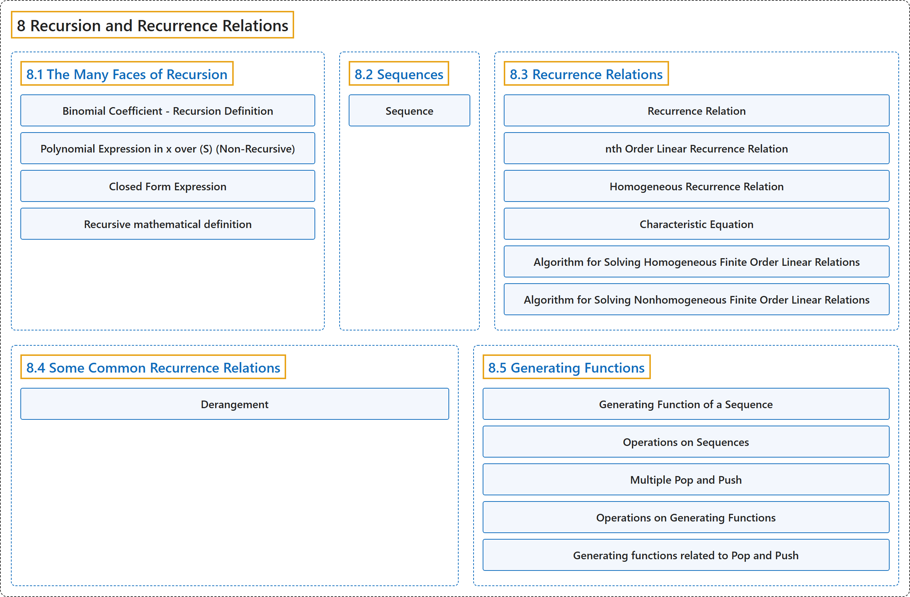

# 8 Recursion and Recurrence Relations

## Classification

## Glossary

| Term | Definition | 中文翻译 | Source |
|---|---|---|---|
| **8 Recursion and Recurrence Relations** 递归与递推关系 | (No definition) | （无定义） | [Doerr & Levasseur, n.d., chapter 8](https://discretemath.org/ads/chapter_8.html) |
| **[8.1 The Many Faces of Recursion](8-1-the-many-faces-of-recursion.md)** 递归的多种面貌 | (No definition) | （无定义） | [Doerr & Levasseur, n.d., section 8.1](https://discretemath.org/ads/s-faces-of-recursion.html) |
| **[8.2 Sequences](8-2-sequences.md)** 序列 | (No definition) | （无定义） | [Doerr & Levasseur, n.d., section 8.2](https://discretemath.org/ads/s-Sequences.html) |
| **[8.3 Recurrence Relations](8-3-recurrence-relations.md)** 递推关系 | (No definition) | （无定义） | [Doerr & Levasseur, n.d., section 8.3](https://discretemath.org/ads/s-recurrence-relations.html) |
| **[8.4 Some Common Recurrence Relations](8-4-some-common-recurrence-relations.md)** 一些常见的递推关系 | (No definition) | （无定义） | [Doerr & Levasseur, n.d., section 8.4](https://discretemath.org/ads/s-some-common-rrs.html) |
| **[8.5 Generating Functions](8-5-generating-functions.md)** 生成函数 | (No definition) | （无定义） | [Doerr & Levasseur, n.d., section 8.5](https://discretemath.org/ads/s-generating-functions.html) |

## References

Doerr, A., & Levasseur, K. (n.d.). *Applied discrete structures*. Retrieved October 28, 2026, from <https://discretemath.org/ads/index-ads.html>
