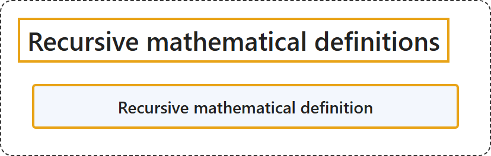

# 1.2 Recursive mathematical definitions

Tier: CS Core.

## Classification

## Glossary

| Term | Definition | 中文翻译 | Source |
|---|---|---|---|
| **Recursive mathematical definition** 递归数学定义 | (context) "A recursive process is one in which objects are **defined in terms of other objects of the same type**." | （语境）递归过程是这样一种过程：对象**用同类型的其他对象来定义**。 | [Weisstein, n.d., "Recursion" entry, para. 1](https://mathworld.wolfram.com/Recursion.html#:~:text=A%20recursive%20process%20is%20one%20in%20which%20objects%20are%20defined) |

## References

- Joint Task Force on Computing Curricula. (2024). *Computer science curricula 2023*. Association for Computing Machinery. <https://doi.org/10.1145/3664191>
- Weisstein, E. W. (n.d.). *Recursion*. MathWorld: A Wolfram Resource. Retrieved October 27, 2026, from <https://mathworld.wolfram.com/Recursion.html>
