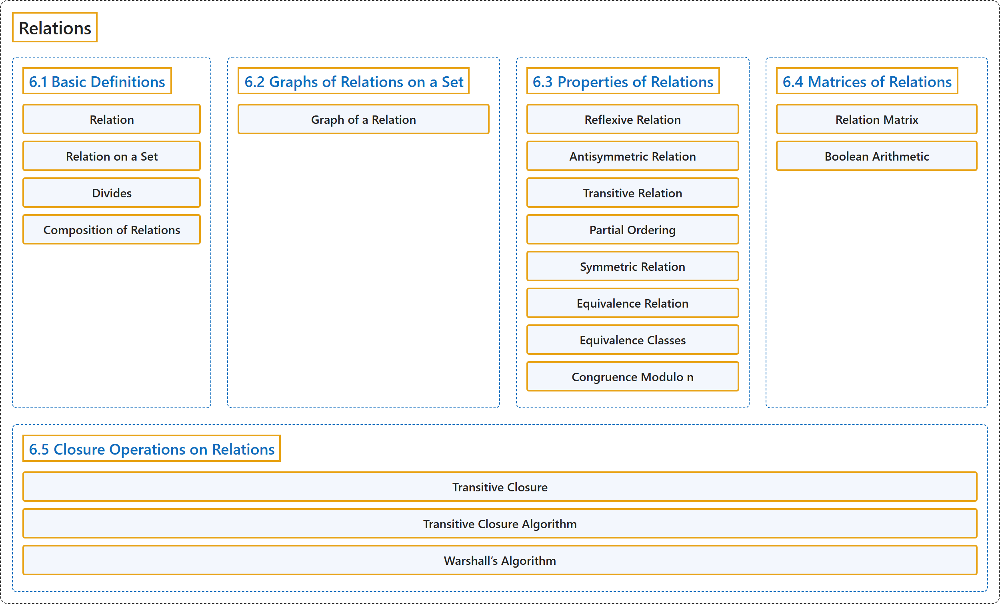

# 6 Relations

## Classification

## Glossary

| Term | Definition | 中文翻译 | Source |
|---|---|---|---|
| **6 Relations** 关系 | (No definition) | （无定义） | [Doerr & Levasseur, n.d., chapter 6](https://discretemath.org/ads/chapter_6.html) |
| **6.1 Basic Definitions** 基本定义 | (No definition) | （无定义） | [Doerr & Levasseur, n.d., section 6.1](https://discretemath.org/ads/s-basic-definitions.html) |
| **Relation** 关系 | "A relation is **any subset of a Cartesian product**." | 关系是**笛卡儿积的任意子集**。 | [Weisstein, n.d.-g, "Relation" entry, para. 1](https://mathworld.wolfram.com/Relation.html#:~:text=A%20relation%20is%20any%20subset%20of%20a%20Cartesian%20product) |
| **Relation on a Set** 集合上的关系 | "A **relation from a set $A$ into itself** is called a **relation on $A\text{.}$**" | 从集合 $A$ 到其自身的**关系**称为 **$A$ 上的关系**。 | [Doerr & Levasseur, n.d., Definition 6.1.4](https://discretemath.org/ads/s-basic-definitions.html#relation-on-a-set) |
| **Divides** 整除 | "Let $a, b \in \mathbb{Z}\text{,}$ $a \neq 0\text{.}$ We say that **$a$ divides $b\text{,}$** denoted $a \mid b\text{,}$ if and only if **there exists an integer $k$ such that $a k = b\text{.}$**" | 设 $a, b \in \mathbb{Z}$，$a \neq 0$。我们说 **$a$ 整除 $b$，**记作 $a \mid b$，当且仅当**存在整数 $k$ 使得 $a k = b$。** | [Doerr & Levasseur, n.d., Definition 6.1.5](https://discretemath.org/ads/s-basic-definitions.html#Divides) |
| **Composition of Relations** 关系的复合 | "Let $r$ be a relation from a set $A$ into a set $B\text{,}$ and let $s$ be a relation from $B$ into a set $C\text{.}$ The **composition of $r$ with $s\text{,}$** written $rs\text{,}$ is the **set of pairs of the form $(a, c) \in A\times C\text{,}$** where $(a, c) \in rs$ if and only if there exists $b \in B$ such that $(a, b) \in r$ and $(b, c) \in s\text{.}$" | 设 $r$ 是从集合 $A$ 到集合 $B$ 的关系，$s$ 是从 $B$ 到集合 $C$。 的关系。$r$ 与 $s$ 的**复合**记作 $rs$，是**形如 $(a, c) \in A\times C$， 的有序对的集合**，其中 $(a, c) \in rs$ 当且仅当存在 $b \in B$ 使得 $(a, b) \in r$ 且 $(b, c) \in s$。 | [Doerr & Levasseur, n.d., Definition 6.1.9](https://discretemath.org/ads/s-basic-definitions.html#def-composition-of-relations) |
| **6.2 Graphs of Relations on a Set** 集合上关系的图 | (No definition) | （无定义） | [Doerr & Levasseur, n.d., section 6.2](https://discretemath.org/ads/s-graphs-of-relations-on-a-set.html) |
| **Graph of a Relation** 关系的图 | (context) "In this section we introduce **directed graphs** as a way to **visualize relations on a set**." | （语境）在本节中，我们引入**有向图**，作为**将集合上的关系可视化**的一种方式。 | [Doerr & Levasseur, n.d., section 6.2](https://discretemath.org/ads/s-graphs-of-relations-on-a-set.html#s-graphs-of-relations-on-a-set-2-1) |
| **6.3 Properties of Relations** 关系的性质 | (No definition) | （无定义） | [Doerr & Levasseur, n.d., section 6.3](https://discretemath.org/ads/s-properties-of-relations.html) |
| **Reflexive Relation** 自反关系 | "Let $A$ be a set and let $r$ be a relation on $A\text{.}$ Then $r$ is **reflexive** if and only if **$a r a$ for all $a \in A\text{.}$**" | 设 $A$ 是集合，$r$ 是 $A$ 上的关系。则 $r$ 是**自反的**，当且仅当**对所有 $a \in A$。 有 $a r a$**。 | [Doerr & Levasseur, n.d., Definition 6.3.1](https://discretemath.org/ads/s-properties-of-relations.html#def-reflexive-relation) |
| **Antisymmetric Relation** 反对称关系 | "Let $A$ be a set and let $r$ be a relation on $A\text{.}$ Then $r$ is **antisymmetric** if and only if **whenever $a r b$ and $a \neq b$ then $b r a$ is false**." | 设 $A$ 是集合，$r$ 是 $A$ 上的关系。则 $r$ 是**反对称的**，当且仅当**每当 $a r b$ 且 $a \neq b$ 时，$b r a$ 为假**。 | [Doerr & Levasseur, n.d., Definition 6.3.2](https://discretemath.org/ads/s-properties-of-relations.html#def-antisymmetric-relation) |
| **Transitive Relation** 传递关系 | "Let $A$ be a set and let $r$ be a relation on $A\text{.}$ $r$ is **transitive** if and only if **whenever $a r b$ and $b r c$ then $a r c\text{.}$**" | 设 $A$ 是集合，$r$ 是 $A$ 上的关系。$r$ 是**传递的**，当且仅当**每当 $a r b$ 且 $b r c$ 时，有 $a r c$。** | [Doerr & Levasseur, n.d., Definition 6.3.3](https://discretemath.org/ads/s-properties-of-relations.html#def-transitive-relation) |
| **Partial Ordering** 偏序 | "A relation on a set $A$ that is **reflexive, antisymmetric, and transitive** is called a **partial ordering** on $A\text{.}$ A set on which there is a partial ordering relation defined is called a **partially ordered set or poset**." | 集合 $A$ 上**自反、反对称且传递**的关系称为 $A$ 上的**偏序**。定义了偏序关系的集合称为**偏序集**。 | [Doerr & Levasseur, n.d., Definition 6.3.4](https://discretemath.org/ads/s-properties-of-relations.html#partial-ordering) |
| **Symmetric Relation** 对称关系 | "Let $r$ be a relation on a set $A\text{.}$ $r$ is **symmetric** if and only if **whenever $a r b\text{,}$ it follows that $b r a\text{.}$**" | 设 $r$ 是集合 $A$。 上的关系。$r$ 是**对称的**，当且仅当**每当 $a r b$， 时，就有 $b r a$。** | [Doerr & Levasseur, n.d., Definition 6.3.10](https://discretemath.org/ads/s-properties-of-relations.html#def-symmetric-relation) |
| **Equivalence Relation** 等价关系 | "A relation $r$ on a set $A$ is called an **equivalence relation** if and only if it is **reflexive, symmetric, and transitive**." | 集合 $A$ 上的关系 $r$ 称为**等价关系**，当且仅当它是**自反、对称且传递的**。 | [Doerr & Levasseur, n.d., Definition 6.3.11](https://discretemath.org/ads/s-properties-of-relations.html#def-equivalence-relation) |
| **Equivalence Classes** 等价类 | "Let $r$ be an equivalence relation on $A\text{,}$ and $a \in A\text{.}$ The **equivalence class of $a$** is the **set, $[a]\text{,}$ of all elements to which $a$ is related**." | 设 $r$ 是 $A$， 上的等价关系，$a \in A$。$a$ 的**等价类**是**与 $a$ 有关系的所有元素构成的集合** $[a]$。 | [Doerr & Levasseur, n.d., Definition 6.3.13](https://discretemath.org/ads/s-properties-of-relations.html#def-equivalence-classes) |
| **Congruence Modulo n** 模 n 同余 | "Let $n$ be a positive integer, $n\geq 2\text{.}$ We define **congruence modulo n** to be the **relation $\equiv_n$ defined on the integers** by" | 设 $n$ 是正整数，$n\geq 2$。我们将**模 $n$ 同余**定义为整数上的**关系 $\equiv_n$**，其定义为 | [Doerr & Levasseur, n.d., Definition 6.3.15](https://discretemath.org/ads/s-properties-of-relations.html#def-congruence-mod-n) |
| **6.4 Matrices of Relations** 关系矩阵 | (No definition) | （无定义） | [Doerr & Levasseur, n.d., section 6.4](https://discretemath.org/ads/s-matrices-of-relations.html) |
| **Relation Matrix** 关系矩阵 | "Let $A = \{a_1,a_2,\ldots, a_m\}$ and $B= \{b_1,b_2,\ldots, b_n\}$ be finite sets of cardinality $m$ and $n\text{,}$ respectively. Let $r$ be a relation from $A$ into $B\text{.}$ Then $r$ can be **represented by the $m\times n$ matrix $R$** defined by" | 设 $A = \{a_1,a_2,\ldots, a_m\}$ 和 $B= \{b_1,b_2,\ldots, b_n\}$ 分别是基数为 $m$ 和 $n$， 的有限集。设 $r$ 是从 $A$ 到 $B$。 的关系。则 $r$ 可以用**如下定义的 $m\times n$ 矩阵 $R$ 表示** | [Doerr & Levasseur, n.d., Definition 6.4.1](https://discretemath.org/ads/s-matrices-of-relations.html#def-adjacency-matrix) |
| **Boolean Arithmetic** 布尔算术 | "**Boolean arithmetic** is the **arithmetic defined on $\{0,1\}$** using Boolean addition and Boolean multiplication, defined by" | **布尔算术**是在 **$\{0,1\}$ 上**使用布尔加法和布尔乘法定义的算术，其定义为 | [Doerr & Levasseur, n.d., Definition 6.4.4](https://discretemath.org/ads/s-matrices-of-relations.html#def-boolean-arithmetic) |
| **6.5 Closure Operations on Relations** 关系的闭包运算 | (No definition) | （无定义） | [Doerr & Levasseur, n.d., section 6.5](https://discretemath.org/ads/s-closure-operations-on-relations.html) |
| **Transitive Closure** 传递闭包 | "Let $A$ be a set and $r$ be a relation on $A\text{.}$ The **transitive closure of $r\text{,}$** denoted by $r^+\text{,}$ is the **smallest transitive relation that contains $r$ as a subset**." | 设 $A$ 是集合，$r$ 是 $A$ 上的关系。$r$ 的**传递闭包**记作 $r^+$，是**以 $r$ 为子集的最小传递关系**。 | [Doerr & Levasseur, n.d., Definition 6.5.1](https://discretemath.org/ads/s-closure-operations-on-relations.html#def-transitive-closure) |
| **Transitive Closure Algorithm** 传递闭包算法 | "Let $R$ be a relation matrix and let $R^+$ be its **transitive closure matrix**, which is to be computed as matrix $T$" | 设 $R$ 是关系矩阵，$R^+$ 是其**传递闭包矩阵**，将其计算为矩阵 $T$ | [Doerr & Levasseur, n.d., Algorithm 6.5.5](https://discretemath.org/ads/s-closure-operations-on-relations.html#alg-trans-closure) |
| **Warshall’s Algorithm** Warshall 算法 | "Let $R$ be an $n \times n$ relation matrix and let $R^+$ be its **transitive closure matrix**, which is to be computed as matrix $T$ using **Boolean arithmetic**" | 设 $R$ 是 $n \times n$ 关系矩阵，$R^+$ 是其**传递闭包矩阵**，使用**布尔算术**将其计算为矩阵 $T$ | [Doerr & Levasseur, n.d., Algorithm 6.5.7](https://discretemath.org/ads/s-closure-operations-on-relations.html#alg-warshall) |

## References

Doerr, A., & Levasseur, K. (n.d.). *Applied discrete structures*. Retrieved October 28, 2026, from <https://discretemath.org/ads/index-ads.html>

Weisstein, E. W. (n.d.-g). *Relation*. MathWorld: A Wolfram Resource. Retrieved October 27, 2026, from <https://mathworld.wolfram.com/Relation.html>
