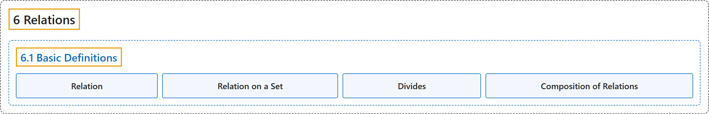

# 6.1 Basic Definitions

## Classification

## Glossary

| Term | Definition | 中文翻译 | Source |
|---|---|---|---|
| **6.1 Basic Definitions** 基本定义 | (No definition) | （无定义） | [Doerr & Levasseur, n.d., section 6.1](https://discretemath.org/ads/s-basic-definitions.html) |
| **Relation** 关系 | "A relation is **any subset of a Cartesian product**." | 关系是**笛卡儿积的任意子集**。 | [Weisstein, n.d.-g, "Relation" entry, para. 1](https://mathworld.wolfram.com/Relation.html#:~:text=A%20relation%20is%20any%20subset%20of%20a%20Cartesian%20product) |
| **Relation on a Set** 集合上的关系 | "A **relation from a set $A$ into itself** is called a **relation on $A\text{.}$**" | 从集合 $A$ 到其自身的**关系**称为 **$A$ 上的关系**。 | [Doerr & Levasseur, n.d., Definition 6.1.4](https://discretemath.org/ads/s-basic-definitions.html#relation-on-a-set) |
| **Divides** 整除 | "Let $a, b \in \mathbb{Z}\text{,}$ $a \neq 0\text{.}$ We say that **$a$ divides $b\text{,}$** denoted $a \mid b\text{,}$ if and only if **there exists an integer $k$ such that $a k = b\text{.}$**" | 设 $a, b \in \mathbb{Z}$，$a \neq 0$。我们说 **$a$ 整除 $b$，**记作 $a \mid b$，当且仅当**存在整数 $k$ 使得 $a k = b$。** | [Doerr & Levasseur, n.d., Definition 6.1.5](https://discretemath.org/ads/s-basic-definitions.html#Divides) |
| **Composition of Relations** 关系的复合 | "Let $r$ be a relation from a set $A$ into a set $B\text{,}$ and let $s$ be a relation from $B$ into a set $C\text{.}$ The **composition of $r$ with $s\text{,}$** written $rs\text{,}$ is the **set of pairs of the form $(a, c) \in A\times C\text{,}$** where $(a, c) \in rs$ if and only if there exists $b \in B$ such that $(a, b) \in r$ and $(b, c) \in s\text{.}$" | 设 $r$ 是从集合 $A$ 到集合 $B$ 的关系，$s$ 是从 $B$ 到集合 $C$。 的关系。$r$ 与 $s$ 的**复合**记作 $rs$，是**形如 $(a, c) \in A\times C$， 的有序对的集合**，其中 $(a, c) \in rs$ 当且仅当存在 $b \in B$ 使得 $(a, b) \in r$ 且 $(b, c) \in s$。 | [Doerr & Levasseur, n.d., Definition 6.1.9](https://discretemath.org/ads/s-basic-definitions.html#def-composition-of-relations) |

## References

Doerr, A., & Levasseur, K. (n.d.). *Applied discrete structures*. Retrieved October 28, 2026, from <https://discretemath.org/ads/index-ads.html>

Weisstein, E. W. (n.d.-g). *Relation*. MathWorld: A Wolfram Resource. Retrieved October 27, 2026, from <https://mathworld.wolfram.com/Relation.html>
