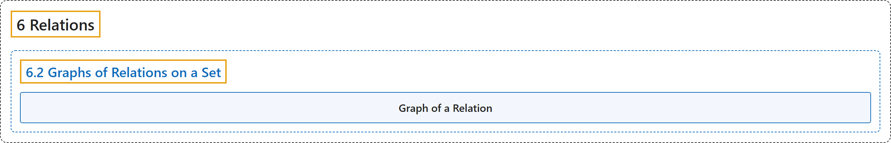

# 6.2 Graphs of Relations on a Set

## Classification

## Glossary

| Term | Definition | 中文翻译 | Source |
|---|---|---|---|
| **6.2 Graphs of Relations on a Set** 集合上关系的图 | (No definition) | （无定义） | [Doerr & Levasseur, n.d., section 6.2](https://discretemath.org/ads/s-graphs-of-relations-on-a-set.html) |
| **Graph of a Relation** 关系的图 | (context) "In this section we introduce **directed graphs** as a way to **visualize relations on a set**." | （语境）在本节中，我们引入**有向图**，作为**将集合上的关系可视化**的一种方式。 | [Doerr & Levasseur, n.d., section 6.2](https://discretemath.org/ads/s-graphs-of-relations-on-a-set.html#s-graphs-of-relations-on-a-set-2-1) |

## References

Doerr, A., & Levasseur, K. (n.d.). *Applied discrete structures*. Retrieved October 28, 2026, from <https://discretemath.org/ads/index-ads.html>
