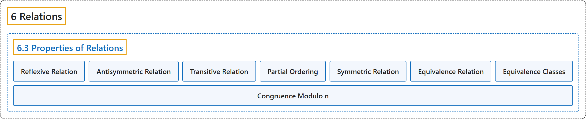

# 6.3 Properties of Relations

## Classification

## Glossary

| Term | Definition | 中文翻译 | Source |
|---|---|---|---|
| **6.3 Properties of Relations** 关系的性质 | (No definition) | （无定义） | [Doerr & Levasseur, n.d., section 6.3](https://discretemath.org/ads/s-properties-of-relations.html) |
| **Reflexive Relation** 自反关系 | "Let $A$ be a set and let $r$ be a relation on $A\text{.}$ Then $r$ is **reflexive** if and only if **$a r a$ for all $a \in A\text{.}$**" | 设 $A$ 是集合，$r$ 是 $A$ 上的关系。则 $r$ 是**自反的**，当且仅当**对所有 $a \in A$。 有 $a r a$**。 | [Doerr & Levasseur, n.d., Definition 6.3.1](https://discretemath.org/ads/s-properties-of-relations.html#def-reflexive-relation) |
| **Antisymmetric Relation** 反对称关系 | "Let $A$ be a set and let $r$ be a relation on $A\text{.}$ Then $r$ is **antisymmetric** if and only if **whenever $a r b$ and $a \neq b$ then $b r a$ is false**." | 设 $A$ 是集合，$r$ 是 $A$ 上的关系。则 $r$ 是**反对称的**，当且仅当**每当 $a r b$ 且 $a \neq b$ 时，$b r a$ 为假**。 | [Doerr & Levasseur, n.d., Definition 6.3.2](https://discretemath.org/ads/s-properties-of-relations.html#def-antisymmetric-relation) |
| **Transitive Relation** 传递关系 | "Let $A$ be a set and let $r$ be a relation on $A\text{.}$ $r$ is **transitive** if and only if **whenever $a r b$ and $b r c$ then $a r c\text{.}$**" | 设 $A$ 是集合，$r$ 是 $A$ 上的关系。$r$ 是**传递的**，当且仅当**每当 $a r b$ 且 $b r c$ 时，有 $a r c$。** | [Doerr & Levasseur, n.d., Definition 6.3.3](https://discretemath.org/ads/s-properties-of-relations.html#def-transitive-relation) |
| **Partial Ordering** 偏序 | "A relation on a set $A$ that is **reflexive, antisymmetric, and transitive** is called a **partial ordering** on $A\text{.}$ A set on which there is a partial ordering relation defined is called a **partially ordered set or poset**." | 集合 $A$ 上**自反、反对称且传递**的关系称为 $A$ 上的**偏序**。定义了偏序关系的集合称为**偏序集**。 | [Doerr & Levasseur, n.d., Definition 6.3.4](https://discretemath.org/ads/s-properties-of-relations.html#partial-ordering) |
| **Symmetric Relation** 对称关系 | "Let $r$ be a relation on a set $A\text{.}$ $r$ is **symmetric** if and only if **whenever $a r b\text{,}$ it follows that $b r a\text{.}$**" | 设 $r$ 是集合 $A$。 上的关系。$r$ 是**对称的**，当且仅当**每当 $a r b$， 时，就有 $b r a$。** | [Doerr & Levasseur, n.d., Definition 6.3.10](https://discretemath.org/ads/s-properties-of-relations.html#def-symmetric-relation) |
| **Equivalence Relation** 等价关系 | "A relation $r$ on a set $A$ is called an **equivalence relation** if and only if it is **reflexive, symmetric, and transitive**." | 集合 $A$ 上的关系 $r$ 称为**等价关系**，当且仅当它是**自反、对称且传递的**。 | [Doerr & Levasseur, n.d., Definition 6.3.11](https://discretemath.org/ads/s-properties-of-relations.html#def-equivalence-relation) |
| **Equivalence Classes** 等价类 | "Let $r$ be an equivalence relation on $A\text{,}$ and $a \in A\text{.}$ The **equivalence class of $a$** is the **set, $[a]\text{,}$ of all elements to which $a$ is related**." | 设 $r$ 是 $A$， 上的等价关系，$a \in A$。$a$ 的**等价类**是**与 $a$ 有关系的所有元素构成的集合** $[a]$。 | [Doerr & Levasseur, n.d., Definition 6.3.13](https://discretemath.org/ads/s-properties-of-relations.html#def-equivalence-classes) |
| **Congruence Modulo n** 模 n 同余 | "Let $n$ be a positive integer, $n\geq 2\text{.}$ We define **congruence modulo n** to be the **relation $\equiv_n$ defined on the integers** by" | 设 $n$ 是正整数，$n\geq 2$。我们将**模 $n$ 同余**定义为整数上的**关系 $\equiv_n$**，其定义为 | [Doerr & Levasseur, n.d., Definition 6.3.15](https://discretemath.org/ads/s-properties-of-relations.html#def-congruence-mod-n) |

## References

Doerr, A., & Levasseur, K. (n.d.). *Applied discrete structures*. Retrieved October 28, 2026, from <https://discretemath.org/ads/index-ads.html>
