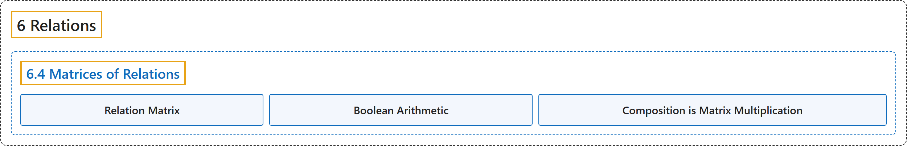

# 6.4 Matrices of Relations

## Classification

## Glossary

| Term | Definition | 中文翻译 | Source |
|---|---|---|---|
| **6.4 Matrices of Relations** 关系矩阵 | (No definition) | （无定义） | [Doerr & Levasseur, n.d., section 6.4](https://discretemath.org/ads/s-matrices-of-relations.html) |
| **Relation Matrix** 关系矩阵 | "Let $A = \{a_1,a_2,\ldots, a_m\}$ and $B= \{b_1,b_2,\ldots, b_n\}$ be finite sets of cardinality $m$ and $n\text{,}$ respectively. Let $r$ be a relation from $A$ into $B\text{.}$ Then $r$ can be **represented by the $m\times n$ matrix $R$** defined by" | 设 $A = \{a_1,a_2,\ldots, a_m\}$ 和 $B= \{b_1,b_2,\ldots, b_n\}$ 分别是基数为 $m$ 和 $n$， 的有限集。设 $r$ 是从 $A$ 到 $B$。 的关系。则 $r$ 可以用**如下定义的 $m\times n$ 矩阵 $R$ 表示** | [Doerr & Levasseur, n.d., Definition 6.4.1](https://discretemath.org/ads/s-matrices-of-relations.html#def-adjacency-matrix) |
| **Boolean Arithmetic** 布尔算术 | "**Boolean arithmetic** is the **arithmetic defined on $\{0,1\}$** using Boolean addition and Boolean multiplication, defined by" | **布尔算术**是在 **$\{0,1\}$ 上**使用布尔加法和布尔乘法定义的算术，其定义为 | [Doerr & Levasseur, n.d., Definition 6.4.4](https://discretemath.org/ads/s-matrices-of-relations.html#def-boolean-arithmetic) |
| **Composition is Matrix Multiplication** 复合即矩阵乘法 | "Let $A_1$, $A_2$, and $A_3$ be finite sets where $r_1$ is a relation from $A_1$ into $A_2$ and $r_2$ is a relation from $A_2$ into $A_3$. If $R_1$ and $R_2$ are the adjacency matrices of $r_1$ and $r_2$, respectively, then the product $R_1R_2$ using Boolean arithmetic **is the relation matrix of the composition $r_1r_2$**." | 设 $A_1$、$A_2$ 和 $A_3$ 为有限集，$r_1$ 是从 $A_1$ 到 $A_2$ 的关系，$r_2$ 是从 $A_2$ 到 $A_3$ 的关系。若 $R_1$ 和 $R_2$ 分别是 $r_1$ 和 $r_2$ 的邻接矩阵，则用布尔运算得到的乘积 $R_1R_2$ **是复合关系 $r_1r_2$ 的关系矩阵**。 | [Doerr & Levasseur, n.d., Theorem 6.4.7](https://discretemath.org/ads/s-matrices-of-relations.html#theorem-composition-is-multiplication) |

## References

Doerr, A., & Levasseur, K. (n.d.). *Applied discrete structures*. Retrieved October 28, 2026, from <https://discretemath.org/ads/index-ads.html>
