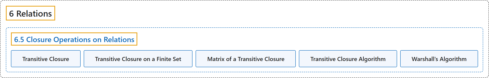

# 6.5 Closure Operations on Relations

## Classification

## Glossary

| Term | Definition | 中文翻译 | Source |
|---|---|---|---|
| **6.5 Closure Operations on Relations** 关系的闭包运算 | (No definition) | （无定义） | [Doerr & Levasseur, n.d., section 6.5](https://discretemath.org/ads/s-closure-operations-on-relations.html) |
| **Transitive Closure** 传递闭包 | "Let $A$ be a set and $r$ be a relation on $A\text{.}$ The **transitive closure of $r\text{,}$** denoted by $r^+\text{,}$ is the **smallest transitive relation that contains $r$ as a subset**." | 设 $A$ 是集合，$r$ 是 $A$ 上的关系。$r$ 的**传递闭包**记作 $r^+$，是**以 $r$ 为子集的最小传递关系**。 | [Doerr & Levasseur, n.d., Definition 6.5.1](https://discretemath.org/ads/s-closure-operations-on-relations.html#def-transitive-closure) |
| **Transitive Closure on a Finite Set** 有限集上的传递闭包 | "If $r$ is a relation on a set $A$ and $\lvert A \rvert = n$, then the transitive closure of $r$ **is the union of the first $n$ powers of r**. That is, $r^+ = r \cup r^2 \cup r ^3 \cup \cdots \cup r^n$." | 若 $r$ 是集合 $A$ 上的关系且 $\lvert A \rvert = n$，则 $r$ 的传递闭包**是 $r$ 的前 $n$ 个幂的并**。即 $r^+ = r \cup r^2 \cup r ^3 \cup \cdots \cup r^n$。 | [Doerr & Levasseur, n.d., Theorem 6.5.2](https://discretemath.org/ads/s-closure-operations-on-relations.html#theorem-transitive-closure-formula) |
| **Matrix of a Transitive Closure** 传递闭包的矩阵 | "Let $r$ be a relation on a finite set and $R$ its matrix. Let $R^+$ be the matrix of $r^+$, the transitive closure of $r$. Then **$R^+ = R + R^2 + \cdots + R^n$**, using Boolean arithmetic." | 设 $r$ 是有限集上的关系，$R$ 为其矩阵。设 $R^+$ 是 $r^+$（即 $r$ 的传递闭包）的矩阵。则用布尔运算，**$R^+ = R + R^2 + \cdots + R^n$**。 | [Doerr & Levasseur, n.d., Theorem 6.5.4](https://discretemath.org/ads/s-closure-operations-on-relations.html#theorem-matrix-transitive-closure) |
| **Transitive Closure Algorithm** 传递闭包算法 | "Let $R$ be a relation matrix and let $R^+$ be its **transitive closure matrix**, which is to be computed as matrix $T$" | 设 $R$ 是关系矩阵，$R^+$ 是其**传递闭包矩阵**，将其计算为矩阵 $T$ | [Doerr & Levasseur, n.d., Algorithm 6.5.5](https://discretemath.org/ads/s-closure-operations-on-relations.html#alg-trans-closure) |
| **Warshall’s Algorithm** Warshall 算法 | "Let $R$ be an $n \times n$ relation matrix and let $R^+$ be its **transitive closure matrix**, which is to be computed as matrix $T$ using **Boolean arithmetic**" | 设 $R$ 是 $n \times n$ 关系矩阵，$R^+$ 是其**传递闭包矩阵**，使用**布尔算术**将其计算为矩阵 $T$ | [Doerr & Levasseur, n.d., Algorithm 6.5.7](https://discretemath.org/ads/s-closure-operations-on-relations.html#alg-warshall) |

## References

Doerr, A., & Levasseur, K. (n.d.). *Applied discrete structures*. Retrieved October 28, 2026, from <https://discretemath.org/ads/index-ads.html>
