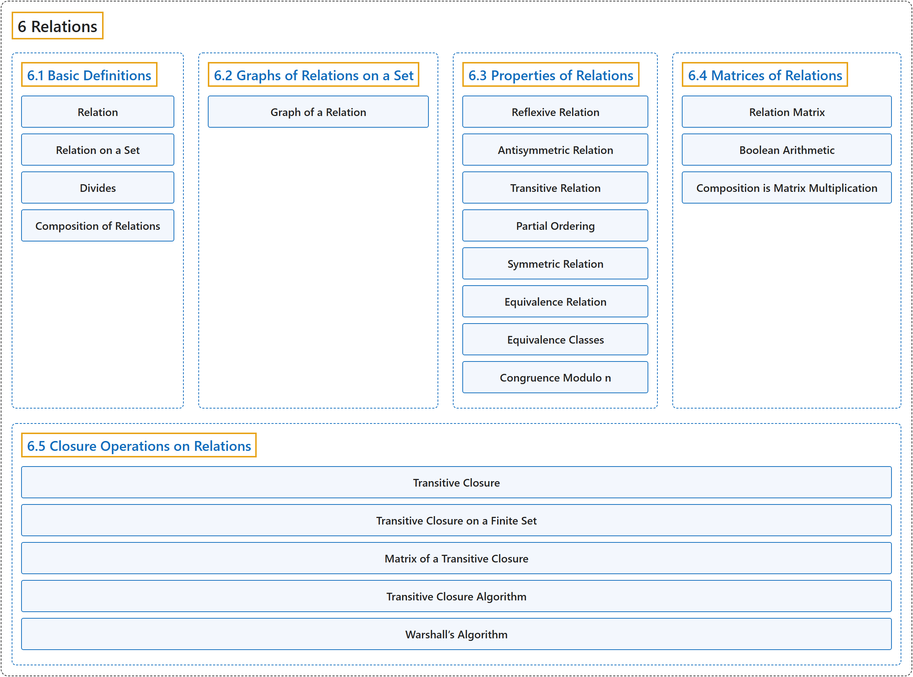

# 6 Relations

## Classification

## Glossary

| Term | Definition | 中文翻译 | Source |
|---|---|---|---|
| **6 Relations** 关系 | (No definition) | （无定义） | [Doerr & Levasseur, n.d., chapter 6](https://discretemath.org/ads/chapter_6.html) |
| **[6.1 Basic Definitions](6-1-basic-definitions.md)** 基本定义 | (No definition) | （无定义） | [Doerr & Levasseur, n.d., section 6.1](https://discretemath.org/ads/s-basic-definitions.html) |
| **[6.2 Graphs of Relations on a Set](6-2-graphs-of-relations-on-a-set.md)** 集合上关系的图 | (No definition) | （无定义） | [Doerr & Levasseur, n.d., section 6.2](https://discretemath.org/ads/s-graphs-of-relations-on-a-set.html) |
| **[6.3 Properties of Relations](6-3-properties-of-relations.md)** 关系的性质 | (No definition) | （无定义） | [Doerr & Levasseur, n.d., section 6.3](https://discretemath.org/ads/s-properties-of-relations.html) |
| **[6.4 Matrices of Relations](6-4-matrices-of-relations.md)** 关系矩阵 | (No definition) | （无定义） | [Doerr & Levasseur, n.d., section 6.4](https://discretemath.org/ads/s-matrices-of-relations.html) |
| **[6.5 Closure Operations on Relations](6-5-closure-operations-on-relations.md)** 关系的闭包运算 | (No definition) | （无定义） | [Doerr & Levasseur, n.d., section 6.5](https://discretemath.org/ads/s-closure-operations-on-relations.html) |

## References

Doerr, A., & Levasseur, K. (n.d.). *Applied discrete structures*. Retrieved October 28, 2026, from <https://discretemath.org/ads/index-ads.html>
