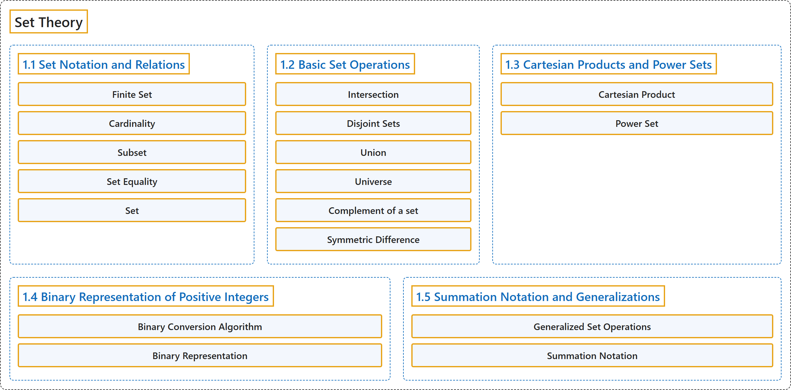

# 1 Set Theory

## Classification

## Glossary

| Term | Definition | 中文翻译 | Source |
|---|---|---|---|
| **1 Set Theory** 集合论 | (No definition) | （无定义） | [Doerr & Levasseur, n.d., chapter 1](https://discretemath.org/ads/chapter_1.html) |
| **1.1 Set Notation and Relations** 集合记号与关系 | (No definition) | （无定义） | [Doerr & Levasseur, n.d., section 1.1](https://discretemath.org/ads/s-set-Notation-and-Relations.html) |
| **Finite Set** 有限集 | "A finite set is a set X **whose elements can be numbered through from 1 to n**, for **some positive integer n**." | 有限集是这样一个集合 X：**它的元素可以从 1 编号到 n**，其中 n 是**某个正整数**。 | [Weisstein, n.d.-c, "Finite set" entry, para. 1](https://mathworld.wolfram.com/FiniteSet.html#:~:text=A%20finite%20set%20is%20a%20set) |
| **Cardinality** 基数 | "Let $A$ be a finite set. The **number of different elements in $A$** is called its **cardinality**. The cardinality of a finite set $A$ is denoted $\lvert A \rvert\text{.}$" | 设 $A$ 是有限集。$A$ 中**不同元素的个数**称为它的**基数**。有限集 $A$ 的基数记作 $\lvert A \rvert$。 | [Doerr & Levasseur, n.d., Definition 1.1.2](https://discretemath.org/ads/s-set-Notation-and-Relations.html#cardinality) |
| **Subset** 子集 | "Let $A$ and $B$ be sets. We say that **$A$ is a subset of $B$ if and only if every element of $A$ is an element of $B\text{.}$** We write $A \subseteq B$ to denote the fact that $A$ is a subset of $B\text{.}$" | 设 $A$ 和 $B$ 是集合。我们说 **$A$ 是 $B$ 的子集，当且仅当 $A$ 的每个元素都是 $B$ 的元素**。我们记 $A \subseteq B$ 来表示 $A$ 是 $B$ 的子集这一事实。 | [Doerr & Levasseur, n.d., Definition 1.1.3](https://discretemath.org/ads/s-set-Notation-and-Relations.html#def-subset) |
| **Set Equality** 集合相等 | "Let $A$ and $B$ be sets. We say that $A$ is equal to $B$ (notation $A = B$) if and only if **every element of $A$ is an element of $B$ and conversely every element of $B$ is an element of $A\text{;}$** that is, **$A \subseteq B$ and $B \subseteq A\text{.}$**" | 设 $A$ 和 $B$ 是集合。我们说 $A$ 等于 $B$（记作 $A = B$），当且仅当 **$A$ 的每个元素都是 $B$ 的元素，反过来 $B$ 的每个元素也都是 $A$ 的元素**；即 **$A \subseteq B$ 且 $B \subseteq A$。** | [Doerr & Levasseur, n.d., Definition 1.1.5](https://discretemath.org/ads/s-set-Notation-and-Relations.html#set-equality) |
| **Set** 集合 | "A set is a finite or infinite **collection of objects** in which **order has no significance**, and multiplicity is generally also ignored (unlike a list or multiset)." | 集合是有限或无限的**对象的汇集**，其中**顺序没有意义**，重复次数通常也被忽略（不同于列表或多重集）。 | [Weisstein, n.d.-h, "Set" entry, para. 1](https://mathworld.wolfram.com/Set.html#:~:text=A%20set%20is%20a%20finite%20or%20infinite%20collection%20of%20objects) |
| **1.2 Basic Set Operations** 集合的基本运算 | (No definition) | （无定义） | [Doerr & Levasseur, n.d., section 1.2](https://discretemath.org/ads/s-basic_Set_Operations.html) |
| **Intersection** 交集 | "Let $A$ and $B$ be sets. The **intersection** of $A$ and $B$ (denoted by $A \cap B$) is the **set of all elements that are in both $A$ and $B\text{.}$** That is, $A \cap B = \{x:x \in A \textrm{ and } x \in B\}\text{.}$" | 设 $A$ 和 $B$ 是集合。$A$ 与 $B$ 的**交集**（记作 $A \cap B$）是**同时属于 $A$ 和 $B$ 的所有元素构成的集合**。即 $A \cap B = \{x:x \in A \textrm{ and } x \in B\}$。 | [Doerr & Levasseur, n.d., Definition 1.2.1](https://discretemath.org/ads/s-basic_Set_Operations.html#def-intersection) |
| **Disjoint Sets** 不相交集 | "Two sets are **disjoint** if they have **no elements in common**. That is, $A$ and $B$ are disjoint if $A \cap B = \emptyset\text{.}$" | 两个集合若**没有公共元素**，则称它们**不相交**。即，若 $A \cap B = \emptyset$，则 $A$ 和 $B$ 不相交。 | [Doerr & Levasseur, n.d., Definition 1.2.3](https://discretemath.org/ads/s-basic_Set_Operations.html#def-disjoint-sets) |
| **Union** 并集 | "Let $A$ and $B$ be sets. The **union** of $A$ and $B$ (denoted by $A \cup B$) is the **set of all elements that are in $A$ or in $B$ or in both A and B**. That is, $A\cup B= \{x:x \in A\textrm{ or } x\in B\}\text{.}$" | 设 $A$ 和 $B$ 是集合。$A$ 与 $B$ 的**并集**（记作 $A \cup B$）是**属于 $A$ 或属于 $B$ 或同时属于 $A$ 和 $B$ 的所有元素构成的集合**。即 $A\cup B= \{x:x \in A\textrm{ or } x\in B\}$。 | [Doerr & Levasseur, n.d., Definition 1.2.4](https://discretemath.org/ads/s-basic_Set_Operations.html#def-union) |
| **Universe** 全集 | "The **universe**, or **universal set**, is the **set of all elements under discussion for possible membership in a set**. We normally reserve the letter $U$ for a universe in general discussions." | **全集**，或称**论域**，是**为了判断某集合可能包含哪些元素而讨论的所有元素构成的集合**。在一般讨论中，我们通常用字母 $U$ 表示全集。 | [Doerr & Levasseur, n.d., Definition 1.2.6](https://discretemath.org/ads/s-basic_Set_Operations.html#universe) |
| **Complement of a set** 集合的补集 | "Let $A$ and $B$ be sets. The **complement of $A$ relative to $B$** (notation $B - A$) is the **set of elements that are in $B$ and not in $A\text{.}$** That is, $B-A=\{x: x\in B \textrm{ and } x\notin A\}\text{.}$ If $U$ is the universal set, then $U-A$ is denoted by $A^c$ and is called simply the **complement of $A\text{.}$** $A^c=\{x\in U: x\notin A\}\text{.}$" | 设 $A$ 和 $B$ 是集合。$A$ 相对于 $B$ 的**补集**（记作 $B - A$）是**属于 $B$ 但不属于 $A$ 的元素构成的集合**。即 $B-A=\{x: x\in B \textrm{ and } x\notin A\}$。若 $U$ 是全集，则 $U-A$ 记作 $A^c$，简称为 $A$ 的**补集**。$A^c=\{x\in U: x\notin A\}$。 | [Doerr & Levasseur, n.d., Definition 1.2.10](https://discretemath.org/ads/s-basic_Set_Operations.html#set_complement) |
| **Symmetric Difference** 对称差 | "Let $A$ and $B$ be sets. The **symmetric difference** of $A$ and $B$ (denoted by $A\oplus B$) is the **set of all elements that are in $A$ and $B$ but not in both**. That is, $A \oplus B = (A \cup B) - (A \cap B)\text{.}$" | 设 $A$ 和 $B$ 是集合。$A$ 与 $B$ 的**对称差**（记作 $A\oplus B$）是**属于 $A$ 或 $B$ 但不同时属于两者的所有元素构成的集合**。即 $A \oplus B = (A \cup B) - (A \cap B)$。 | [Doerr & Levasseur, n.d., Definition 1.2.15](https://discretemath.org/ads/s-basic_Set_Operations.html#symmetric-difference) |
| **1.3 Cartesian Products and Power Sets** 笛卡儿积与幂集 | (No definition) | （无定义） | [Doerr & Levasseur, n.d., section 1.3](https://discretemath.org/ads/s-cartesian_Products_and_Power_Sets.html) |
| **Cartesian Product** 笛卡儿积 | "Let $A$ and $B$ be sets. The **Cartesian product** of $A$ and $B\text{,}$ denoted by $A\times B\text{,}$ is defined as follows: $A\times B = \{(a, b) \mid a \in A \quad\textrm{and}\quad b \in B\}\text{,}$ that is, $A\times B$ is the **set of all possible ordered pairs** whose first component comes from $A$ and whose second component comes from $B\text{.}$" | 设 $A$ 和 $B$ 是集合。$A$ 与 $B$ 的**笛卡尔积**记作 $A\times B$，定义如下：$A\times B = \{(a, b) \mid a \in A \quad\textrm{and}\quad b \in B\}$，即 $A\times B$ 是**所有可能的有序对构成的集合**，其第一个分量取自 $A$，第二个分量取自 $B$。 | [Doerr & Levasseur, n.d., Definition 1.3.1](https://discretemath.org/ads/s-cartesian_Products_and_Power_Sets.html#cartesian-product) |
| **Power Set** 幂集 | "If $A$ is any set, the **power set** of $A$ is the **set of all subsets of $A\text{,}$** denoted $\mathcal{P}(A)\text{.}$" | 若 $A$ 是任意集合，则 $A$ 的**幂集**是 **$A$ 的所有子集构成的集合**，记作 $\mathcal{P}(A)$。 | [Doerr & Levasseur, n.d., Definition 1.3.3](https://discretemath.org/ads/s-cartesian_Products_and_Power_Sets.html#power-set) |
| **1.4 Binary Representation of Positive Integers** 正整数的二进制表示 | (No definition) | （无定义） | [Doerr & Levasseur, n.d., section 1.4](https://discretemath.org/ads/s-binary_Representation_of_Positive_Integers.html) |
| **Binary Conversion Algorithm** 二进制转换算法 | "An **algorithm for determining the binary representation of a positive integer**." | 一种**确定正整数的二进制表示的算法**。 | [Doerr & Levasseur, n.d., Algorithm 1.4.2](https://discretemath.org/ads/s-binary_Representation_of_Positive_Integers.html#binary-conversion-algorithm) |
| **Binary Representation** 二进制表示 | (context) "The binary number system differs from the decimal number system in that units are **grouped by twos, fours, eights, etc.** That is, the group sizes are **powers of two** instead of powers of ten." | （语境）二进制数系与十进制数系的不同之处在于，单位是按**二、四、八等分组**的。也就是说，分组大小是**二的幂**而不是十的幂。 | [Doerr & Levasseur, n.d., section 1.4](https://discretemath.org/ads/s-binary_Representation_of_Positive_Integers.html#ss-grouping-by-twos-4) |
| **1.5 Summation Notation and Generalizations** 求和记号及其推广 | (No definition) | （无定义） | [Doerr & Levasseur, n.d., section 1.5](https://discretemath.org/ads/s-summation_Notation_and_Generalizations.html) |
| **Generalized Set Operations** 广义集合运算 | "**Let $A_1, A_2, \ldots, A_n$ be sets**. Then:" | 设 $A_1, A_2, \ldots, A_n$ 是**集合**。则： | [Doerr & Levasseur, n.d., Definition 1.5.3](https://discretemath.org/ads/s-summation_Notation_and_Generalizations.html#generalized-set-operations) |
| **Summation Notation** 求和记号 | "A sum of numbers such as $a_1+a_2+a_3+a_4$ is called a **series** and is often written $\sum_{k=1}^4 a_k$ in what is called **summation notation**." | 形如 $a_1+a_2+a_3+a_4$ 的若干数之和称为**级数**，常写作 $\sum_{k=1}^4 a_k$，这种写法称为**求和记号**。 | [Doerr & Levasseur, n.d., section 1.5](https://discretemath.org/ads/s-summation_Notation_and_Generalizations.html#ss-sums-2) |

## References

Doerr, A., & Levasseur, K. (n.d.). *Applied discrete structures*. Retrieved October 28, 2026, from <https://discretemath.org/ads/index-ads.html>

Weisstein, E. W. (n.d.-c). *Finite set*. MathWorld: A Wolfram Resource. Retrieved October 27, 2026, from <https://mathworld.wolfram.com/FiniteSet.html>

Weisstein, E. W. (n.d.-h). *Set*. MathWorld: A Wolfram Resource. Retrieved October 27, 2026, from <https://mathworld.wolfram.com/Set.html>
