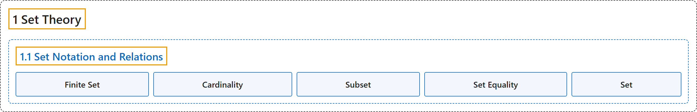

# 1.1 Set Notation and Relations

## Classification

## Glossary

| Term | Definition | 中文翻译 | Source |
|---|---|---|---|
| **1.1 Set Notation and Relations** 集合记号与关系 | (No definition) | （无定义） | [Doerr & Levasseur, n.d., section 1.1](https://discretemath.org/ads/s-set-Notation-and-Relations.html) |
| **Finite Set** 有限集 | "A finite set is a set X **whose elements can be numbered through from 1 to n**, for **some positive integer n**." | 有限集是这样一个集合 X：**它的元素可以从 1 编号到 n**，其中 n 是**某个正整数**。 | [Weisstein, n.d.-c, "Finite set" entry, para. 1](https://mathworld.wolfram.com/FiniteSet.html#:~:text=A%20finite%20set%20is%20a%20set) |
| **Cardinality** 基数 | "Let $A$ be a finite set. The **number of different elements in $A$** is called its **cardinality**. The cardinality of a finite set $A$ is denoted $\lvert A \rvert\text{.}$" | 设 $A$ 是有限集。$A$ 中**不同元素的个数**称为它的**基数**。有限集 $A$ 的基数记作 $\lvert A \rvert$。 | [Doerr & Levasseur, n.d., Definition 1.1.2](https://discretemath.org/ads/s-set-Notation-and-Relations.html#cardinality) |
| **Subset** 子集 | "Let $A$ and $B$ be sets. We say that **$A$ is a subset of $B$ if and only if every element of $A$ is an element of $B\text{.}$** We write $A \subseteq B$ to denote the fact that $A$ is a subset of $B\text{.}$" | 设 $A$ 和 $B$ 是集合。我们说 **$A$ 是 $B$ 的子集，当且仅当 $A$ 的每个元素都是 $B$ 的元素**。我们记 $A \subseteq B$ 来表示 $A$ 是 $B$ 的子集这一事实。 | [Doerr & Levasseur, n.d., Definition 1.1.3](https://discretemath.org/ads/s-set-Notation-and-Relations.html#def-subset) |
| **Set Equality** 集合相等 | "Let $A$ and $B$ be sets. We say that $A$ is equal to $B$ (notation $A = B$) if and only if **every element of $A$ is an element of $B$ and conversely every element of $B$ is an element of $A\text{;}$** that is, **$A \subseteq B$ and $B \subseteq A\text{.}$**" | 设 $A$ 和 $B$ 是集合。我们说 $A$ 等于 $B$（记作 $A = B$），当且仅当 **$A$ 的每个元素都是 $B$ 的元素，反过来 $B$ 的每个元素也都是 $A$ 的元素**；即 **$A \subseteq B$ 且 $B \subseteq A$。** | [Doerr & Levasseur, n.d., Definition 1.1.5](https://discretemath.org/ads/s-set-Notation-and-Relations.html#set-equality) |
| **Set** 集合 | "A set is a finite or infinite **collection of objects** in which **order has no significance**, and multiplicity is generally also ignored (unlike a list or multiset)." | 集合是有限或无限的**对象的汇集**，其中**顺序没有意义**，重复次数通常也被忽略（不同于列表或多重集）。 | [Weisstein, n.d.-h, "Set" entry, para. 1](https://mathworld.wolfram.com/Set.html#:~:text=A%20set%20is%20a%20finite%20or%20infinite%20collection%20of%20objects) |

## References

Doerr, A., & Levasseur, K. (n.d.). *Applied discrete structures*. Retrieved October 28, 2026, from <https://discretemath.org/ads/index-ads.html>

Weisstein, E. W. (n.d.-c). *Finite set*. MathWorld: A Wolfram Resource. Retrieved October 27, 2026, from <https://mathworld.wolfram.com/FiniteSet.html>

Weisstein, E. W. (n.d.-h). *Set*. MathWorld: A Wolfram Resource. Retrieved October 27, 2026, from <https://mathworld.wolfram.com/Set.html>
