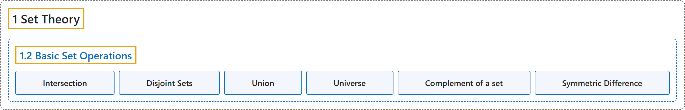

# 1.2 Basic Set Operations

## Classification

## Glossary

| Term | Definition | 中文翻译 | Source |
|---|---|---|---|
| **1.2 Basic Set Operations** 集合的基本运算 | (No definition) | （无定义） | [Doerr & Levasseur, n.d., section 1.2](https://discretemath.org/ads/s-basic_Set_Operations.html) |
| **Intersection** 交集 | "Let $A$ and $B$ be sets. The **intersection** of $A$ and $B$ (denoted by $A \cap B$) is the **set of all elements that are in both $A$ and $B\text{.}$** That is, $A \cap B = \{x:x \in A \textrm{ and } x \in B\}\text{.}$" | 设 $A$ 和 $B$ 是集合。$A$ 与 $B$ 的**交集**（记作 $A \cap B$）是**同时属于 $A$ 和 $B$ 的所有元素构成的集合**。即 $A \cap B = \{x:x \in A \textrm{ and } x \in B\}$。 | [Doerr & Levasseur, n.d., Definition 1.2.1](https://discretemath.org/ads/s-basic_Set_Operations.html#def-intersection) |
| **Disjoint Sets** 不相交集 | "Two sets are **disjoint** if they have **no elements in common**. That is, $A$ and $B$ are disjoint if $A \cap B = \emptyset\text{.}$" | 两个集合若**没有公共元素**，则称它们**不相交**。即，若 $A \cap B = \emptyset$，则 $A$ 和 $B$ 不相交。 | [Doerr & Levasseur, n.d., Definition 1.2.3](https://discretemath.org/ads/s-basic_Set_Operations.html#def-disjoint-sets) |
| **Union** 并集 | "Let $A$ and $B$ be sets. The **union** of $A$ and $B$ (denoted by $A \cup B$) is the **set of all elements that are in $A$ or in $B$ or in both A and B**. That is, $A\cup B= \{x:x \in A\textrm{ or } x\in B\}\text{.}$" | 设 $A$ 和 $B$ 是集合。$A$ 与 $B$ 的**并集**（记作 $A \cup B$）是**属于 $A$ 或属于 $B$ 或同时属于 $A$ 和 $B$ 的所有元素构成的集合**。即 $A\cup B= \{x:x \in A\textrm{ or } x\in B\}$。 | [Doerr & Levasseur, n.d., Definition 1.2.4](https://discretemath.org/ads/s-basic_Set_Operations.html#def-union) |
| **Universe** 全集 | "The **universe**, or **universal set**, is the **set of all elements under discussion for possible membership in a set**. We normally reserve the letter $U$ for a universe in general discussions." | **全集**，或称**论域**，是**为了判断某集合可能包含哪些元素而讨论的所有元素构成的集合**。在一般讨论中，我们通常用字母 $U$ 表示全集。 | [Doerr & Levasseur, n.d., Definition 1.2.6](https://discretemath.org/ads/s-basic_Set_Operations.html#universe) |
| **Complement of a set** 集合的补集 | "Let $A$ and $B$ be sets. The **complement of $A$ relative to $B$** (notation $B - A$) is the **set of elements that are in $B$ and not in $A\text{.}$** That is, $B-A=\{x: x\in B \textrm{ and } x\notin A\}\text{.}$ If $U$ is the universal set, then $U-A$ is denoted by $A^c$ and is called simply the **complement of $A\text{.}$** $A^c=\{x\in U: x\notin A\}\text{.}$" | 设 $A$ 和 $B$ 是集合。$A$ 相对于 $B$ 的**补集**（记作 $B - A$）是**属于 $B$ 但不属于 $A$ 的元素构成的集合**。即 $B-A=\{x: x\in B \textrm{ and } x\notin A\}$。若 $U$ 是全集，则 $U-A$ 记作 $A^c$，简称为 $A$ 的**补集**。$A^c=\{x\in U: x\notin A\}$。 | [Doerr & Levasseur, n.d., Definition 1.2.10](https://discretemath.org/ads/s-basic_Set_Operations.html#set_complement) |
| **Symmetric Difference** 对称差 | "Let $A$ and $B$ be sets. The **symmetric difference** of $A$ and $B$ (denoted by $A\oplus B$) is the **set of all elements that are in $A$ and $B$ but not in both**. That is, $A \oplus B = (A \cup B) - (A \cap B)\text{.}$" | 设 $A$ 和 $B$ 是集合。$A$ 与 $B$ 的**对称差**（记作 $A\oplus B$）是**属于 $A$ 或 $B$ 但不同时属于两者的所有元素构成的集合**。即 $A \oplus B = (A \cup B) - (A \cap B)$。 | [Doerr & Levasseur, n.d., Definition 1.2.15](https://discretemath.org/ads/s-basic_Set_Operations.html#symmetric-difference) |

## References

Doerr, A., & Levasseur, K. (n.d.). *Applied discrete structures*. Retrieved October 28, 2026, from <https://discretemath.org/ads/index-ads.html>
