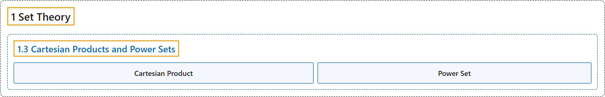

# 1.3 Cartesian Products and Power Sets

## Classification

## Glossary

| Term | Definition | 中文翻译 | Source |
|---|---|---|---|
| **1.3 Cartesian Products and Power Sets** 笛卡儿积与幂集 | (No definition) | （无定义） | [Doerr & Levasseur, n.d., section 1.3](https://discretemath.org/ads/s-cartesian_Products_and_Power_Sets.html) |
| **Cartesian Product** 笛卡儿积 | "Let $A$ and $B$ be sets. The **Cartesian product** of $A$ and $B\text{,}$ denoted by $A\times B\text{,}$ is defined as follows: $A\times B = \{(a, b) \mid a \in A \quad\textrm{and}\quad b \in B\}\text{,}$ that is, $A\times B$ is the **set of all possible ordered pairs** whose first component comes from $A$ and whose second component comes from $B\text{.}$" | 设 $A$ 和 $B$ 是集合。$A$ 与 $B$ 的**笛卡尔积**记作 $A\times B$，定义如下：$A\times B = \{(a, b) \mid a \in A \quad\textrm{and}\quad b \in B\}$，即 $A\times B$ 是**所有可能的有序对构成的集合**，其第一个分量取自 $A$，第二个分量取自 $B$。 | [Doerr & Levasseur, n.d., Definition 1.3.1](https://discretemath.org/ads/s-cartesian_Products_and_Power_Sets.html#cartesian-product) |
| **Power Set** 幂集 | "If $A$ is any set, the **power set** of $A$ is the **set of all subsets of $A\text{,}$** denoted $\mathcal{P}(A)\text{.}$" | 若 $A$ 是任意集合，则 $A$ 的**幂集**是 **$A$ 的所有子集构成的集合**，记作 $\mathcal{P}(A)$。 | [Doerr & Levasseur, n.d., Definition 1.3.3](https://discretemath.org/ads/s-cartesian_Products_and_Power_Sets.html#power-set) |

## References

Doerr, A., & Levasseur, K. (n.d.). *Applied discrete structures*. Retrieved October 28, 2026, from <https://discretemath.org/ads/index-ads.html>
