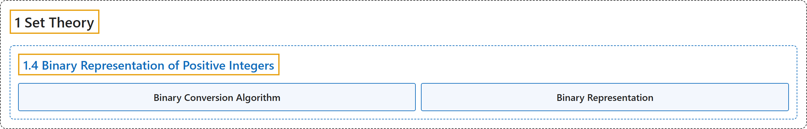

# 1.4 Binary Representation of Positive Integers

## Classification

## Glossary

| Term | Definition | 中文翻译 | Source |
|---|---|---|---|
| **1.4 Binary Representation of Positive Integers** 正整数的二进制表示 | (No definition) | （无定义） | [Doerr & Levasseur, n.d., section 1.4](https://discretemath.org/ads/s-binary_Representation_of_Positive_Integers.html) |
| **Binary Conversion Algorithm** 二进制转换算法 | "An **algorithm for determining the binary representation of a positive integer**." | 一种**确定正整数的二进制表示的算法**。 | [Doerr & Levasseur, n.d., Algorithm 1.4.2](https://discretemath.org/ads/s-binary_Representation_of_Positive_Integers.html#binary-conversion-algorithm) |
| **Binary Representation** 二进制表示 | (context) "The binary number system differs from the decimal number system in that units are **grouped by twos, fours, eights, etc.** That is, the group sizes are **powers of two** instead of powers of ten." | （语境）二进制数系与十进制数系的不同之处在于，单位是按**二、四、八等分组**的。也就是说，分组大小是**二的幂**而不是十的幂。 | [Doerr & Levasseur, n.d., section 1.4](https://discretemath.org/ads/s-binary_Representation_of_Positive_Integers.html#ss-grouping-by-twos-4) |

## References

Doerr, A., & Levasseur, K. (n.d.). *Applied discrete structures*. Retrieved October 28, 2026, from <https://discretemath.org/ads/index-ads.html>
